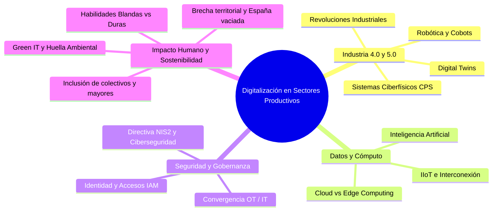

# Digitalización Aplicada a los Sectores Productivos

Bienvenido al espacio de documentación y recursos del módulo **Digitalización Aplicada a los Sectores Productivos (DASP)**, correspondiente a los ciclos formativos de Grado Superior de Formación Profesional para el curso académico 2026/2027.

---

## Presentación del Módulo

Vivimos una era de transformación tecnológica sin precedentes. La integración de la Inteligencia Artificial, el Internet de las Cosas (IoT), la robótica colaborativa y las arquitecturas en la nube está redefiniendo no solo los procesos de fabricación industrial, sino también los servicios, la gestión de datos, la estructura empresarial y el propio tejido socioeconómico.

El propósito de este módulo es dotar al alumnado de una comprensión **estratégica, técnica y crítica** sobre cómo la digitalización impacta en los sectores productivos: desde la automatización de planta y los sistemas ciberfísicos hasta la toma de decisiones basada en datos, la ciberseguridad industrial y los dilemas éticos que transforman nuestra sociedad.

---

## Objetivos Generales

- Analizar la evolución histórica y tecnológica desde la Primera Revolución Industrial hasta la **Industria 4.0** y el paradigma humano-céntrico de la **Industria 5.0**.
- Comprender el funcionamiento, arquitectura y aplicaciones de los **Sistemas Ciberfísicos (CPS)** y las tecnologías disruptivas habilitadoras.
- Dominar los conceptos de **convergencia entre entornos OT (Tecnología Operativa) e IT (Tecnología de la Información)**, identificando sus diferencias críticas de diseño y sus vectores de ciberseguridad.
- Evaluar arquitecturas de procesamiento de datos decidiendo con criterio técnico entre **Cloud Computing y Edge Computing** según latencia, costes y criticidad.
- Desarrollar una mirada crítica y ética ante los desafíos de la digitalización: brecha territorial (zonas rurales), exclusión generacional (personas mayores), huella ecológica (consumo de agua y energía en IA) y futuro del trabajo.

---

## Estructura de Unidades Didácticas

A lo largo del curso exploraremos los siguientes bloques de aprendizaje:

1. **[Unidad 1: Digitalización de los sectores productivos](./temas/01-digitalizacion/index.md):** Fundamentos, cronología histórica, sistemas ciberfísicos, convergencia OT/IT, Edge vs Cloud, sostenibilidad y taller de debates socioeconómicos.
2. **Unidad 2: Tecnologías Habilitadoras Digitales (THD):** Profundización en Inteligencia Artificial aplicada, visión artificial, gemelos digitales, sensorización y redes industriales.
3. **Unidad 3: El Dato como Activo Estratégico:** Big Data, analítica predictiva, gobierno del dato, privacidad y soberanía digital en la Unión Europea.
4. **Unidad 4: Ciberseguridad y Resiliencia en Entornos Productivos:** Seguridad en infraestructuras críticas, normativa NIS2, planes de continuidad y respuesta ante incidentes.
5. **Unidad 5: Transformación Digital y Personas:** Gestión del cambio, cultura ágil, impacto en el empleo y diseño centrado en el usuario.

---

## Metodología y Enfoque en el Aula

Este módulo se imparte combinando rigor técnico con metodologías activas:

- **Casos de Estudio Reales:** Análisis de incidentes reales de ciberseguridad industrial, proyectos punteros de gemelos digitales y fracasos sonados de sobreautomatización.
- **Retos Prácticos ("Hands-on"):** Laboratorios de cálculo de latencia de red, simulación de flujos de telemetría IoT y auditorías de control de accesos.
- **Talleres de Debate y Pensamiento Crítico:** Espacios estructurados donde confrontar argumentos con datos objetivos sobre el impacto social, territorial y laboral de la tecnología.

!!! tip "Comienza por la Unidad 1"
    Accede directamente a la [Unidad 1: Digitalización de los sectores productivos](./temas/01-digitalizacion/index.md) para explorar los conceptos teóricos, esquemas arquitectónicos y la batería de debates.