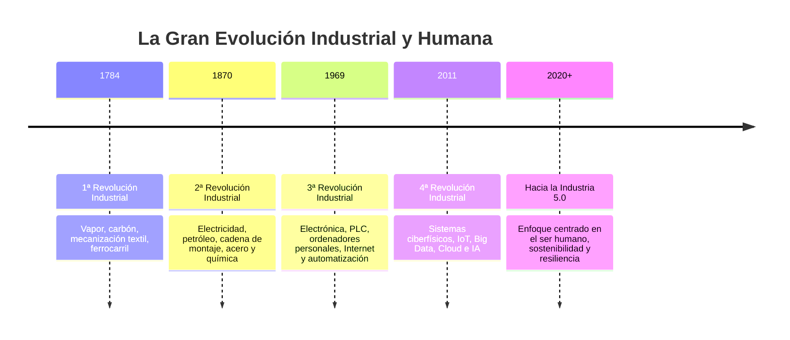
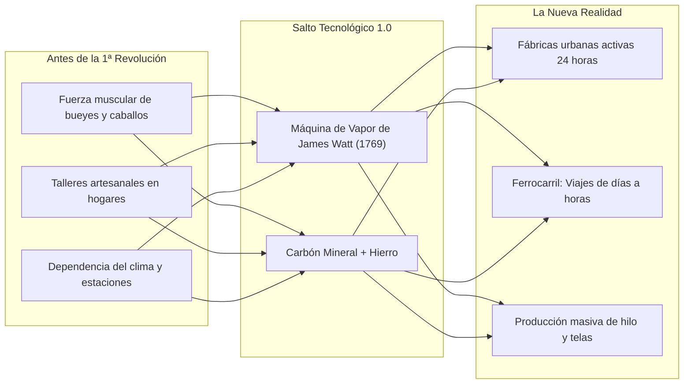
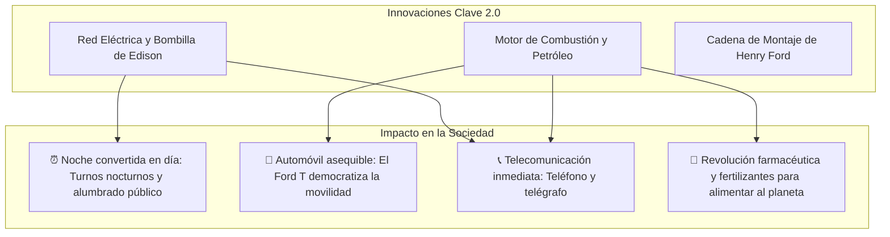
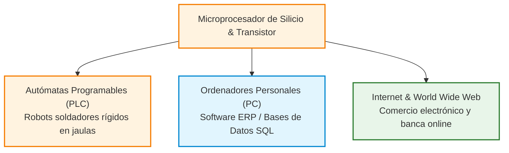
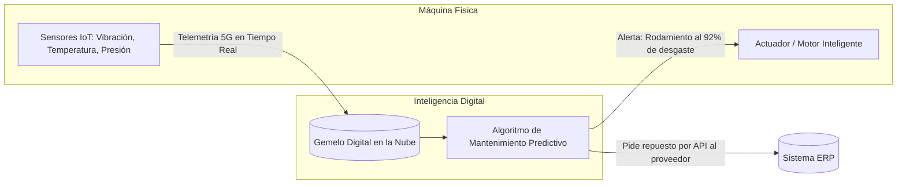
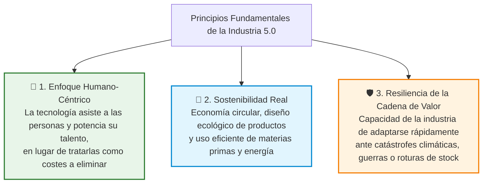
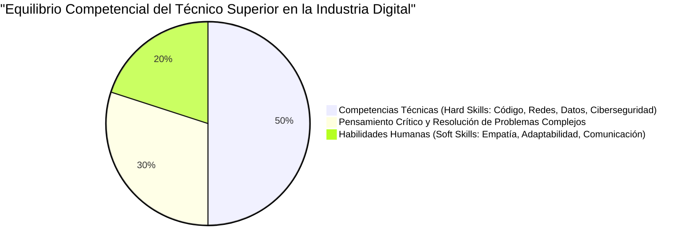

# 1.1 Cronología de las Revoluciones Industriales e Industria 5.0

La historia de la industria y la tecnología no es una línea continua y uniforme, sino una sucesión de saltos disruptivos impulsados por nuevos descubrimientos científicos, nuevas fuentes de energía y transformaciones radicales en la forma de organizar el trabajo humano.

Para un futuro profesional técnico, comprender estas etapas históricas no es un ejercicio de memorización, sino la clave para entender **por qué el mundo actual funciona como funciona** y qué impacto real tienen las tecnologías en la vida cotidiana de las personas.

---

## 1. De la Fuerza Animal a los Algoritmos Inteligentes

---

## 2. Las Revoluciones Industriales al Detalle

---

### 🚂 Primera Revolución Industrial (Industria 1.0, c. 1780 - 1840): La Conquista de la Energía Mecánica

Hasta finales del siglo XVIII, la humanidad dependía exclusivamente de la fuerza muscular de personas y animales (bueyes, caballos) y de la fuerza errática de los ríos y el viento. Si el viento no soplaba o el río se congelaba, la producción se detenía por completo.

- **Origen:** Gran Bretaña, extendiéndose a Bélgica, Francia y Alemania.
- **Fuentes de energía:** El **carbón mineral** y el **vapor de agua**.
- **Materia prima esencial:** El **hierro fundido**.
- **Invención motriz:** La **máquina de vapor** perfeccionada por James Watt (1769), que transformó la energía térmica en energía mecánica continua.
- **Organización:** Nace el **sistema fabril (*factory system*)**, agrupando a cientos de trabajadores bajo un mismo techo junto a máquinas movidas por un eje central de vapor.

#### 📦 ¿Qué supuso en la realidad cotidiana de las personas?

| Ámbito | La Vida Real ANTES (Siglo XVIII) | La Vida Real DESPUÉS (Industria 1.0) |
| :--- | :--- | :--- |
| **La ropa y el textil** | La lana y el lino se hilaban a mano en ruecas caseras durante semanas. Tener más de dos camisas era un lujo reservado a las clases altas. | El **telar mecánico** abarató el tejido de algodón un 90%. Por primera vez en la historia, la clase trabajadora pudo vestirse con prendas limpias y lavables. |
| **Los viajes y el transporte** | Viajar de Londres a Manchester o de Madrid a Valencia llevaba entre 4 y 6 días en incómodas carretas de caballos por caminos de barro. | El **ferrocarril de vapor** redujo el mismo viaje a pocas horas. Nace el transporte regular de mercancías frescas y el concepto de horario y puntualidad. |
| **El lugar de vida** | El 90% de la población vivía en pequeñas aldeas agrícolas, trabajando de sol a sol según las estaciones climáticas. | **Éxodo rural masivo:** Millones de familias abandonaron el campo para hacinarse en ciudades industriales sin alcantarillado ni agua corriente (Mánchester, Birmingham). |
| **El trabajo humano** | El artesano elaboraba el producto de principio a fin a su propio ritmo con sus herramientas manuales. | El obrero se convirtió en un apéndice de la máquina: **jornadas de 14 a 16 horas diarias**, 6 días por semana, en naves ruidosas, oscuras y llenas de polvo de carbón. |

!!! danger "La Cara Oscura: Mano de Obra Infantil y Precariedad"
    Como las máquinas textiles eran mecánicamente sencillas y no exigían fuerza física sino dedos ágiles, las fábricas contrataron masivamente a **niños de entre 6 y 10 años** por una fracción del salario de un adulto. Su baja estatura les permitía meterse bajo los telares en marcha para desenredar hilos o desatascar virutas, sufriendo mutilaciones y una altísima tasa de mortalidad ante la total ausencia de legislación laboral o seguros de accidentes.

---

### ⚡ Segunda Revolución Industrial (Industria 2.0, c. 1870 - 1914): La Era del Consumo Masivo y la Electricidad

Hacia finales del siglo XIX, el vapor y el carbón mostraron sus límites físicos: eran pesados, sucios y difíciles de transportar a largas distancias. Dos nuevas fuentes de energía cambiaron el planeta: **la electricidad** y el **petróleo**.

- **Fuentes de energía:** La **energía eléctrica** (redes de distribución) y el **petróleo** (motor de explosión interna).
- **Nuevos materiales:** El **acero Bessemer** (más resistente y elástico que el hierro), el **aluminio**, el zinc y los primeros polímeros plásticos sintéticos (**baquelita**).
- **Innovación motriz:** El motor de combustión interna (Daimler, Benz, Diesel) y la dinamo eléctrica.
- **La gran revolución química:** Síntesis de fertilizantes artificiales, síntesis de la aspirina (Bayer, 1897), vulcanización del caucho para neumáticos y derivados petroquímicos.

#### 📦 ¿Qué supuso en la realidad cotidiana de las personas?

| Ámbito | La Vida Real ANTES (Industria 1.0) | La Vida Real DESPUÉS (Industria 2.0) |
| :--- | :--- | :--- |
| **La noche y la iluminación** | Al caer el sol, la vida se detenía. Se usaban velas de sebo o lámparas de gas peligrosas que causaban incendios pavorosos en ciudades y fábricas. | La **bombilla incandescente de Edison (1879)** iluminó las calles (haciéndolas seguras de noche) y permitió a las fábricas introducir el **turno de noche**, duplicando la producción. |
| **La fabricación de objetos** | Cada máquina o carruaje se ensamblaba a mano de forma artesanal. Si una pieza se rompía, un herrero tenía que forjar un repuesto único a medida. | **Piezas intercambiables estandarizadas:** Millones de tornillos, bujías y ruedas exactamente idénticos producidos en serie a costes insignificantes. |
| **El automóvil para todos** | El coche era un juguete exclusivo para millonarios que costaba años de salario de un trabajador común. | **La Cadena de Montaje (Ford T):** Henry Ford redujo el tiempo de ensamblaje de un coche de 12 horas a 93 minutos. Su precio bajó de 850$ a 300$, permitiendo que sus propios obreros pudieran comprarlo. |
| **La comunicación a distancia** | Enviar una carta de Europa a América en barco tardaba entre 2 y 3 semanas; recibir respuesta requería mes y medio. | El **telégrafo transoceánico y el teléfono de Bell:** Transmisión de noticias, órdenes de compra y cotizaciones de bolsa en **pocos segundos**. |

!!! note "Caso de Estudio: El Ford T y el Salario de 5 Dólares"
    En 1914, Henry Ford duplicó el salario de sus obreros a **5 dólares al día** y redujo la jornada a 8 horas. No lo hizo por beneficencia, sino por cálculo económico: comprendió que si sus trabajadores ganaban suficiente dinero y tenían tiempo libre los fines de semana, **ellos mismos se convertirían en los principales clientes de sus propios automóviles**. Así nació la sociedad de consumo masivo y la clase media moderna.

---

### 💻 Tercera Revolución Industrial (Industria 3.0, c. 1969 - 2010): La Automatización y la Era de la Información

Hasta la década de 1960, las fábricas estaban llenas de cadenas de montaje mecánicas operadas por humanos o controladas por gigantescos **armarios de relés electromagnéticos**. Si una empresa de coches quería cambiar el modelo que fabricaba, los ingenieros tenían que pasar meses recableando manualmente miles de cables de cobre en armarios del tamaño de habitaciones enteras.

La invención del **transistor**, el **microprocesador de silicio** y la **computación digital** transformó este escenario:

- **Núcleo tecnológico:** La **electrónica de estado sólido**, la informática y las telecomunicaciones digitales.
- **Hito industrial clave:** La invención del primer **Controlador Lógico Programable (PLC)** (el *Modicon 084* en 1968 por Dick Morley). Por primera vez, el funcionamiento de una fábrica no dependía de cables físicos, sino de **código de software reprogramable**.
- **Aparición del Software como ciencia:** Pioneras como **Margaret Hamilton** en el proyecto Apolo 11 demostraron que el software no era una tarea administrativa auxiliar, sino un componente crítico capaz de salvar vidas y gobernar misiones aeroespaciales e industriales.
- **Comunicaciones globales:** Despliegue de **Internet**, la **World Wide Web (1990)** creada por Tim Berners-Lee, el correo electrónico y la telefonía móvil digital (GSM).

#### 📦 ¿Qué supuso en la realidad cotidiana de las personas?

| Ámbito | La Vida Real ANTES (Industria 2.0) | La Vida Real DESPUÉS (Industria 3.0) |
| :--- | :--- | :--- |
| **La reprogramación de fábricas** | Modificar una línea de producción requería desmantelar y recablear armarios enteros de relés durante meses de parada costosa. | Un técnico conecta un ordenador al PLC y **reprograma la lógica en unas horas** mediante diagramas de contactos (Ladder) o texto estructurado. |
| **Las oficinas y la gestión** | Cientos de oficinistas tecleaban a máquina, rellenaban ficheros de papel en archivadores metálicos y enviaban documentos por fax o valija postal. | Los **ordenadores personales (PC)**, las hojas de cálculo (Excel) y las bases de datos sustituyeron a millones de archivadores de papel por registros digitales. |
| **El acceso al conocimiento** | Consultar un dato enciclopédico requería acudir a una biblioteca física o comprar colecciones de 30 tomos impresos en papel. | **La World Wide Web:** Cualquier persona con una conexión a Internet puede consultar millones de páginas de información, manuales técnicos y bases de datos al instante. |
| **Las compras y la banca** | Para pagar una factura o transferir dinero había que esperar colas en la ventanilla del banco en horario matinal de lunes a viernes. | Aparecen los cajeros automáticos (ATM), las tarjetas de crédito magnéticas y la primera banca electrónica a través del navegador web. |

---

### 🌐 Cuarta Revolución Industrial (Industria 4.0, c. 2011 - Presente): La Hiperconectividad Ciberfísica

Si la 3ª Revolución automatizó tareas repetitivas mediante ordenadores y robots que ejecutaban ciegamente secuencias programadas dentro de jaulas de seguridad, la **4ª Revolución Industrial** conecta esas máquinas entre sí y con el mundo virtual a través de datos en tiempo real.

- **Origen del término:** Acuñado en la Feria de Hannover (Alemania, 2011) como estrategia nacional para liderar la manufactura digital.
- **Concepto clave:** La **fusión del mundo físico y el mundo digital**. Las máquinas ya no son "ciegas y sordas"; tienen sensores IoT que miden miles de parámetros por segundo, se autodiagnostican y coordinan sus acciones mediante algoritmos de Inteligencia Artificial.
- **Cuatro pilares tecnológicos disruptivos:**

    1. **Conectividad ubicua:** Redes 5G industriales, computación en la nube (*Cloud*) y en el extremo (*Edge*).
    2. **Inteligencia y datos:** Big Data, analítica predictiva y algoritmos de Machine Learning / Deep Learning.
    3. **Interacción avanzada:** Realidad Aumentada (AR), Realidad Virtual (VR) y robots colaborativos (*cobots*) que trabajan hombro con hombro con humanos.
    4. **Fabricación aditiva:** Impresión 3D industrial de metales y polímeros para crear repuestos complejos bajo demanda.

#### 📦 ¿Qué supuso en la realidad cotidiana de las personas?

| Ámbito | La Vida Real ANTES (Industria 3.0) | La Vida Real DESPUÉS (Industria 4.0) |
| :--- | :--- | :--- |
| **El mantenimiento de máquinas** | **Mantenimiento reactivo:** La máquina se usaba hasta que se rompía de golpe, parando la producción durante días hasta que llegaba el recambio. | **Mantenimiento predictivo:** Sensores de vibración e IA detectan microfisuras invisibles semanas antes de que se produzca la rotura, programando la reparación sin paradas imprevistas. |
| **La personalización de productos** | Si comprabas un coche, tenías que elegir entre 3 colores estándar porque cambiar la pintura en la cadena de montaje requería limpiar los conductos durante horas. | **Personalización masiva en serie:** Puedes configurar tu coche o zapatillas por internet con miles de opciones; la fábrica inteligente reconfigura robots y piezas en tiempo real sin encarecer el coste. |
| **La logística y los envíos** | Encargabas un paquete y tardaba semanas en llegar, sin saber dónde estaba hasta que el cartero llamaba al timbre. | **Trazabilidad de extremo a extremo:** Almacenes con flotas de robots autónomos (AMR), seguimiento GPS por satélite y entregas en 24 horas con seguimiento en el mapa del smartphone. |
| **La seguridad en el trabajo** | Los operarios no podían acercarse a menos de 3 metros de un robot soldador porque su inercia podía causar accidentes mortales. | **Robots colaborativos (*Cobots*):** Equipados con sensores de esfuerzo táctiles y cámaras de visión que reducen su velocidad o se detienen suavemente al menor contacto con el cuerpo humano. |

---

### 🤝 El Nuevo Horizonte: Hacia la Industria 5.0

La Cuarta Revolución Industrial trajo avances colosales en eficiencia y rentabilidad económica, pero también evidenció serias carencias:

- La obsesión por sustituir humanos por robots generó desempleo y deshumanización en muchas plantas industriales.
- El consumo masivo de servidores y centros de datos disparó la huella de carbono y el gasto energético global.
- Las cadenas de producción globalizadas demostraron ser extremadamente frágiles ante pandemias o crisis geopolíticas.

Por estos motivos, la **Comisión Europea** formalizó las directrices de la **Industria 5.0**:

---

## 3. Cuadro Comparativo Global de las Revoluciones

| Dimensión | 1ª Revolución (1.0) | 2ª Revolución (2.0) | 3ª Revolución (3.0) | 4ª Revolución (4.0) | Industria 5.0 |
| :--- | :--- | :--- | :--- | :--- | :--- |
| **Cronología** | c. 1780 - 1840 | c. 1870 - 1914 | c. 1969 - 2010 | c. 2011 - actualidad | Horizonte en construcción |
| **Fuente de energía** | Carbón mineral, vapor de agua | Petróleo, electricidad | Nuclear, gas, renovables incipientes | Red eléctrica, baterías ion-litio | Renovables distribuidas, hidrógeno verde |
| **Invención motriz** | Máquina de vapor y telar | Motor de explosión, dinamo | Transistor, PLC, PC, Internet | Sistemas Ciberfísicos (CPS), IoT, IA | Cobots bioinspirados, IA ética colaborativa |
| **Organización fabril** | Sistema fabril concentrado | Cadena de montaje en serie | Células automatizadas con robots rígidos | Fábrica inteligente (*Smart Factory*) | Fábrica personalizada, circular y resiliente |
| **Transporte** | Ferrocarril a vapor | Automóvil, aviación comercial | Contenedores marítimos, aviación jet | Vehículos autónomos, logística conectada | Movilidad eléctrica descarbonizada, drones |
| **Condición del trabajador** | Explotación, mano de obra infantil | Especialización repetitiva (Taylorismo) | Operador de consola y programador | Analista de datos, supervisor de robots | **Socio creativo del robot, bienestar y salud** |

---

## 4. Evolución de Competencias: Hard Skills vs. Soft Skills

En un entorno productivo que cambia a velocidad vertiginosa, el valor de un profesional técnico ya no reside en memorizar comandos concretos, sino en combinar solvencia técnica con madurez humana:

### A. Competencias Duras (*Hard Skills*)
Habilidades técnicas, medibles y certificables:

- **Desarrollo de software y scripting:** Manejo fluido de lenguajes como Python, Kotlin, SQL o lenguajes web para automatizar tareas e integrar APIs.
- **Gestión de redes y conectividad:** Conocimiento de protocolos industriales (MQTT, Modbus, OPC-UA) y arquitecturas de red segmentadas.
- **Ciberseguridad aplicada:** Principios de mínimo privilegio, autenticación multifactor (MFA) y bastionado básico de servidores.
- **Tratamiento del dato:** Extracción, limpieza y visualización de telemetría mediante herramientas como Node-RED o Grafana.

### B. Competencias Blandas (*Soft Skills*)
Habilidades interpersonales y cognitivas insustituibles por algoritmos:

- **Pensamiento crítico:** Cuestionar los resultados generados por una Inteligencia Artificial antes de aceptarlos ciegamente en una decisión crítica.
- **Adaptabilidad y aprendizaje continuo (*Lifelong Learning*):** En el sector tecnológico, las herramientas y librerías se renuevan cada pocos años; la habilidad más valiosa es "aprender a aprender".
- **Empatía y diseño centrado en el usuario:** Diseñar sistemas intuitivos para operarios de planta o clientes no técnicos, evitando soluciones farragosas.
- **Comunicación y trabajo interdisciplinar:** Saber explicar un problema técnico complejo a un director financiero o a un responsable de recursos humanos en un lenguaje accesible.
