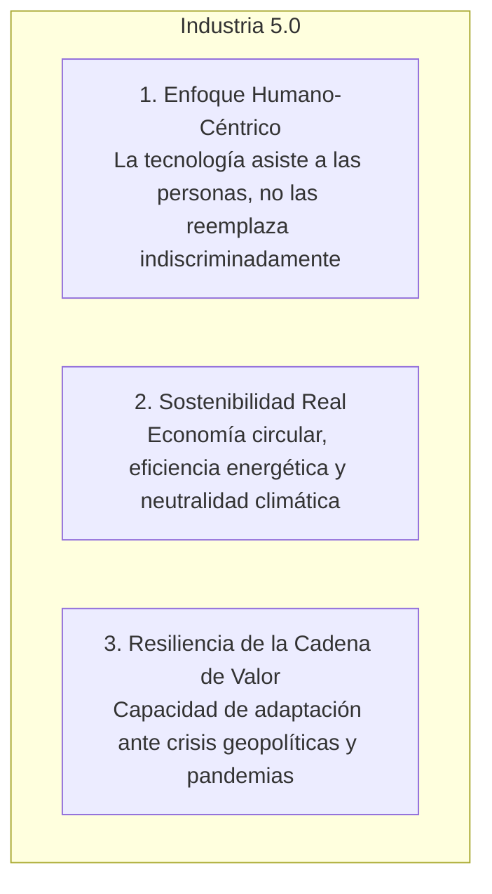
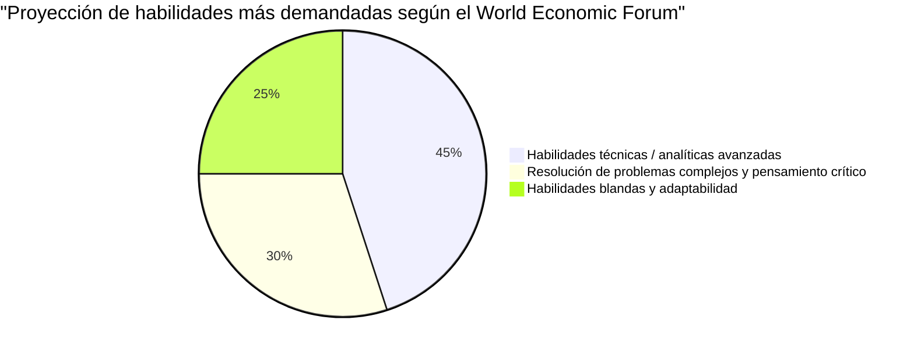

# 1.1 Cronología de las Revoluciones Industriales e Industria 5.0

La historia de la industria y la tecnología no es una línea continua y uniforme, sino una sucesión de saltos disruptivos impulsados por nuevos descubrimientos científicos, nuevas fuentes de energía y transformaciones radicales en la forma de organizar el trabajo humano.

Comprender esta evolución histórica permite analizar la digitalización actual no como una moda pasajera, sino como la fase más reciente de un proceso secular de mecanización, automatización e hiperconectividad.

---

## 1. De la Fuerza Animal a los Algoritmos Inteligentes

---

## 2. Las Cuatro Grandes Revoluciones en Detalle

### Primera Revolución Industrial (Industria 1.0, c. 1780 - 1840)

- **Origen y epicentro:** Gran Bretaña, expandiéndose progresivamente a Bélgica, Francia y Alemania.
- **Fuentes de energía y materias primas:** El carbón mineral y la energía hidráulica. La materia prima reina fue el hierro.
- **Innovación técnica motriz:** La **máquina de vapor** perfeccionada por James Watt (1769). Permitió independizar los talleres de los cursos fluviales e instalar fábricas en centros urbanos.
- **Transporte y comunicaciones:** El ferrocarril de vapor y el barco a vapor redujeron drásticamente los tiempos de transporte de mercancías y personas.
- **Organización del trabajo:** Nace el **sistema fabril** (*factory system*), que sustituye a los talleres artesanales y el trabajo doméstico. 
- **Impacto social y humano:** Provocó un éxodo rural masivo hacia ciudades superpobladas e insalubres. La falta de legislación laboral derivó en jornadas de hasta 16 horas, condiciones de extrema precariedad y explotación sistemática de mano de obra infantil en minas y telares.

---

### Segunda Revolución Industrial (Industria 2.0, c. 1870 - 1914)

- **Fuentes de energía y materias primas:** El **petróleo** y la **electricidad**. Desarrollo masivo del acero Bessemer, el aluminio, el níquel y el zinc.
- **Innovación técnica motriz:** El motor de combustión interna, la dinamo y la bombilla incandescente de Thomas Alva Edison (1879), que permitió extender las jornadas fabriles a turnos nocturnos.
- **Organización del trabajo:** Implantación del taylorismo y la **cadena de montaje en serie** popularizada por Henry Ford en la fabricación del automóvil *Ford Modelo T*. Máxima especialización: el operario repite una única tarea mecánica miles de veces al día.
- **Transporte y comunicaciones:** Automóvil, aviación, tranvías eléctricos urbanos, telégrafo eléctrico, teléfono y fonógrafo.
- **Progreso químico y farmacéutico:** Síntesis del ácido acetilsalicílico (Aspirina) por Felix Hoffmann en 1897, fertilizantes sintéticos, vulcanización del caucho y aparición de los primeros plásticos termoestables sintéticos (baquelita).
- **Impacto social:** Surgimiento de grandes corporaciones monopolísticas, nacimiento del sindicalismo obrero organizado y consolidación de la brecha salarial de género en las líneas fabriles.

---

### Tercera Revolución Industrial (Industria 3.0, c. 1969 - inicios del s. XXI)

- **Núcleo tecnológico:** La **electrónica**, los semiconductores de silicio y la **informática**.
- **Hito industrial clave:** La invención del primer **Controlador Lógico Programable (PLC)** (el *Modicon 084* en 1968 por Dick Morley), que permitió reprogramar secuencias de fabricación en lugar de recablear relés físicos.
- **Aparición de la Ingeniería del Software:** En este periodo, pioneras como **Margaret Hamilton** (directora del equipo que programó el software de navegación del Programa Espacial Apolo en el MIT) acuñaron y dignificaron la disciplina de la ingeniería de software como ciencia crítica.
- **Comunicaciones y digitalización:**

    - Nacimiento y despliegue global de **Internet** y la **World Wide Web** (1990) ideada por Tim Berners-Lee en el CERN.
    - Aparición de los ordenadores personales (PC), las bases de datos relacionales y la telefonía móvil digital.
    - Comienza la transición energética hacia fuentes renovables (solar fotovoltaica y eólica).

---

### Cuarta Revolución Industrial (Industria 4.0, c. 2011 - Presente)

El término fue acuñado formalmente en Alemania en la Feria de Hannover de 2011 para designar la estrategia federal de modernización de su tejido manufacturero.

- **Características esenciales:**
  - **Fusión de esferas:** Convergencia entre los sistemas físicos, el software computacional y la analítica avanzada.
  - **Sistemas Ciberfísicos (CPS):** Máquinas conectadas a la red capaces de recopilar datos con sensórica masiva, autodiagnosticarse y colaborar con humanos o con otras máquinas en tiempo real.
  - **Cuatro pilares tecnológicos disruptivos:**

    1. **Conectividad masiva y cómputo ubicuo:** Nube (*Cloud*), computación en el extremo (*Edge Computing*), redes industriales y redes 5G.
    2. **Inteligencia y datos:** Big Data, analítica predictiva y modelos de Inteligencia Artificial (Machine Learning / Deep Learning).
    3. **Interacción persona-máquina:** Realidad Aumentada (AR), Realidad Virtual (VR), robótica colaborativa (*cobots*) y vehículos de guiado automático (AGV / AMR).
    4. **Fabricación avanzada:** Fabricación aditiva (impresión 3D de polímeros y metales) y nuevos materiales con nanotecnología.

---

## 3. El Nuevo Paradigma: Hacia la Industria 5.0

A menudo se confunde el progreso tecnológico con una carrera ciega hacia la automatización total. Sin embargo, las consecuencias imprevistas de la Industria 4.0 (precarización laboral por sobreautomatización, huella climática del cómputo masivo y vulnerabilidad ante ciberataques) llevaron a la **Comisión Europea** a publicar en 2021 las directrices de la **Industria 5.0**.

!!! info "Definición de Industria 5.0 (Comisión Europea)"
    La Industria 5.0 no es una sustitución tecnológica de la 4.0, sino un **cambio de enfoque ético y estratégico**. Complementa la Industria 4.0 situando la investigación y la innovación al servicio de una industria europea **humano-céntrica, sostenible y resiliente**.

---

## 4. Tabla Comparativa de las Revoluciones Industriales

| Dimensión | 1ª Revolución | 2ª Revolución | 3ª Revolución | 4ª Revolución | Industria 5.0 |
| :--- | :--- | :--- | :--- | :--- | :--- |
| **Periodo** | c. 1780 - 1840 | c. 1870 - 1914 | c. 1969 - 2010 | c. 2011 - actualidad | Horizonte actual |
| **Fuente de energía** | Carbón, vapor, agua | Petróleo, electricidad | Nuclear, fósiles, renovables incipientes | Red eléctrica renovable, baterías ion-litio | Renovables distribuidas, hidrógeno verde |
| **Innovación central** | Máquina de vapor y telar | Motor combustión, cadena de montaje | PLC, ordenadores, Internet, telecomunicaciones | CPS, IoT, Cloud, Inteligencia Artificial | Simbiosis persona-cobot, IA ética |
| **Paradigma fabril** | Sistema fabril urbano | Producción en masa estandarizada | Automatización programada y robótica rígida | Fábrica inteligente y flexible (*Smart Factory*) | Fábrica personalizada, bioinspirada y resiliente |
| **Transporte** | Ferrocarril a vapor | Automóvil, aviación, tranvía | Transporte aéreo comercial, contenedores | Vehículos autónomos, logística conectada | Movilidad eléctrica, drones, logística descarbonizada |
| **Foco principal** | Eficiencia mecánica | Volumen y coste unitario | Automatización de tareas repetitivas | Datos, hiperconectividad y optimización algorítmica | **Bienestar de las personas, planeta y resiliencia** |

---

## 5. Competencias Profesionales en la Era Digital

La digitalización no solo altera las herramientas de trabajo, sino el perfil competencial exigido en el mercado técnico:

### A. Competencias Duras (*Hard Skills*)
Habilidades técnicas, especializadas y certificables:

- **Desarrollo y scripting:** Programación moderna (Python, Kotlin, Java, JavaScript/TypeScript).
- **Gestión del dato e IA:** Manejo de consultas SQL/NoSQL, canalizaciones de datos (*pipelines*) y consumo de APIs de aprendizaje automático.
- **Ciberseguridad básica aplicada:** Principios de mínimo privilegio, configuración segura de cortafuegos y gestión de identidades (IAM).
- **Cloud & Edge:** Despliegue de microservicios en contenedores (Docker), monitorización y protocolos IoT (MQTT, HTTP REST).

### B. Competencias Blandas (*Soft Skills*)
Habilidades interpersonales y socioemocionales de creciente valor:

- **Pensamiento analítico y crítico:** Capacidad de cuestionar los resultados de un algoritmo o modelo de IA antes de darlo por bueno.
- **Resolución de problemas complejos:** Afrontar situaciones imprevistas con enfoques multidisciplinares.
- **Adaptabilidad y aprendizaje continuo (*Lifelong Learning*):** En tecnología, un marco de trabajo (*framework*) puede quedar obsoleto en 3 o 4 años.
- **Inteligencia emocional y empatía:** Especialmente crítica al diseñar soluciones tecnológicas destinadas a personas no técnicas o colectivos vulnerables.

---

## Actividades y Preguntas para la Reflexión

??? question "Actividad 1.1: El mito de la tecnología neutral"
    A lo largo de la 1ª Revolución Industrial se multiplicó la producción textil, pero las condiciones de vida de la clase trabajadora empeoraron drásticamente durante décadas antes de que la legislación interviniera. 
    
    - ¿Ocurre hoy algo similar con los trabajadores de plataformas digitales de reparto o los etiquetadores de datos para modelos de IA?
    - ¿Es la tecnología intrínsecamente neutra o responde siempre a los intereses del modelo económico que la financia?

??? question "Actividad 1.2: El papel de las mujeres en la tecnología"
    Investiga la figura de **Margaret Hamilton** o las mujeres programadoras del **ENIAC**. 
    
    - ¿Por qué durante la 3ª Revolución Industrial la programación llegó a ser considerada una tarea administrativa secundaria, y cómo cambió esa percepción con la llegada de la 4ª Revolución?
