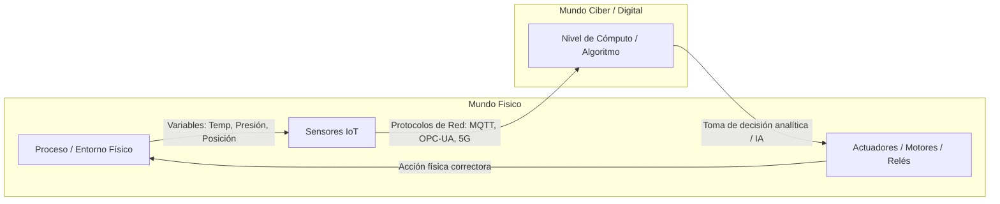
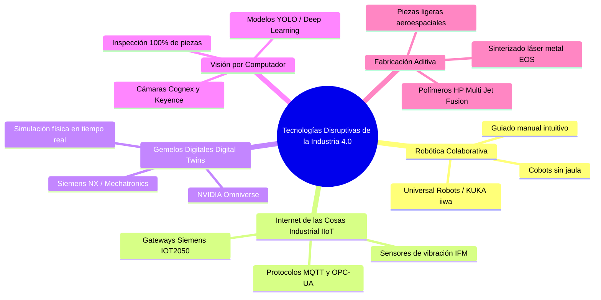
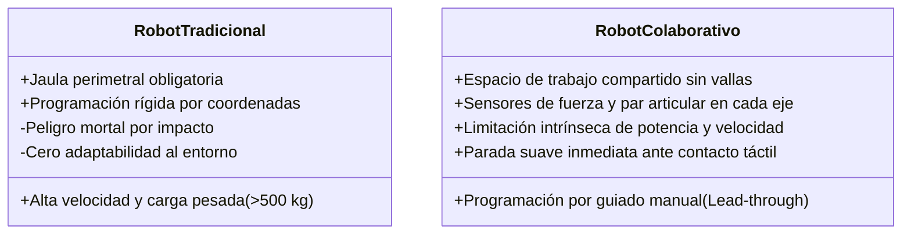
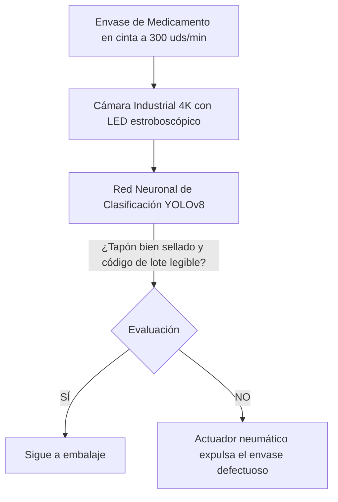
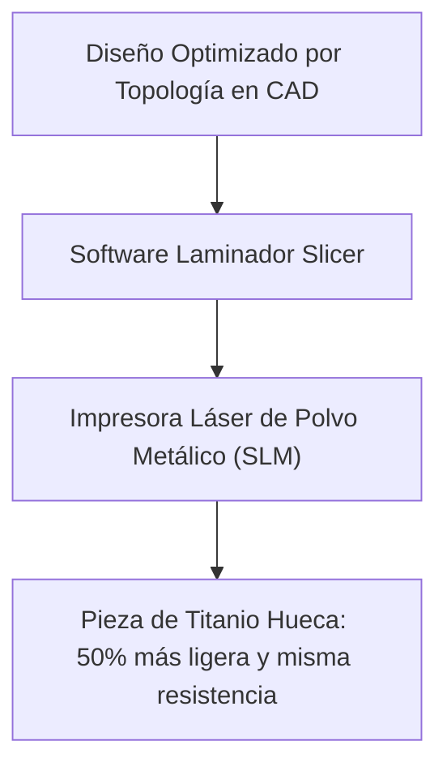

# 1.2 Sistemas Ciberfísicos (CPS) y Tecnologías Habilitadoras

La piedra angular de la Cuarta Revolución Industrial es la superación de la barrera tradicional entre el mundo físico y el mundo virtual. Los **Sistemas Ciberfísicos** (*Cyber-Physical Systems*, CPS) son el mecanismo tecnológico que hace posible esta integración en plantas industriales, infraestructuras y servicios.

---

## 1. ¿Qué es un Sistema Ciberfísico (CPS)?

Un **Sistema Ciberfísico (CPS)** es una integración de computación, redes de comunicación y procesos físicos. A diferencia de un ordenador convencional que solo procesa datos en una pantalla, un CPS opera en un **bucle cerrado de retroalimentación (*feedback loop*)** en tiempo real:

### Características fundamentales de los CPS:

- **Acoplamiento físico-digital estrecho:** El software no se limita a procesar transacciones contables; sus instrucciones mueven brazos mecánicos, abren compuertas de presas hidráulicas o modulan frenos de trenes.
- **Operación en tiempo real estricto (*hard real-time*):** Si la respuesta algorítmica tarda 50 milisegundos más de lo debido, el sistema puede colisionar físicamente.
- **Autonomía y adaptabilidad:** Capacidad de reconfigurar parámetros operativos de manera automática ante variaciones del entorno o fallos parciales.

---

### 📦 Cuadro de Ejemplo Tecnológico: Un CPS en la Vida Real

| Componente del CPS | Dispositivo Tecnológico Concreto | Función en el Sistema |
| :--- | :--- | :--- |
| **Elemento Físico** | Horno de recocido de piezas de acero en automoción. | Debe mantenerse a 850 °C (con un margen de ±2 °C) sin quemar la aleación. |
| **Sensores (Entrada)** | **Termopares tipo K** de alta temperatura y pirómetros ópticos infrarrojos. | Miden la radiación térmica 50 veces por segundo. |
| **Red Industrial** | Bus **PROFINET** sobre cable apantallado o **EtherCAT**. | Transporta la señal con latencia determinista inferior a 1 ms. |
| **Cómputo / Algoritmo** | Autómata **Siemens S7-1500** con bucle PID y modelo predictivo. | Compara temperatura real vs deseada y calcula la corrección. |
| **Actuadores (Salida)** | **Tiristores de potencia** y válvulas servoasistidas de gas. | Regulan al milímetro el caudal de gas y la corriente de las resistencias. |

---

## 2. Tecnologías Habilitadoras Digitales en el Ecosistema CPS

---

### A. Robótica Colaborativa (*Cobots*) vs. Robótica Tradicional

Durante la 3ª Revolución Industrial, los robots industriales (como los brazos soldadores KUKA o Fanuc) operaban encerrados en **jaulas de seguridad**. Si un operario abría la puerta, la máquina ejecutaba una parada de emergencia inmediata debido a su inercia y fuerza letal.

Los **robots colaborativos (*cobots*)** rompen este paradigma:

#### 📦 Cuadro de Tecnologías Concretas en Robótica

| Tipo de Robot | Modelos y Marcas Reales | Ejemplo de Uso en Planta | Ventaja Operativa |
| :--- | :--- | :--- | :--- |
| **Cobot Colaborativo** | **Universal Robots UR10e** o **Fanuc CRX-10iA** | Atornillado de salpicaderos de coches en la misma estación donde un operario monta los cables. | No requiere jaulas; si roza al operario con una fuerza superior a 50 Newtons, se frena suavemente en 10 ms. |
| **Robot Tradicional** | **KUKA KR Quantec** o **ABB IRB 6700** | Puntos de soldadura pesada del chasis de acero en bruto en líneas cerradas. | Velocidad extrema (más de 2 m/s) y capacidad de mover cargas de más de 300 kg. |
| **Robot Móvil Autónomo (AMR)** | **MiR250 (Mobile Industrial Robots)** | Transporte de cajas de tornillería desde el almacén hasta la línea de montaje. | Navega con sensores **LiDAR y SLAM**, esquivando carretillas y personas sin necesidad de cintas magnéticas en el suelo. |

---

### B. Gemelos Digitales (*Digital Twins*)

Un **Gemelo Digital** no es un plano 3D estático en AutoCAD; es una **representación virtual viva y sincronizada** de un activo físico (un motor, un buque o una fábrica entera).

#### 📦 Cuadro de Tecnologías Concretas en Gemelos Digitales

| Herramienta / Software | Desarrollador | Aplicación Concreta en la Industria |
| :--- | :--- | :--- |
| **Siemens Mechatronics Concept Designer** | Siemens | Simula la física de una máquina completa (gravedad, fricción, motores) antes de cortar una sola pieza de metal. |
| **NVIDIA Omniverse / Isaac Sim** | NVIDIA | Crea réplicas fotorrealistas de fábricas enteras con física precisa para entrenar brazos robóticos mediante IA antes de instalarlos. |
| **Caso Real Español: Navantia F-110** | Navantia | Gemelo digital completo de las nuevas fragatas de la Armada Española para predecir averías en alta mar y ensayar maniobras tácticas. |

---

### C. Visión por Computador e Inspección Automatizada

La visión artificial combina cámaras industriales de alta velocidad, iluminación estroboscópica controlada y redes neuronales convolucionales (CNN):

#### 📦 Cuadro de Tecnologías Concretas en Visión Artificial

| Tecnología / Producto | Fabricante | Aplicación en la Vida Real |
| :--- | :--- | :--- |
| **Cámaras Inteligentes In-Sight 2800** | **Cognex** | Verificación de etiquetado y nivel de llenado en embotelladoras de refrescos a 60.000 botellas por hora. |
| **Sistemas de Visión Serie CV-X** | **Keyence** | Inspección microscópica de soldaduras en placas de circuitos electrónicos de telefonía móvil. |
| **Cámaras 3D ToF (Time-of-Flight)** | **Basler** | Detección volumétrica de cajas desalineadas en palets de centros logísticos para guiar brazos despaletizadores. |

---

### D. Fabricación Aditiva (Impresión 3D Industrial)

La manufactura tradicional es **sustractiva** (fresar o cortar un bloque de metal de 10 kg para obtener una pieza de 2 kg, tirando 8 kg en virutas). La fabricación aditiva deposita material capa a capa exclusivamente donde se necesita:

#### 📦 Cuadro de Tecnologías Concretas en Fabricación Aditiva

| Tecnología 3D | Maquinaria Concreta | Material Utilizado | Caso de Uso Real |
| :--- | :--- | :--- | :--- |
| **Sinterizado Láser de Metal (DMLS / SLM)** | **EOS M 290** | Polvo de Titanio (Ti6Al4V) e Inconel | Soportes estructurales de turbinas en **Airbus** y toberas de cohetes aeroespaciales. |
| **Multi Jet Fusion (MJF)** | **HP Jet Fusion 5200** | Polvo de Poliamida (Nylon PA12) | Producción bajo demanda de repuestos descatalogados de electrodomésticos en series cortas. |
| **Estereolitografía Médica (SLA)** | **Formlabs Form 4** | Resinas biocompatibles | Guías quirúrgicas personalizadas y alineadores dentales invisibles fabricados a medida en 2 horas. |

---

## 3. Sectores de Aplicación Transformados por los CPS

### 1. Sanidad y Medicina de Precisión

- **Telemonitorización hospitalaria y domiciliaria:** Camas inteligentes y sensores vestibles (*wearables*) que monitorizan arritmias cardíacas o desaturación de oxígeno, alertando al equipo médico antes de que ocurra un evento crítico.
- **Interfaces Cerebro-Computadora (BCI):** Prótesis biónicas controladas por señales neuronales y sistemas de rehabilitación motora para pacientes con secuelas cerebrovasculares.

### 2. Agricultura Inteligente (*Smart Agro*)

- Drones agrícolas con cámaras multiespectrales para medir el estrés hídrico y plagas en cultivos.
- Tractores y cosechadoras autónomas guiadas por GPS RTK de precisión centimétrica.
- Sistemas de fertirriego ciberfísicos que dosifican agua y nutrientes analizando la conductividad y humedad del suelo en tiempo real.

### 3. Logística y Vehículos Guiados Automáticos

- Almacenes automatizados donde flotas de **AMR (Autonomous Mobile Robots)** desplazan estanterías completas hasta el puesto del operario humano (*Goods-to-Person*), optimizando las rutas de recogida y empaquetado (*picking*).

---

## 4. Caso de Estudio: El Fiasco de la Sobreautomatización en Tesla

A menudo se asume erróneamente que "cuanta más automatización y menos humanos, mejor funciona una planta". La historia de la ingeniería industrial reciente demuestra lo contrario.

!!! warning "Caso Real: 'Automation Hell' en la línea de montaje del Tesla Model 3 (2018)"
    En 2018, Elon Musk intentó crear una fábrica ("la máquina que construye la máquina") donde casi todos los procesos del Tesla Model 3 estuvieran 100% robotizados, incluyendo la colocación de cableados flexibles, juntas de goma y aislamiento acústico.
    
    **El resultado:** Los robots fallaban sistemáticamente al manipular cables flexibles y materiales blandos, la línea de montaje sufría atascos continuos y la producción semanal se desplomó muy por debajo de los objetivos, llevando a la empresa al borde de la bancarrota técnica.
    
    **La corrección:** Tesla tuvo que desmantelar decenas de robots multimillonarios y reincorporar operarios humanos cualificados para las tareas delicadas de ensamblaje final. Musk publicó en Twitter una confesión célebre:
    
    > *"Sí, la excesiva automatización en Tesla fue un error. Para ser precisos, mi error. Los humanos están infravalorados."*

### Lección técnica para Grado Superior:
Los robots y CPS destacan en tareas de alta precisión milimétrica, esfuerzo físico repetitivo y entornos tóxicos. Sin embargo, la **destreza táctil, la visión flexible ante imprevistos y el sentido común adaptativo del ser humano** siguen siendo insustituibles en la mayoría de tareas complejas de montaje. Por ello, la tendencia no es sustituir personas, sino implantar **cobots colaborativos**.
