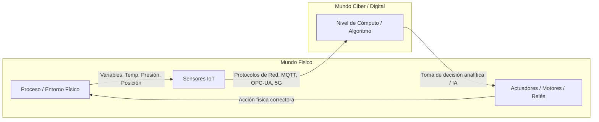
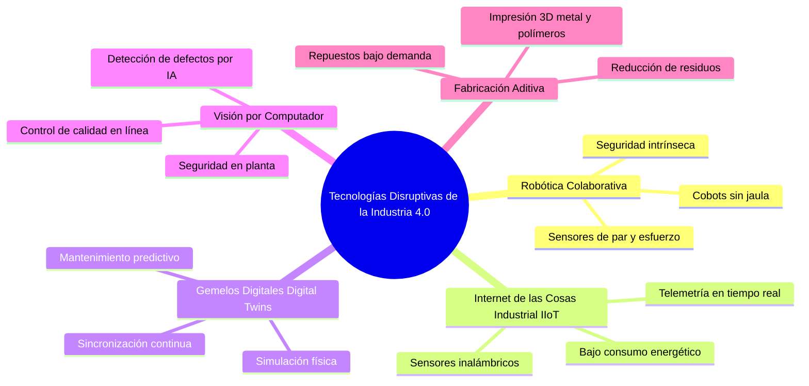
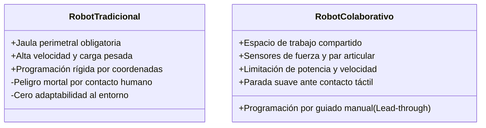

# 1.2 Sistemas Ciberfísicos (CPS) y Tecnologías Habilitadoras

La piedra angular de la Cuarta Revolución Industrial es la superación de la barrera tradicional entre el mundo físico y el mundo virtual. Los **Sistemas Ciberfísicos** (*Cyber-Physical Systems*, CPS) son el mecanismo tecnológico que hace posible esta integración.

---

## 1. ¿Qué es un Sistema Ciberfísico (CPS)?

Un **Sistema Ciberfísico (CPS)** es una integración de computación, redes de comunicación y procesos físicos. A diferencia de un sistema embebido convencional o un ordenador de sobremesa, un CPS opera en un **bucle cerrado de retroalimentación (*feedback loop*)** en tiempo real:

### Características fundamentales de los CPS:
- **Acoplamiento físico-digital estrecho:** El software no se limita a procesar transacciones contables; sus instrucciones mueven brazos mecánicos, abren compuertas de presas hidráulicas o modulan frenos de trenes.
- **Operación en tiempo real estricto (*hard real-time*):** Si la respuesta algorítmica tarda 50 milisegundos más de lo debido, el sistema puede colisionar físicamente.
- **Autonomía y adaptabilidad:** Capacidad de reconfigurar parámetros operativos de manera automática ante variaciones del entorno o fallos parciales.

---

## 2. Tecnologías Habilitadoras Digitales en el Ecosistema CPS

Para que un sistema ciberfísico opere a escala industrial, confluyen varias tecnologías de vanguardia:

---

### A. Robótica Colaborativa (*Cobots*) vs. Robótica Industrial Tradicional

Durante la 3ª Revolución Industrial, los robots industriales (como los brazos soldadores KUKA o Fanuc) operaban encerrados en **jaulas de seguridad**. Si un operario abría la puerta, la máquina ejecutaba una parada de emergencia inmediata debido a su inercia y fuerza letal.

Los **robots colaborativos (*cobots*)** rompen este paradigma:

| Criterio | Robot Industrial Clásico | Robot Colaborativo (Cobot) |
| :--- | :--- | :--- |
| **Seguridad perimetral** | Valla física / Jaula con barreras fotoeléctricas | Sin jaula física (trabaja codo a codo con personas) |
| **Carga útil y velocidad** | Muy alta (> 500 kg, > 2 m/s) | Media / Baja (< 20 kg, velocidad adaptativa) |
| **Puesta en marcha** | Compleja, requiere especialistas de marca | Intuitiva, guiado manual y programación visual |
| **Flexibilidad** | Producciones masivas estáticas | Cambios rápidos de lote y tareas combinadas |

---

### B. Gemelos Digitales (*Digital Twins*)

Un **Gemelo Digital** no es un simple modelo 3D en CAD; es una **representación virtual viva y sincronizada** de un activo físico (una turbina eólica, un motor a reacción o una fábrica entera).

- **Sincronización bidireccional:** El gemelo recibe datos telemétricos de los sensores del mundo real en tiempo real. 
- **Simulación predictiva:** Mediante modelos de física aplicada y Machine Learning, el gemelo calcula cuándo fallará un rodamiento o cómo responderá la estructura ante una sobrecarga térmica antes de que ocurra en la realidad.
- **Caso real español - Navantia F-110:** La empresa pública naval española Navantia diseña y construye sus fragatas F-110 integrando un gemelo digital completo del buque. Esto permite a la tripulación y a los ingenieros en tierra diagnosticar averías mecánicas, simular escenarios de combate o planificar mantenimientos preventivos a miles de millas náuticas de distancia.

---

### C. Visión por Computador e Inspección Automatizada

La combinación de cámaras industriales de alta velocidad y redes neuronales convolucionales (CNN) permite inspeccionar el 100% de la producción en tiempo real:
- Detección microscópica de grietas en obleas de silicio o piezas de automoción.
- Verificación del correcto sellado de envases farmacéuticos y alimentarios.
- Prevención de riesgos laborales: cámaras que alertan si un trabajador entra en una zona de riesgo sin casco o chaleco reflectante.

---

### D. Fabricación Aditiva (Impresión 3D Industrial)

La manufactura tradicional es eminentemente **sustractiva** (fresar, tornear o cortar un bloque de metal, desperdiciando hasta el 70% del material en virutas). La fabricación aditiva deposita material capa a capa únicamente donde es necesario:
- Geometrías complejas y estructuras aligeradas de titanio para la industria aeroespacial.
- Producción de repuestos descatalogados directamente en la fábrica del cliente, eliminando almacenes gigantescos y transporte internacional de recambios.

---

## 3. Sectores de Aplicación Transformados por los CPS

### 1. Sanidad y Medicina de Precisión
- **Telemonitorización hospitalaria y domiciliaria:** Camas inteligentes y sensores vestibles (*wearables*) que monitorizan arritmias cardíacas o desaturación de oxígeno, alertando al equipo médico antes de que ocurra un evento crítico.
- **Interfaces Cerebro-Computadora (BCI):** Prótesis biónicas controladas por señales neuronales y sistemas de rehabilitación motora para pacientes con secuelas cerebrovasculares.

### 2. Agricultura Inteligente (*Smart Agro*)
- Drones agrícolas con cámaras multiespectrales para medir el estrés hídrico y plagas en cultivos.
- Tractores y cosechadoras autónomas guiadas por GPS RTK de precisión centimétrica.
- Sistemas de fertirriego ciberfísicos que dosifican agua y nutrientes analizando la conductividad y humedad del suelo en tiempo real.

### 3. Logística y Vehículos Guiados Automáticos
- Almacenes automatizados donde flotas de **AMR (Autonomous Mobile Robots)** desplazan estanterías completas hasta el puesto del operario humano (*Goods-to-Person*), optimizando las rutas de recogida y empaquetado (*picking*).

---

## 4. Caso de Estudio: El Fiasco de la Sobreautomatización en Tesla

A menudo se asume erróneamente que "cuanta más automatización y menos humanos, mejor funciona una planta". La historia de la ingeniería industrial reciente demuestra lo contrario.

!!! warning "Caso Real: 'Automation Hell' en la línea de montaje del Tesla Model 3 (2018)"
    En 2018, Elon Musk intentó crear una fábrica ("la máquina que construye la máquina") donde casi todos los procesos del Tesla Model 3 estuvieran 100% robotizados, incluyendo la colocación de cableados flexibles, juntas de goma y aislamiento acústico.
    
    **El resultado:** Los robots fallaban sistemáticamente al manipular cables flexibles y materiales blandos, la línea de montaje sufría atascos continuos y la producción semanal se desplomó muy por debajo de los objetivos, llevando a la empresa al borde de la bancarrota técnica.
    
    **La corrección:** Tesla tuvo que desmantelar decenas de robots multimillonarios y reincorporar operarios humanos cualificados para las tareas delicadas de ensamblaje final. Musk publicó en Twitter una confesión célebre:
    
    > *"Sí, la excesiva automatización en Tesla fue un error. Para ser precisos, mi error. Los humanos están infravalorados."*

### Lección técnica para Grado Superior:
Los robots y CPS destacan en tareas de alta precisión milimétrica, esfuerzo físico repetitivo y entornos tóxicos. Sin embargo, la **destreza táctil, la visión flexible ante imprevistos y el sentido común adaptativo del ser humano** siguen siendo insustituibles en la mayoría de tareas complejas de montaje. Por ello, la tendencia no es sustituir personas, sino implantar **cobots colaborativos**.

---

## Reto Práctico: Auditoría de Automatización

??? tip "Laboratorio en el Aula: Análisis de Factibilidad de un CPS"
    Imagina que una conservera local quiere modernizar su línea de envasado de atún. Te piden consejo sobre qué automatizar:
    
    1. **Tarea A:** Paletizado de cajas pesadas de 25 kg desde el final de la cinta hasta un palé de madera.
    2. **Tarea B:** Limpieza manual del pescado para retirar espinas y piel residual antes de meterlo en la lata.
    3. **Tarea C:** Etiquetado y lectura de código de barras para trazabilidad alimentaria.
    
    **Cuestiones:**
    - ¿Qué tarea asignarías a un robot industrial clásico, cuál a un cobot/visión artificial y cuál mantendrías con operarios humanos?
    - Justifica tu respuesta considerando costes, ergonomía, destreza y seguridad.
