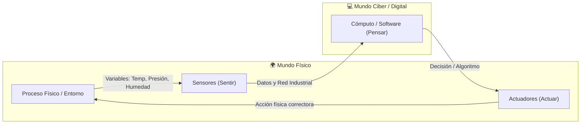
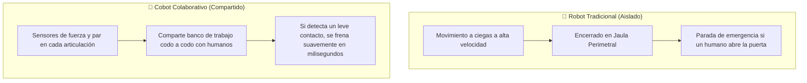
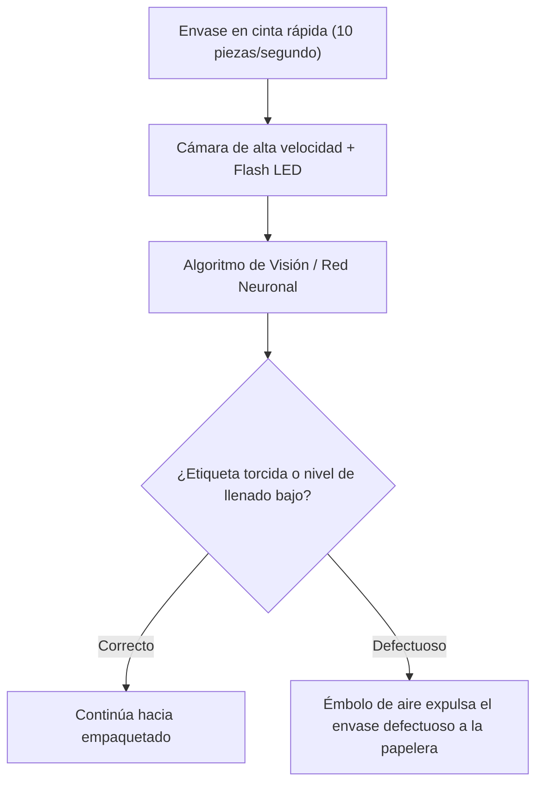
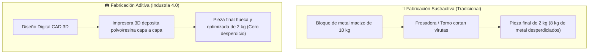
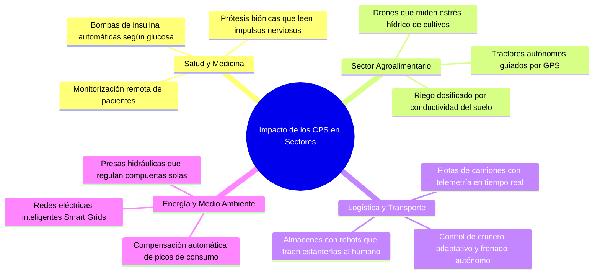

# 1.2 Sistemas Ciberfísicos (CPS) y Tecnologías Habilitadoras

La piedra angular de la Cuarta Revolución Industrial es la superación de la barrera tradicional entre el mundo físico y el mundo virtual. Los **Sistemas Ciberfísicos** (*Cyber-Physical Systems*, CPS) son el mecanismo tecnológico que hace posible esta integración en plantas industriales, infraestructuras y servicios.

---

## 1. ¿Qué es un Sistema Ciberfísico (CPS)?

Un **Sistema Ciberfísico (CPS)** es la **integración total entre el mundo físico** (las cosas tangibles: máquinas, vehículos, tuberías, cultivos) y el **mundo digital o virtual** (el software, las redes de comunicación y los algoritmos analíticos).

Para entenderlo de forma sencilla, un sistema ciberfísico funciona como un **organismo digitalizado**: tiene sensores para "sentir" el entorno, un cerebro informático para "pensar" y procesar datos, y actuadores para "actuar" físicamente en tiempo real.

---

### La Analogía del Cuerpo Humano

Para comprender sus componentes de forma pedagógica, podemos compararlo con el funcionamiento de nuestro propio cuerpo:

| Componente en el CPS | Equivalente Humano | ¿Qué hace en la industria? |
| :--- | :--- | :--- |
| **Sensores** *(Parte física)* | **Los 5 sentidos** (vista, tacto, oído...) | Miden magnitudes físicas: temperatura, presión, vibración acústica, caudal o velocidad de giro de un eje. |
| **Red y Computación** *(Parte ciber)* | **El sistema nervioso y el cerebro** | Transmiten las señales, analizan los datos mediante software o modelos de IA y deciden qué corrección aplicar. |
| **Actuadores** *(Parte física)* | **Los músculos y extremidades** | Reciben la orden del software y ejecutan una acción física tangible: abrir una compuerta, acelerar un motor, frenar un brazo mecánico. |

---

### ¿En qué se diferencia de una máquina tradicional?

- **Máquina tradicional:** Funciona con órdenes directas de un operario o ejecuta un programa rígido y ciego. Por ejemplo, una batidora o una sierra mecánica corta a la misma velocidad sin "saber" si el material es blando o si se está atascando, salvo que un humano pulse un botón de parada.

- **Sistema Ciberfísico:** Está conectado en red, analiza datos constantemente, aprende de su entorno y **toma decisiones autónomas en tiempo real** para adaptarse a imprevistos sin necesidad de intervención manual continua.

---

### Ejemplo Práctico: Un Invernadero Inteligente

Para ver cómo interactúan estas capas en un caso cotidiano de digitalización agrícola:

- **1. Entorno Físico:** Las tomateras, la tierra, la luz solar y el aire del invernadero.

- **2. Sensores (Sentir):** Un sensor clavan en el sustrato mide que la humedad de la tierra ha caído al 18% y un termómetro digital detecta que la temperatura interior ha subido a 36 °C.

- **3. Capa Ciber (Pensar):** El microcontrolador local analiza los datos, se conecta a Internet mediante Wi-Fi/4G para consultar la previsión meteorológica del día (que anticipa una ola de calor) y calcula que las tomateras sufrirán estrés hídrico severo si no se actúa en menos de 10 minutos.

- **4. Actuadores (Actuar):** El sistema abre automáticamente las electroválvulas del riego por goteo durante 15 minutos y activa los motores que despliegan un toldo térmico en el techo para generar sombra. Todo esto ocurre mientras el agricultor revisa los informes desde una aplicación móvil en su casa.

---

### ¿Por qué son clave en los Sectores Productivos?

Los sistemas ciberfísicos son el núcleo operativo de la Industria 4.0 porque desbloquean tres capacidades antes imposibles:

- **Mantenimiento predictivo:** La máquina detecta microvibraciones invisibles para el ojo y el oído humano, deduciendo mediante algoritmos que un rodamiento fallará en dos semanas y programando su propia orden de recambio antes de romperse en plena producción.

- **Producción flexible y personalizada:** Una línea de ensamblaje puede alternar entre fabricar el modelo A o el modelo B sobre la marcha, porque las máquinas leen el identificador de cada pieza y reconfiguran sus herramientas automáticamente en milisegundos.

- **Optimización de recursos:** El sistema solo consume agua, electricidad o reactivos químicos en la cantidad exacta que los sensores determinan necesaria en cada instante.

---

## 2. Tecnologías Habilitadoras del Ecosistema CPS

Alrededor del bucle central de los CPS orbitan un conjunto de **tecnologías habilitadoras digitales (THD)**. Cada una de ellas resuelve un cuello de botella específico del mundo físico.

---

### A. Robótica Colaborativa (*Cobots*)

Durante décadas, los robots industriales tradicionales (como los brazos mecánicos que sueldan carrocerías de automóviles) han trabajado **encerrados dentro de jaulas metálicas con vallas de seguridad y sensores de corte**. 

La razón es simple: son máquinas pesadas, ciegas y rígidas. Se mueven con fuerza descomunal entre coordenadas matemáticas prefijadas. Si un operario se cruzara en su trayectoria, el robot no lo sabría y provocaría un accidente mortal.

#### La Analogía: La batidora industrial vs. El ayudante de cocina

- Un **robot tradicional** es como una batidora industrial gigante sin tapa: extremadamente rápida y potente, pero si metes la mano, la destruye sin detenerse.
- Un **cobot** es como un ayudante humano en la cocina: trabaja a tu lado, te sujeta la sartén mientras tú añades los ingredientes, y si por error le rozas el brazo con el codo, se detiene suavemente de forma refleja.

#### ¿Cómo funciona un Cobot?
Los cobots incorporan **sensores de par articular** en cada articulación motora. Miden continuamente la resistencia física que experimentan. Si la fuerza contraria supera un umbral de seguridad mínimo (por ejemplo, rozar la mano del operario), el software del cobot corta la alimentación del motor en cuestión de milisegundos y frena suavemente.

#### Situación Real en la Industria:
En una línea de montaje de salpicaderos de automóviles, un operario humano se encarga de encajar los cables eléctricos y los conectores delicados (tarea que requiere destreza táctil y visión flexible), mientras un cobot situado a escasos centímetros sujeta la pieza pesada y aprieta con precisión milimétrica los tornillos de fijación sin fatiga.

---

### B. Gemelos Digitales (*Digital Twins*)

Un **Gemelo Digital** no es un plano 3D estático hecho en AutoCAD. Es una **réplica virtual viva, dinámica y conectada en tiempo real** de un objeto físico, una máquina o una fábrica entera.

#### La Analogía: El simulador de vuelo o el motor de videojuegos

Imagina un videojuego de carreras de coches hiperrealista. Si chocas el coche contra un muro a 200 km/h, el motor de físicas calcula exactamente cómo se deforma el chasis, cuánto rebota la rueda y si el motor arde.

Un **Gemelo Digital** hace exactamente eso, pero alimentado por la realidad:
- **Plano 3D tradicional:** Es una foto fija que describe cómo se diseñó la máquina.
- **Gemelo Digital:** Es una simulación continua conectada por sensores a la máquina real. Si el motor físico de la planta se calienta 5 °C de más, el modelo virtual en la pantalla se pone al rojo vivo en el mismo segundo.

#### ¿Para qué sirve simular antes de actuar?
Permite responder preguntas de tipo *"¿Qué pasaría si...?"* sin arriesgar dinero ni vidas humanas:
- ¿Qué pasará si aceleramos la producción un 15% durante la próxima semana? El gemelo digital simula el desgaste de los componentes antes de tocar el botón en la fábrica real.
- Si se avecina una ola de frío extremo, el gemelo de una red eléctrica predice qué transformadores pueden sobrecargarse y reequilibra el flujo con antelación.

#### Situación Real en la Industria:
Los astilleros modernos (como Navantia en la construcción de fragatas) crean un gemelo digital completo del buque. La tripulación y los ingenieros pueden ensayar maniobras de emergencia, calcular rutas con menor consumo de combustible o predecir averías mecánicas en alta mar a miles de kilómetros de la costa.

---

### C. Visión por Computador e Inspección Automatizada

En las líneas de producción tradicionales, el control de calidad dependía exclusivamente de los ojos del operario: mirar botellas, galletas o piezas metálicas que pasaban a gran velocidad por una cinta transportadora para retirar las defectuosas.

Sin embargo, el ojo humano sufre **fatiga visual**, parpadea y no puede mantener una concentración perfecta durante jornadas enteras inspeccionando 600 envases por minuto.

#### La Analogía: El ojo biónico con vista de lince

La visión por computador combina una cámara digital industrial (capaz de capturar decenas de fotos por segundo con iluminación sincronizada) con un software que procesa las imágenes como **matrices numéricas de píxeles**.

- Un operario humano "mira" y hace una estimación intuitiva.
- El algoritmo de visión "mide" contrastes, cuenta píxeles de color, verifica dimensiones con precisión de micras y compara patrones mediante inteligencia artificial.

#### Situación Real en la Industria:
En una planta embotelladora de refrescos, los envases pasan a un ritmo de 50.000 botellas por hora. Una cámara de visión artificial fotografía cada botella en una fracción de milisegundo: comprueba que el nivel de líquido sea exacto, que el tapón esté correctamente roscado y que el código de barras y lote de caducidad sean perfectamente legibles. Si alguna botella falla, un actuador neumático (un golpe de aire comprimido) la expulsa de la cinta al instante sin ralentizar la producción.

---

### D. Fabricación Aditiva (Impresión 3D Industrial)

Para entender la revolución de la fabricación aditiva, es necesario contrastarla con el método que ha dominado la industria durante siglos: la **fabricación sustractiva**.

#### La Analogía: La estatua de mármol vs. La construcción con piezas de LEGO

- **Fabricación Tradicional (Sustractiva):** Es como un escultor esculpiendo una figura a partir de un gran bloque de mármol: para obtener la figura deseada debe picar y retirar toneladas de piedra que se convierten en escombros.
- **Fabricación Aditiva (Impresión 3D):** Es como construir con piezas de LEGO o moldear con plastilina: se añade material exclusivamente capa a capa donde hace falta, sin desperdiciar nada.

#### Ventajas Industriales Clave:

- **Geometrías imposibles y estructuras huecas:** Permite fabricar piezas metálicas con estructuras internas en panel de abeja (*honeycomb*), que mantienen la misma resistencia estructural pero pesan un 50% menos.
- **Producción bajo demanda y sin moldes:** Para fabricar 5 piezas no hace falta encargar un molde industrial de 30.000 €; basta con enviar el archivo digital a la impresora 3D.
- **Reparación de piezas descatalogadas:** Si una máquina agrícola de hace 25 años rompe un engranaje y el fabricante ya no existe, se escanea en 3D la pieza rota y se imprime un recambio funcional en horas.

#### Situación Real en la Industria:
En el sector aeroespacial (aviones y satélites), cada kilogramo de peso ahorrado reduce el consumo de combustible en millones de litros a lo largo de su vida útil. Empresas como Airbus imprimen toberas de motores y soportes estructurales de titanio mediante sinterizado láser de polvo metálico, logrando piezas ultraligeras y de una sola pieza que antes requerían unir 20 tornillos y soldaduras.

---

## 3. Sectores Productivos Transformados por los CPS

La digitalización mediante sistemas ciberfísicos no es exclusiva de las fábricas de coches; transforma sectores esenciales:

---

## 4. Caso de Reflexión: El Fiasco de la Sobreautomatización en Tesla

A menudo se asume erróneamente que *"cuanta más automatización y menos humanos intervengan, mejor funcionará un negocio"*. La historia industrial reciente demuestra que este enfoque extremo conduce al fracaso.

!!! warning "Caso Real: El 'Infierno de la Automatización' del Tesla Model 3 (2018)"
    En 2018, Tesla construyó una fábrica donde pretendía que el ensamblaje del Tesla Model 3 fuera 100% automatizado, eliminando casi por completo a los operarios humanos bajo el lema de *"la máquina que construye a la máquina"*.
    
    **El problema:** Se instalaron robots para instalar cableados flexibles, juntas de goma en las puertas y fijar aislamientos acústicos. Los brazos robóticos eran incapaces de lidiar con cables flexibles que se doblaban de forma impredecible o con juntas blandas: las piezas se atascaban, la línea de montaje se detenía continuamente y la producción cayó a niveles críticos que estuvieron a punto de llevar a la compañía a la quiebra.
    
    **La solución:** Tesla tuvo que desmantelar decenas de robots multimillonarios y reincorporar operarios humanos cualificados para las tareas delicadas de montaje final. Elon Musk reconoció públicamente el error con una frase reveladora:
    
    > *"Sí, la excesiva automatización en Tesla fue un error. Los humanos están infravalorados."*

### 💡 Lección de Diseño para Técnicos de Grado Superior:
Los robots y los sistemas ciberfísicos son imbatibles en tareas que demandan **fuerza bruta, repetición exacta milimétrica, velocidad en condiciones tóxicas o análisis de millones de números**. 

Sin embargo, la **destreza táctil fina, la capacidad de adaptarse a un cable que no cae siempre en el mismo sitio y el sentido común ante un imprevisto** siguen siendo capacidades exclusivas de las personas. La verdadera digitalización productiva de la Industria 5.0 no busca eliminar al ser humano, sino potenciarlo mediante **cobots y herramientas colaborativas**.
