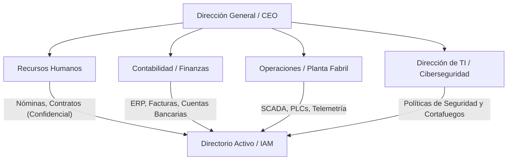
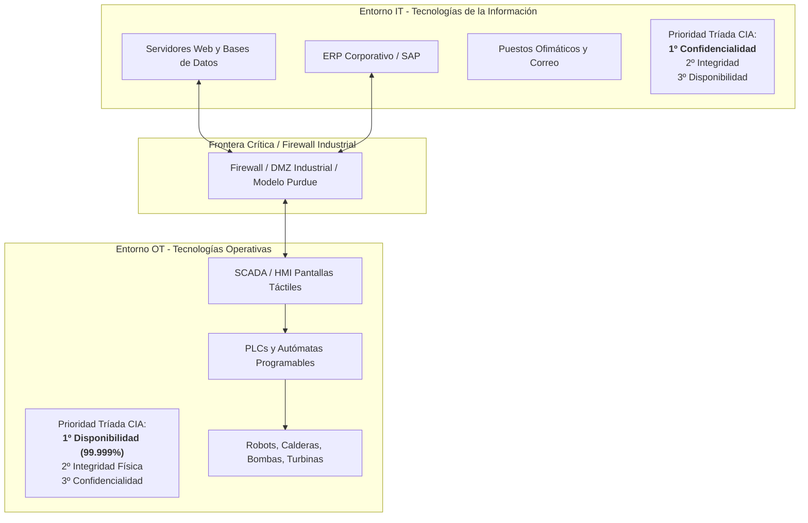
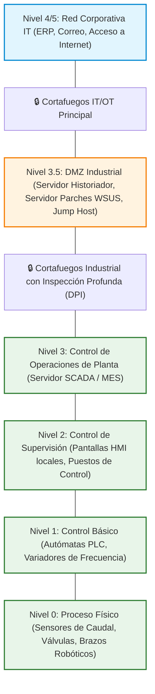
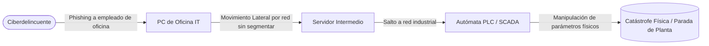

# 1.3 Estructura Organizativa y Convergencia OT / IT

Uno de los mayores desafíos técnicos y de gestión de la digitalización no es la tecnología en sí misma, sino la integración entre dos mundos que durante décadas operaron de espaldas: el mundo corporativo de las oficinas (**IT - Information Technology**) y el mundo de las líneas de producción y plantas industriales (**OT - Operational Technology**).

---

## 1. Estructura Empresarial e Identidad Digital

En cualquier organización moderna, los departamentos (Recursos Humanos, Finanzas, Operaciones, TI, Logística) están jerarquizados y requieren accesos estrictamente diferenciados a la información:

---

### Control de Acceso y Gestión de Identidades (IAM)

La digitalización de una empresa exige abandonar la gestión manual de contraseñas compartidas mediante sistemas de **Control de Acceso Basado en Roles (RBAC)**:

- **Principio de Mínimo Privilegio (*Least Privilege*):** Un operario de planta solo tiene permisos de lectura sobre la receta del producto y control sobre su estación de trabajo; no puede acceder a las nóminas de RRHH ni modificar las reglas del cortafuegos corporativo.
- **Autenticación Multifactor (MFA / 2FA):** Exigencia de al menos dos factores distintos de autenticación:

    1. *Algo que sabes:* Contraseña o PIN complejo.
    2. *Algo que tienes:* Llave de seguridad FIDO2 (YubiKey), app autenticadora TOTP (Google Authenticator) o tarjeta RFID corporativa.
    3. *Algo que eres:* Biometría (huella dactilar, reconocimiento facial 3D o escaneo de iris).

#### 📦 Cuadro de Tecnologías Concretas en IAM y Autenticación

| Tecnología / Producto | Fabricante / Tipo | Función en la Empresa | Caso de Uso Práctico |
| :--- | :--- | :--- | :--- |
| **Microsoft Entra ID** *(antes Azure AD)* | Microsoft (Cloud) | Directorio activo en la nube y gestión unificada de identidades corporativas. | Si se despide a un empleado, revocar su cuenta en Entra ID bloquea al instante su acceso al correo, al ERP y a las máquinas de planta. |
| **Keycloak** | Red Hat / Open Source | Servidor de gestión de identidades y accesos (IAM) autoalojado (*On-Premise*). | Autenticación mediante **Single Sign-On (SSO)** y OAuth2/OpenID Connect en servidores propios sin cuotas por usuario. |
| **YubiKey Serie 5** | **Yubico** (Hardware FIDO2) | Llave criptográfica física USB/NFC resistente al agua y a golpes. | Los técnicos de mantenimiento conectan su YubiKey al PC industrial para autorizar cambios en el código del PLC; inmune a ataques de *phishing*. |
| **Lectores Biométricos Suprema** | **Suprema BioMini** | Sensor dactilar óptico rugerizado con detección de dedos falsos de silicona. | Fichaje horario y apertura de puertas de acceso restringido en zonas con polvo o grasa industrial. |

!!! warning "El dilema ético y técnico de la biometría"
    A diferencia de una contraseña comprometida (que se restablece en 10 segundos con un nuevo hash en base de datos), **los datos biométricos no se pueden cambiar**. Si una base de datos con las huellas o el escaneo facial de los trabajadores es sustraída por ciberdelincuentes, la identidad de esos empleados queda expuesta de por vida. Por ello, el RGPD europeo cataloga la biometría como dato de categoría especial y exige cifrado de extremo a extremo y procesado en local.

---

## 2. El Choque de Dos Mundos: IT vs. OT

Para un profesional de la informática, entender la diferencia entre IT y OT es indispensable para evitar incidentes catastróficos en fábricas, hospitales o redes de transporte.

---

## 3. Matriz Comparativa Técnica: IT vs. OT

| Criterio | Entorno IT (Information Technology) | Entorno OT (Operational Technology) |
| :--- | :--- | :--- |
| **Objetivo central** | Gestión, análisis y almacenamiento de datos corporativos | Control y monitorización en tiempo real de procesos físicos |
| **Prioridad de Seguridad** | **Confidencialidad** > Integridad > Disponibilidad | **Disponibilidad (24/7/365)** > Integridad > Confidencialidad |
| **Tolerancia al retardo** | Tolera latencias de segundos o reintentos TCP | **Tiempo real estricto (*jitter* < milisegundos)** |
| **Impacto de un fallo** | Pérdida de dinero, daño reputacional, fuga de datos | **Daño a infraestructuras, explosiones, riesgo vital para personas** |
| **Ciclo de vida del hardware** | 3 a 5 años (servidores, portátiles, switches) | **15 a 30 años (turbinas, generadores, PLCs industriales)** |
| **Gestión de parches** | Actualizaciones automáticas semanales/mensuales | Parchear requiere parar la fábrica; se audita durante meses |
| **Protocolos habituales** | TCP/IP, HTTPS, SSH, DNS, REST, GraphQL | Modbus, Profinet, EtherCAT, OPC-UA, CAN Bus, DNP3 |

---

### 📦 Cuadro de Tecnologías y Marcas Concretas: ¿Qué se usa en cada lado?

| Capa Tecnológica | Tecnología Típica en Oficina (IT) | Tecnología Típica en Fábrica (OT) |
| :--- | :--- | :--- |
| **Hardware de Cómputo** | Servidores rack **Dell PowerEdge** o instancias en **AWS EC2**. | Autómatas programables **Siemens S7-1500**, **Rockwell Allen-Bradley ControlLogix**, o **Schneider Modicon M580**. |
| **Sistemas Operativos** | **Windows Server 2022**, **Ubuntu Server**, **Red Hat Enterprise Linux**. | Sistemas operativos de tiempo real (**RTOS**): **VxWorks**, **QNX**, **FreeRTOS** o firmwares propietarios embebidos. |
| **Switches y Redes** | Switches de oficina **Cisco Catalyst 9200** (ventilación activa, plástico/metal ligero). | Switches rugerizados carril DIN **Siemens SCALANCE X** o **Moxa EDS-508** (sin ventiladores, toleran 75 °C y polvo). |
| **Software Central** | ERP **SAP S/4HANA**, CRM **Salesforce**, bases de datos **PostgreSQL**. | Software SCADA **Siemens WinCC**, **Ignition SCADA**, o **Wonderware InTouch**. |

---

## 4. La Segmentación Segura: El Modelo Purdue

Para conectar la planta a los sistemas de negocio sin exponer las máquinas a internet, la industria utiliza la arquitectura segmentada del **Modelo Purdue (ISA-95)**:

#### 📦 Cuadro de Tecnologías Concretas en Ciberseguridad Industrial

| Dispositivo / Software | Fabricante | Función en la Red Industrial |
| :--- | :--- | :--- |
| **Firewall Rugged PA-400R** | **Palo Alto Networks** | Cortafuegos industrial que entiende protocolos OT (Modbus, Profinet) bloqueando comandos anómalos hacia los PLCs. |
| **Sensor de Red Claroty / Nozomi** | **Nozomi Networks** | Monitoriza pasivamente el tráfico de red de planta para detectar ciberataques sin interrumpir las máquinas. |
| **Servidor Historiador OSIsoft PI** | **AVEVA (OSIsoft)** | Ubicado en la DMZ; recopila millones de datos de sensores de planta para que el ERP los consulte sin tocar los PLCs. |

---

## 5. La Superficie de Ataque Industrial y Casos Históricos

Históricamente, los sistemas de planta estaban aislados del exterior mediante un **aislamiento físico (*air gap*)**. La digitalización ha derribado ese aislamiento para enviar telemetría a la nube, abriendo la puerta a incidentes graves:

### Casos Reales Paradigmáticos:

1. **Stuxnet (2010):** El primer ciberarma militar conocida de la historia. Infectó sistemas SCADA de Siemens mediante memorias USB y alteró las frecuencias de rotación de las centrifugadoras de enriquecimiento de uranio en la planta iraní de Natanz, destruyéndolas físicamente mientras en las pantallas de los operadores mostraba lecturas falsas de normalidad.

2. **Ransomware Colonial Pipeline (2021):** Un grupo de ciberdelincuentes secuestró los sistemas de facturación (IT) del mayor oleoducto de la costa este de EEUU. Por miedo a que el malware saltara a la red operativa de bombeo (OT), la compañía cerró el oleoducto durante 6 días, provocando compras de pánico de gasolina y crisis de transporte en varios estados.

3. **Ciberataque al Hospital Clínic de Barcelona (2023):** Un ransomware secuestró miles de historiales clínicos y paralizó servicios de radioterapia y quirófanos programados durante semanas, evidenciando que en el ámbito sanitario la convergencia IT/OT compromete directamente la salud de los pacientes.

---

## 6. El Marco Regulatorio Europeo: Directiva NIS2

Ante la avalancha de ataques a infraestructuras críticas, la Unión Europea aprobó la **Directiva NIS2 (Network and Information Security 2)**:

- **Ámbito ampliado:** Ya no solo afecta a multinacionales de energía o telecomunicaciones; ahora obliga a pymes y proveedores de sectores esenciales (sanidad, tratamiento de aguas, logística alimentaria, automoción, industria química).
- **Régimen sancionador:** Multas de hasta **10 millones de euros o el 2% del volumen de negocio global**, junto con **responsabilidad civil e inhabilitación directa de los directivos** que descuiden la seguridad de sus redes.
- **Obligaciones técnicas:** Segmentación estricta de redes de control industrial mediante el **Modelo Purdue**, planes de respuesta a incidentes en menos de 24 horas y auditoría continua de la cadena de suministro de software.
