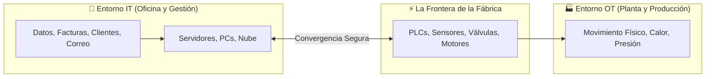
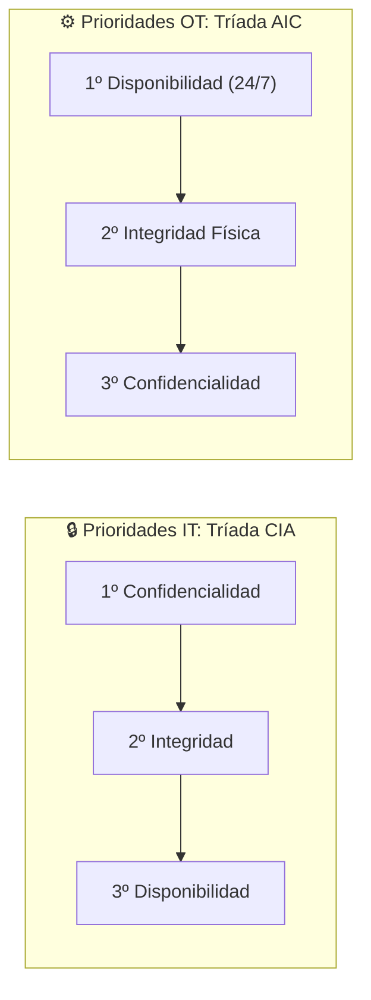
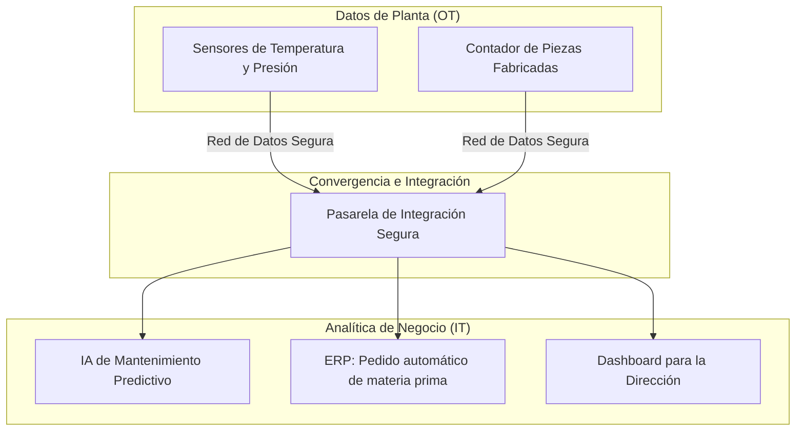
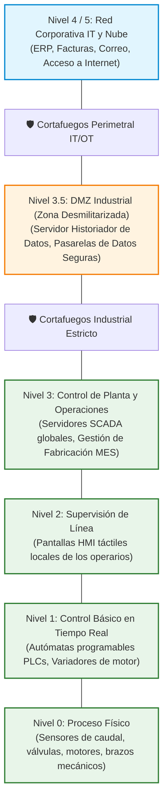
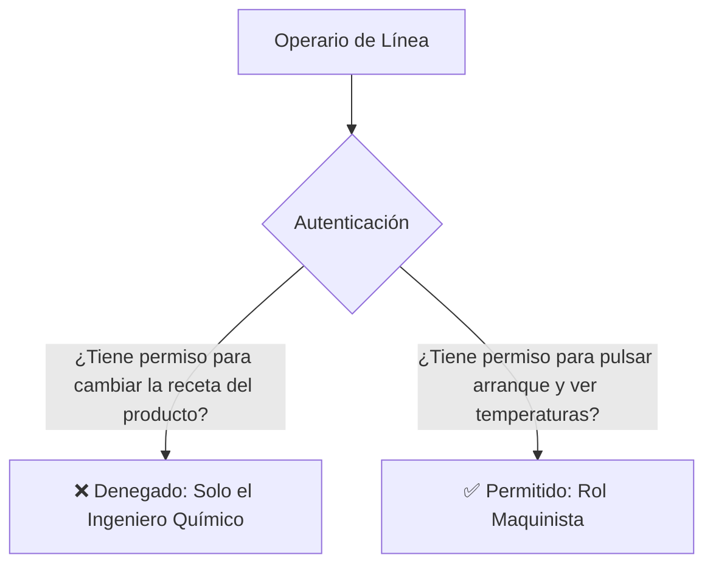
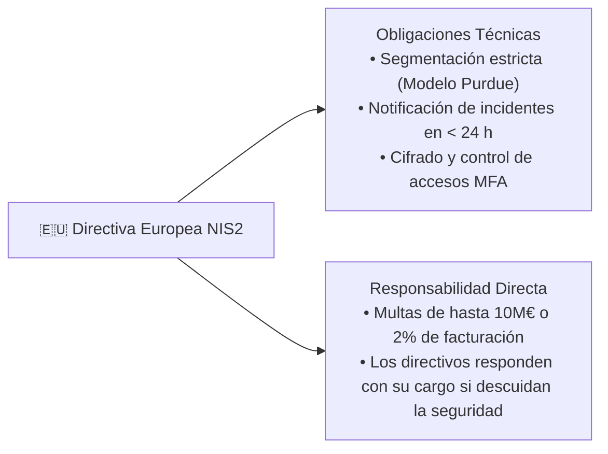

# 1.3 Estructura Organizativa y Convergencia OT / IT

Uno de los mayores desafíos de la digitalización en cualquier sector productivo no reside únicamente en la tecnología, sino en la integración entre dos mundos que durante décadas operaron de espaldas: el mundo corporativo de las oficinas (**IT - Information Technology**) y el mundo de las líneas de producción y plantas industriales (**OT - Operational Technology**).

---

## 1. La Brecha Histórica: ¿Qué diferencia a IT de OT?

La diferencia entre **IT** (*Information Technology* / Tecnología de la Información) y **OT** (*Operational Technology* / Tecnología de la Operación) es la división cultural y técnica más importante que la digitalización industrial está intentando salvar.

En pocas palabras:

- **IT gestiona la información y las decisiones del negocio** (los datos que vemos en pantallas, servidores y bases de datos).
- **OT gestiona el mundo físico y las máquinas** (las piezas que se mueven, los fluidos que hierven y la electricidad que fluye).

---

### Tabla Comparativa Principal

Para un técnico o técnica de Grado Superior, distinguir estos dos entornos es indispensable para no cometer errores fatales en una organización:

| Criterio | IT (Tecnología de la Información) | OT (Tecnología de la Operación) |
| :--- | :--- | :--- |
| **Objetivo principal** | Procesar datos para la gestión del negocio y la administración. | Monitorear y controlar procesos físicos reales en planta. |
| **Enfoque del entorno** | Entorno virtual y transaccional (pantallas, servidores, nube). | Entorno físico e industrial (plantas, fábricas, calderas, almacenes). |
| **Dispositivos clave** | Servidores, portátiles, switches de red, bases de datos SQL, ERP. | Autómatas (PLC), sensores de presión/temperatura, brazos robóticos, sistemas SCADA. |
| **Latencia / Tiempo** | Respuestas en segundos o minutos (muy tolerante a pequeños retardos). | **Tiempo real estricto** (milisegundos o microsegundos; el retraso causa colisiones). |
| **Prioridad de Seguridad** | **1º Confidencialidad**, 2º Integridad, 3º Disponibilidad. | **1º Disponibilidad / Seguridad física (*Safety*)**, 2º Integridad, 3º Confidencialidad. |
| **Ciclo de vida del equipo** | **3 a 5 años** (equipos sustituidos con frecuencia por obsolescencia). | **15 a 30 años** (maquinaria masiva diseñada para funcionar durante décadas). |
| **Gestión de cambios / Parches** | Actualizaciones automáticas semanales o parches nocturnos rutinarios. | Parchear requiere detener la producción; se planifica y audita con meses de antelación. |

---

### La Paradoja de las Prioridades: C-I-A vs. A-I-C

La razón por la que los ingenieros de sistemas informáticos (IT) y los jefes de mantenimiento de planta (OT) tradicionalmente no se han entendido bien es porque sus prioridades son diametralmente opuestas ante un fallo:

#### ¿Qué ocurre ante un ataque o anomalía?

- **En IT:** Si entra un virus en el servidor web corporativo, la medida inmediata es **apagar el servidor o desconectarlo de la red** para proteger la confidencialidad de las contraseñas y datos bancarios. Que los empleados no puedan consultar el correo o que la tienda online esté caída durante 3 horas es una molestia económica, pero nadie muere ni se destruyen instalaciones.

- **En OT:** Si un técnico de informática apaga de golpe el servidor de control de una planta química o el PLC de un horno de fundición para "aplicar un antivirus", el fluido puede solidificarse en las cañerías, los gases pueden aumentar su presión sin escape y puede provocarse **una explosión o un accidente físico grave con riesgo vital**. En OT, la **disponibilidad continua (99.999%)** y la **seguridad física (*Safety*)** están siempre por encima de la privacidad de los datos.

---

### ¿Qué es la Convergencia IT/OT en la Industria 4.0?

Tradicionalmente, el entorno OT era una **"isla tecnológica" aislada de Internet** mediante lo que se conoce como aislamiento físico (*air gap*): las máquinas funcionaban sin conexión al exterior, controladas mediante cables exclusivos y pantallas locales.

Con la llegada del Internet de las Cosas Industrial (IIoT), la Inteligencia Artificial y la necesidad de optimizar costes, ambos mundos se han tenido que conectar:

- **OT proporciona los datos brutos:** Temperatura real del motor, consumo energético en tiempo real, revoluciones por minuto y recuento de piezas defectuosas.
- **IT aporta la capacidad analítica masiva:** Conecta esos datos a servidores centrales o a la nube, aplica modelos de aprendizaje automático para predecir averías y sincroniza la producción con el software de compras y logística (ERP).

**El gran reto:** Al conectar los equipos de OT a la red corporativa y a Internet, las máquinas de fábrica quedan expuestas a ciberataques externos. Por ello, la ciberseguridad industrial se ha convertido en una disciplina crítica.

---

## 2. El Modelo Purdue: ¿Qué es y qué intenta solucionar?

Imagina el mayor error que podría cometer un informático en una fábrica: conectar un autómata (PLC) que controla una prensa hidráulica directamente al mismo switch o red Wi-Fi donde se conectan los ordenadores de administración y los teléfonos móviles de los trabajadores.

Si un empleado de oficina abre un correo con un virus (*phishing*), el malware podría escanear la red local, saltar al autómata de la prensa y alterar sus parámetros de frenado.

Para evitar esta catástrofe se creó el **Modelo Purdue (estándar ISA-95)**.

---

### ¿Qué intenta solucionar el Modelo Purdue?

El Modelo Purdue es una **arquitectura de segmentación de redes en capas jerárquicas**. Su objetivo es garantizar que:

- Una infección en la red de oficina jamás llegue de forma directa a las máquinas físicas de la planta.
- Las órdenes de control industrial fluyan únicamente entre niveles adyacentes y bajo inspección estricta.

#### La Analogía: El Castillo Medieval y sus Murallas Concéntricas

Para entender el Modelo Purdue, imagina una fortaleza medieval defendida frente a invasiones:

- **La aldea exterior (Nivel 4/5 - IT):** Es la zona donde entra y sale todo el mundo (Internet, proveedores, correos electrónicos). Es la más vulnerable.
- **La muralla exterior y el foso (Cortafuegos IT/OT):** Nadie del pueblo llano puede entrar directamente a la torre del homenaje sin pasar por la guardia.
- **La aduana o patio intermedio (Nivel 3.5 - DMZ Industrial):** Es una zona neutral ("zona desmilitarizada"). Los comerciantes dejan los suministros aquí; los guardias los inspeccionan minuciosamente y luego los soldados del castillo los recogen. Nadie de la aldea entra al interior del castillo.
- **El corazón del castillo (Niveles 0, 1 y 2 - OT):** Donde residen los sistemas vitales. Están completamente aislados del exterior y solo se comunican con su entorno inmediato.

---

### Estructura de Capas del Modelo Purdue

#### ¿Qué hay en cada nivel explicado de abajo hacia arriba?

- **Nivel 0 (El Proceso Físico):** Son los "músculos y sentidos". Sensores de temperatura, motores, pistones neumáticos. No tienen capacidad de cómputo compleja; simplemente miden o ejecutan fuerza física.

- **Nivel 1 (Control Básico):** Son los "reflejos inmediatos". Los autómatas programables (PLCs) leen los sensores del Nivel 0 y modulan los motores en milisegundos con lógica determinista.

- **Nivel 2 (Supervisión de Línea):** Las pantallas táctiles (HMI) situadas junto a las máquinas donde el maquinista supervisa temperaturas y velocidades locales.

- **Nivel 3 (Control de Operaciones):** El software supervisor general (SCADA / MES) que coordina toda la nave de producción y registra qué turnos están produciendo más piezas.

- **Nivel 3.5 (La DMZ Industrial):** **La clave de la seguridad.** Aquí se aloja el *Servidor Historiador*. El Nivel 3 envía los datos a la DMZ, y el ERP del Nivel 4 consulta la DMZ. **El Nivel 4 nunca habla directamente con el Nivel 1.**

- **Nivel 4 y 5 (Red de Negocio e IT):** Oficinas centrales, gestión de compras, nóminas, facturación e interfaces con la nube y clientes.

---

## 3. Identidad Digital y Control de Acceso (IAM)

En una empresa digitalizada, no todas las personas deben tener acceso a todos los datos. Si un técnico de mantenimiento pudiera editar el código de un PLC sin identificarse, cualquier sabotaje o error humano quedaría sin registrar.

El **Control de Acceso Basado en Roles (RBAC)** y el **Principio de Mínimo Privilegio** dictan que cada usuario debe tener acceso **únicamente a lo indispensable para cumplir su jornada laboral**:

---

### Los 3 Factores de Autenticación (MFA)

Para evitar contraseñas compartidas escritas en pegatinas sobre los cuadros eléctricos, la industria emplea autenticación multifactor:

- **1. Algo que sabes:** Una contraseña alfanumérica, un PIN o una frase de paso.
- **2. Algo que tienes:** Una tarjeta RFID corporativa, una llave criptográfica física (por ejemplo, tipo llave USB de seguridad) o una app en el móvil con códigos temporales (TOTP).
- **3. Algo que eres:** Un rasgo biométrico propio de tu cuerpo (huella dactilar, lectura de iris, geometría facial 3D).

#### El Dilema Práctico de la Biometría en la Industria:

!!! warning "El reto de la biometría en el taller físico"
    En las oficinas, el reconocimiento facial o la huella dactilar en el móvil son muy cómodos. Pero, ¿qué ocurre en una fábrica de calderería o en un almacén frigorífico?
    
    Los operarios llevan guantes gruesos, mascarillas antipolvo y sus manos tienen restos de grasa industrial. Los lectores dactilares o faciales convencionales fallan sistemáticamente. Por eso, en entornos OT se recurre habitualmente a **tarjetas de proximidad RFID resistentes** o **llaves criptográficas físicas robustas** que se conectan al panel de control para autorizar maniobras críticas.

---

## 4. Casos Históricos de Choque IT/OT

Para comprender la magnitud de la amenaza de seguridad cuando IT y OT convergen sin la protección adecuada, basta con examinar tres incidentes reales que cambiaron la historia de la ingeniería:

### 1. El Ataque Stuxnet (2010): El primer ciberataque con destrucción física

- **¿Qué ocurrió?** La planta de enriquecimiento nuclear de Natanz (Irán) estaba completamente aislada de Internet (*air gap*). Sin embargo, un ciberataque introdujo un gusano informático a través de una simple **memoria USB** conectada por un técnico de mantenimiento a un ordenador de planta.
- **El efecto físico:** El malware reprogramó en silencio los autómatas (PLCs) que controlaban las centrifugadoras nucleares, obligándolas a girar a velocidades extremas para destruirlas por resonancia física, mientras en las pantallas de los operarios (SCADA) mostraba gráficos de telemetría totalmente normales. Se destruyeron físicamente unas 1.000 centrifugadoras sin disparar ninguna alarma previa.

### 2. El Secuestro de Colonial Pipeline (2021): El pánico por la falta de separación

- **¿Qué ocurrió?** Un grupo de cibercriminales infectó mediante *ransomware* la red de facturación y contabilidad (IT) del mayor oleoducto de los Estados Unidos debido a una contraseña filtrada en Internet sin doble factor de autenticación.
- **La consecuencia:** Aunque el virus no había tocado las bombas de combustible (OT), los directivos no podían estar seguros al 100% de que la red estuviera bien segmentada. Por precaución extrema, **apagaron todo el bombeo de gasolina durante 6 días**, provocando desabastecimiento, compras de pánico en gasolineras y la declaración de estado de emergencia en varios estados.

---

## 5. El Marco Regulatorio: La Directiva Europea NIS2

Durante décadas, la ciberseguridad industrial se consideró un gasto secundario. Para obligar a las organizaciones a protegerse, la Unión Europea aprobó la **Directiva NIS2 (Network and Information Security 2)**.

### ¿Qué exige a las empresas?

- **Ámbito extendido:** Ya no solo afecta a centrales eléctricas o bancos; ahora abarca a pymes que gestionen aguas potables, cadenas logísticas alimentarias, fábricas químicas o centros hospitalarios.
- **Fin de la impunidad:** Si una empresa sufre una parada o fuga grave por negligencia en ciberseguridad, los directivos pueden ser inhabilitados profesionalmente y responder con sanciones millonarias.
- **Deber de segmentación:** La implantación de arquitecturas como el Modelo Purdue y la gestión rigurosa de accesos ya no es una sugerencia técnica opcional, sino un **imperativo legal de obligado cumplimiento**.
