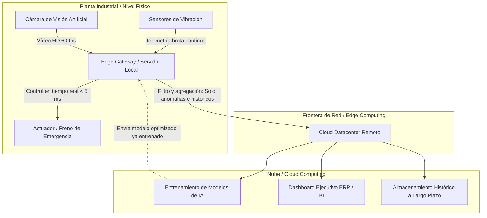
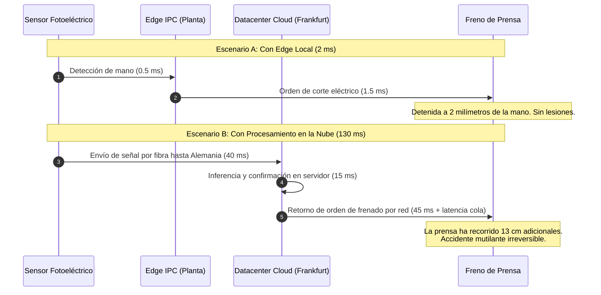
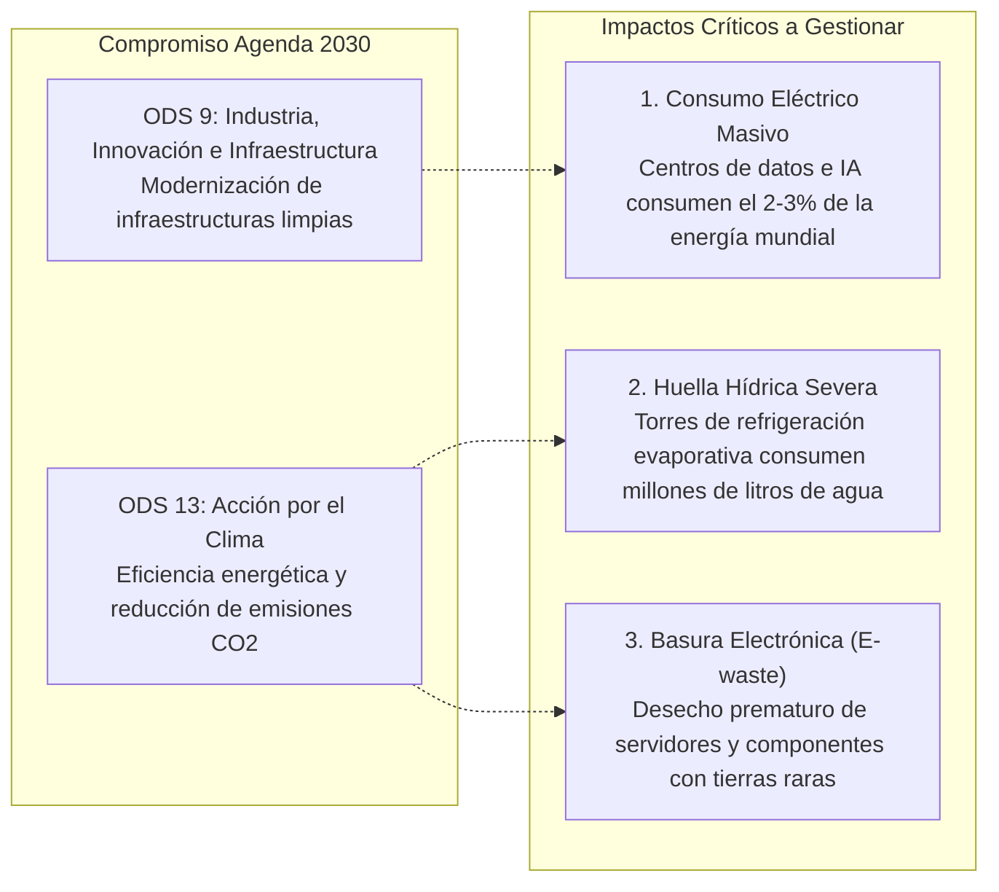

# 1.4 Edge Computing, Cloud y Sostenibilidad

La digitalización de una industria genera ingentes volúmenes de datos por segundo. Sin embargo, no todos los datos deben procesarse de la misma manera ni en el mismo lugar. Elegir la arquitectura de computación adecuada entre la nube (**Cloud**) y el extremo (**Edge**) es una de las decisiones más críticas para garantizar la seguridad física, el rendimiento económico y la sostenibilidad medioambiental de una organización.

---

## 1. Arquitecturas de Cómputo: Cloud vs. Edge Computing

---

### A. Cloud Computing (Computación en la Nube)

Consiste en centralizar el almacenamiento y el procesamiento en grandes centros de datos remotos gestionados por proveedores de hiperescala (AWS, Microsoft Azure, Google Cloud).

- **Ventajas:**

    - Capacidad de cómputo y almacenamiento prácticamente ilimitada bajo demanda.
    - Pago por uso: no requiere amortizar servidores físicos locales multimillonarios.
    - Servicios gestionados de analítica masiva (*Big Data*) y entrenamiento de modelos de IA.

- **Inconvenientes en entornos industriales:**

    - **Latencia impredecible:** La señal debe recorrer cientos o miles de kilómetros por Internet, con variaciones (*jitter*) inaceptables para control de máquinas.
    - **Coste y saturación de ancho de banda:** Transmitir gigabytes de vídeo industrial continuo por segundo satura la conexión de fibra y dispara los costes de transferencia de salida (*egress data*).
    - **Dependencia de la conectividad:** Si se cae el enlace de fibra o el proveedor de Internet sufre una avería, la fábrica quedaría totalmente paralizada si depende del Cloud para operar.

#### 📦 Cuadro de Tecnologías Concretas en Cloud Industrial

| Proveedor / Plataforma | Servicio Concreto | Función en la Arquitectura Industrial |
| :--- | :--- | :--- |
| **Amazon Web Services (AWS)** | **AWS IoT Core** | Broker masivo gestionado que recibe millones de mensajes MQTT de sensores de todo el mundo y los enruta hacia bases de datos. |
| **Microsoft Azure** | **Azure IoT Hub** y **Digital Twins** | Permite modelar relaciones entre máquinas y edificios, sincronizando la telemetría en la nube. |
| **Google Cloud Platform (GCP)** | **Google BigQuery** | Almacén de datos (*Data Warehouse*) analítico que ejecuta consultas SQL sobre petabytes de datos de producción en segundos. |

---

### B. Edge Computing (Computación en el Borde / Frontera)

Consiste en procesar, analizar y filtrar los datos físicamente cerca de donde se generan: en ordenadores industriales (*IPCs*), pasarelas (*gateways* IoT) o en el propio sensor o cámara inteligente.

- **Ventajas:**

    - **Latencia ultrabaja determinista (< 5 ms):** Vital para paradas de emergencia, vehículos autónomos y robótica de precisión.
    - **Autonomía operativa (*Offline first*):** Si se corta Internet exterior, la fábrica sigue funcionando localmente sin interrupción.
    - **Privacidad y cumplimiento normativo:** Los datos sensibles o imágenes de trabajadores no salen de las instalaciones locales.

- **Inconvenientes:**

    - Capacidad de procesamiento y almacenamiento limitada por el hardware local.
    - Coste de mantenimiento físico y actualización de los equipos repartidos por la planta.

#### 📦 Cuadro de Tecnologías Concretas en Edge Computing

| Hardware / Software Edge | Fabricante / Desarrollador | Caso de Uso Práctico en Planta |
| :--- | :--- | :--- |
| **SIMATIC IPC227E / IOT2050** | **Siemens** | Microordenador industrial sin ventiladores (*fanless*) instalado en carril DIN dentro del armario eléctrico de una máquina. |
| **Edge Gateway Serie 3000** | **Dell Technologies** | Pasarela rugerizada que conecta sensores analógicos antiguos por puerto serie RS-485 y los convierte a MQTT. |
| **Node-RED** | OpenJS Foundation (Open Source) | Entorno visual de programación por nodos para conectar sensores de planta con bases de datos locales sin escribir miles de líneas de código. |
| **AWS IoT Greengrass** | AWS | Permite ejecutar funciones serverless (Lambdas), contenedores Docker e inferencias de Machine Learning localmente en el dispositivo Edge sin conexión a Internet. |

---

## 2. Comparativa Técnica para Grado Superior

| Parámetro | Edge Computing (Extremo) | Cloud Computing (Nube) |
| :--- | :--- | :--- |
| **Ubicación del procesado** | En la máquina, pasarela o armario de planta | En un centro de datos remoto centralizado |
| **Latencia de respuesta** | **Inmediata y determinista (1 - 10 milisegundos)** | Variable (50 - 300+ milisegundos) |
| **Consumo de ancho de banda** | Mínimo (solo transmite resúmenes o alertas) | Alto (requiere canal constante de subida) |
| **Tolerancia a pérdida de red** | **Excelente (funciona en modo autónomo/local)** | Nula (sin Internet se detiene el servicio) |
| **Escalabilidad de cómputo** | Rígida (limitada al hardware del dispositivo) | Elástica y prácticamente ilimitada |
| **Casos de uso ideales** | Visión en línea, control de cobots, telemetría crítica | Predicción de demanda, BI, modelos de IA global |

---

## 3. Ejemplo de Cálculo de Ingeniería: ¿Por qué el Cloud mata en tiempo real?

Imagina una prensa hidráulica que estampa planchas de acero a 1 metro por segundo. Una barrera fotoeléctrica detecta la mano de un operario a 15 centímetros del punto de impacto:

!!! danger "Conclusión de Arquitectura"
    Las funciones de **seguridad física y control de procesos en tiempo real deben residir SIEMPRE en el Edge**. El Cloud se reserva para analítica agregada, optimización energética global y almacenamiento histórico.

---

## 4. Tecnología Verde (*Green IT*), ODS y la Paradoja Ambiental

A menudo la digitalización se vende como un proceso "inmaterial" y ecológico porque elimina el uso de papel en las oficinas. Sin embargo, la infraestructura que sostiene el mundo digital tiene una huella física y energética colosal.

---

### La Métrica PUE (*Power Usage Effectiveness*)

La eficiencia energética de un centro de datos se mide mediante el índice **PUE**:

$$\text{PUE} = \frac{\text{Energía Total que entra al Centro de Datos (kW)}}{\text{Energía consumida exclusivamente por los Servidores (kW)}}$$

#### 📦 Cuadro de Eficiencia en Centros de Datos Reales

| Rango PUE | Nivel de Eficiencia | Caso Real en la Industria |
| :--- | :--- | :--- |
| **PUE = 1.0** | Ideal teórico perfecto | Toda la energía consumida va a los chips; cero gasto en ventilación o iluminación. |
| **PUE = 1.1 - 1.2** | Excelente / Vanguardia | **Centro de Datos de Google en Hamina (Finlandia):** Refrigerado exclusivamente con agua marina helada del Golfo de Finlandia, sin climatizadores por compresor. |
| **PUE = 1.5 - 2.0** | Típico / Tradicional | Centro de datos convencional: por cada $100\text{ kW}$ que gastan los servidores, se gastan otros $80\text{ kW}$ en aparatos de aire acondicionado para que no se quemen. |

---

### La Cara Oculta del Boom de la Inteligencia Artificial

- **Consumo eléctrico:** El entrenamiento de un único modelo de lenguaje grande (LLM) de vanguardia puede consumir tanta electricidad como el consumo medio de cientos de hogares durante todo un año.
- **Estrés hídrico:** Los centros de datos de refrigeración líquida evaporativa pueden evaporar entre 1 y 3 litros de agua potable por cada kilovatio-hora de energía consumida para evitar que los procesadores GPU se sobrecalienten. Esto genera graves conflictos vecinales en zonas agrícolas con sequía recurrente.
- **La chatarra electrónica (*e-waste*):** Se generan anualmente más de 50 millones de toneladas de residuos electrónicos en el mundo. Menos del 20% se recicla formalmente; el resto termina en vertederos de países en desarrollo, liberando plomo, mercurio y cadmio al subsuelo.

---

## 5. Estrategias Profesionales de Green IT

Como futuros profesionales del desarrollo de software y la infraestructura tecnológica, vuestras decisiones de diseño importan:

1. **Eficiencia algorítmica y del código:** Un algoritmo mal optimizado que consume un 80% de CPU innecesariamente durante millones de ejecuciones en un servidor equivale a quemar carbón en una central térmica.

2. **Reacondicionamiento y ciclo de vida extendido:** En lugar de reemplazar ordenadores industriales o servidores cada 3 años por política corporativa, actualizar componentes modulares (RAM, SSDs) y reutilizar equipos menos potentes como nodos Edge o cortafuegos perimetrales.

3. **Selección de proveedores Cloud con contratos verdes:** Escoger regiones de nube (*Cloud Regions*) con métricas PUE cercanas a 1.1 y respaldadas por contratos directos de compra de energía 100% renovable (PPA - *Power Purchase Agreements*).
