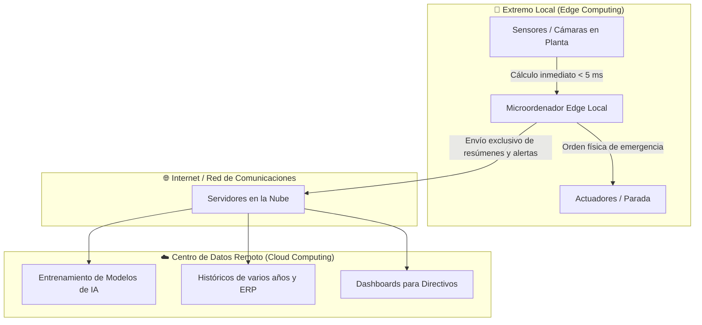
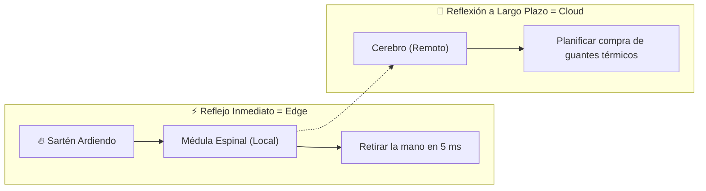
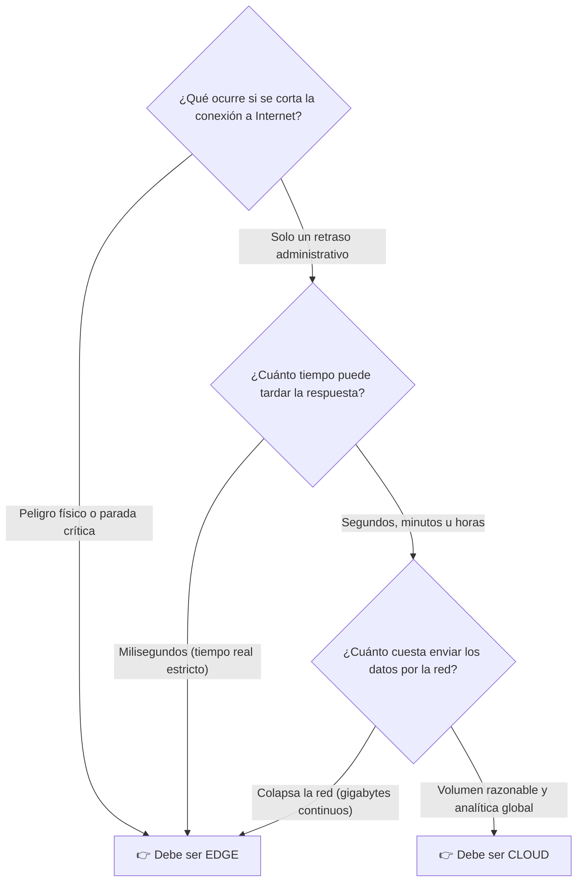
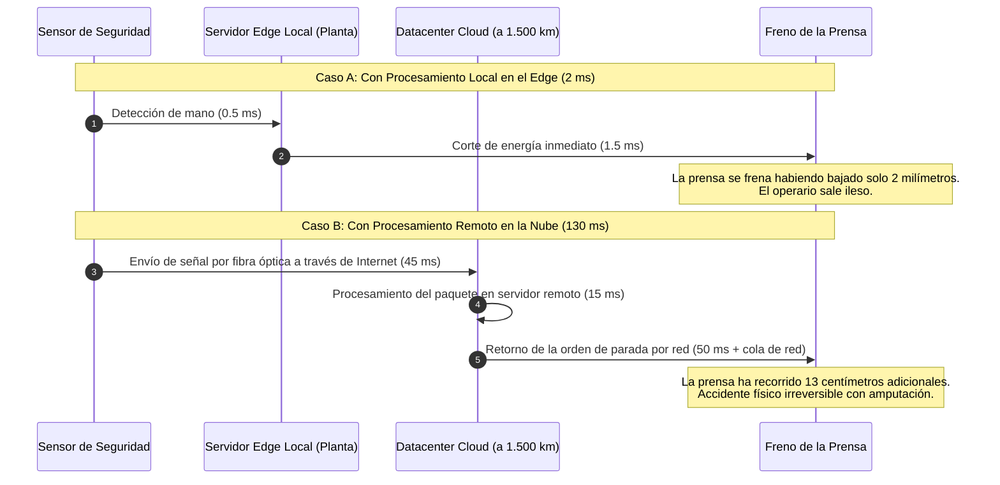
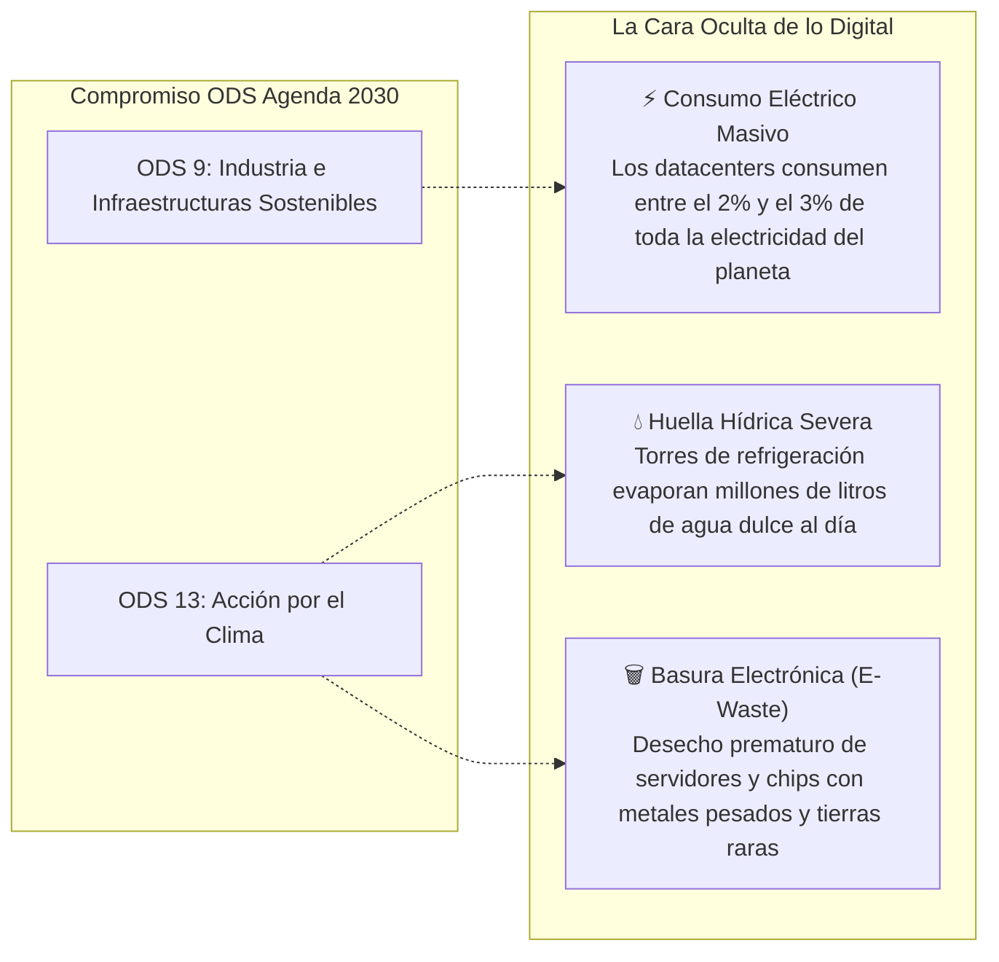
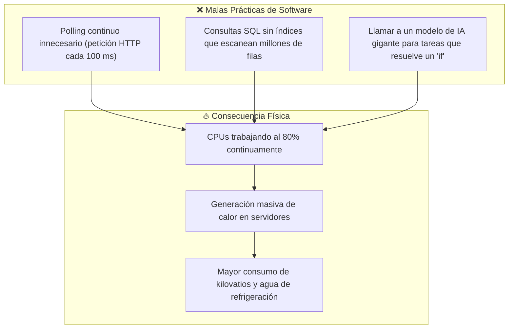

# 1.4 Edge Computing, Cloud y Sostenibilidad

La digitalización de cualquier sector productivo genera miles o millones de datos por segundo. Sin embargo, procesar todos esos datos no es una tarea homogénea: ¿debemos enviarlo todo a la nube o debemos procesarlo justo donde se genera? 

Saber elegir la arquitectura de computación adecuada entre la **Nube (*Cloud*)** y el **Borde (*Edge*)** es una de las decisiones técnicas y económicas más críticas para cualquier profesional del desarrollo y la infraestructura.

---

## 1. ¿Qué es Cloud Computing y qué es Edge Computing?

Para entender estos dos conceptos de forma pedagógica, basta con pensar en **dónde reside el "cerebro"** que toma las decisiones:

- **Cloud Computing (Computación en la Nube):** Consiste en enviar los datos a través de Internet a gigantescos centros de datos remotos (situados a cientos o miles de kilómetros). Allí disponemos de una capacidad de cálculo y almacenamiento prácticamente infinita.
- **Edge Computing (Computación en el Extremo o Borde):** Consiste en colocar la capacidad de procesamiento informático físicamente cerca de donde se generan los datos: en la propia máquina, en el sensor inteligente o en un microordenador industrial situado en el armario eléctrico de la fábrica.

---

### La Analogía del Cuerpo Humano: El Reflejo vs. La Reflexión

Imagina lo que hace tu cuerpo cuando tocas por descuido una sartén al fuego a 200 °C:

- **Tu arco reflejo espinal (Edge Computing):** Los nervios de tu mano no envían la señal hasta la corteza cerebral para que medites durante dos segundos si te conviene soltar la sartén. La médula espinal (en el "borde" de tu sistema nervioso) procesa la señal en milisegundos y ordena a los músculos de tu brazo retirar la mano de inmediato para evitar quemaduras graves.

- **Tu cerebro consciente (Cloud Computing):** Minutos después, cuando ya estás a salvo, tu cerebro analiza calmadamente lo sucedido, reflexiona sobre por qué te distrajiste y decide que la próxima vez usarás una manopla aislante.

---

### Tabla Comparativa Principal

| Parámetro | Edge Computing (En el Extremo) | Cloud Computing (En la Nube) |
| :--- | :--- | :--- |
| **¿Dónde se procesa?** | En el propio dispositivo, máquina o armario de planta. | En centros de datos remotos centralizados. |
| **Tiempo de respuesta (Latencia)** | **Instantáneo y determinista (1 a 10 milisegundos)**. | Variable según la red (50 a 300+ milisegundos). |
| **¿Qué pasa si se cae Internet?** | **Sigue funcionando al 100% de forma autónoma**. | El servicio se detiene por completo al perder conexión. |
| **Consumo de ancho de banda** | Mínimo: procesa en local y solo envía resúmenes o alertas. | Masivo: requiere enviar flujos constantes de datos a la nube. |
| **Potencia de cómputo** | Limitada al chip del dispositivo local. | Prácticamente ilimitada y elástica bajo demanda. |
| **Ejemplo cotidiano** | El reconocimiento facial de tu móvil o el airbag de un coche. | El algoritmo de recomendaciones de YouTube o la previsión del clima. |

---

## 2. Las Tres Preguntas de Oro del Arquitecto Técnico

Para decidir si una funcionalidad de software debe ejecutarse en el Edge o en el Cloud, cualquier equipo de desarrollo debe responder a tres preguntas fundamentales:

---

### Pregunta 1: ¿Qué pasa si se corta la conexión a Internet?
Si una fábrica de automóviles depende de la nube para que un robot aplique el pegamento en el parabrisas y el cable de fibra óptica exterior sufre un corte accidental por obras en la calle, **toda la fábrica de 2.000 trabajadores quedaría paralizada**. 

- Si la tarea es crítica para la supervivencia de la operación, **debe ser Edge** (*modo offline-first*).

### Pregunta 2: ¿Cuánto tiempo puede esperar la respuesta?
La velocidad de la luz a través de cables de fibra óptica tiene un límite físico. Enviar un paquete de datos desde una fábrica en Valencia hasta un centro de datos en Irlanda o Fráncfort y recibir la respuesta de vuelta tarda entre 40 y 100 milisegundos en condiciones óptimas.

- Si una cuchilla industrial corta a 2 metros por segundo, 100 milisegundos de retardo significan 20 centímetros de error. **Debe ser Edge.**

### Pregunta 3: ¿Cuánto cuesta enviar los datos por la red?
Imagina una planta con 20 cámaras de visión artificial de alta definición grabando a 60 fotogramas por segundo. Transmitir ese vídeo continuo a la nube saturaría por completo la conexión y supondría miles de euros mensuales en cuotas de transferencia de datos.

- **La solución inteligente:** La cámara procesa el vídeo en local mediante un modelo de visión artificial ligero (Edge). Si detecta que una pieza está rota, envía a la nube un único paquete de datos en formato JSON de apenas 2 kilobytes con la alerta y la foto de la anomalía.

---

## 3. Ejemplo Real de Cálculo: ¿Por qué la latencia de la nube puede ser fatal?

Imagina una prensa hidráulica que estampa planchas de acero descendiendo a una velocidad de **1 metro por segundo**. Una barrera óptica detecta que la mano de un operario ha rebasado por error la zona de peligro y está a solo **10 centímetros** del punto de impacto:

!!! danger "Principio de Arquitectura Indiscutible"
    Las funciones de **seguridad física, protección de personas y control en tiempo real estricto jamás se delegan a la nube**. Pertenecen exclusivamente al **Edge Computing**.

---

## 4. Tecnología Verde (*Green IT*) y Sostenibilidad

A menudo la digitalización se promociona como un fenómeno completamente "limpio e inmaterial" bajo el argumento de que elimina el papel y los archivadores físicos. Sin embargo, la infraestructura que sostiene el mundo digital tiene una **huella ecológica colosal**.

---

### La Huella Hídrica y Energética de la Nube

Para que millones de servidores funcionen 24 horas al día sin fundirse por el calor acumulado en los racks, los centros de datos requieren sistemas gigantescos de refrigeración:

- **Consumo de agua potable:** Muchos centros de datos utilizan sistemas de refrigeración evaporativa. Un gran centro de datos puede evaporar entre **1 y 4 millones de litros de agua al día**, compitiendo directamente por el agua dulce con cultivos agrícolas y poblaciones locales en épocas de sequía.
- **La paradoja de la Inteligencia Artificial:** Entrenar un único modelo de lenguaje grande (LLM) de vanguardia consume la misma electricidad que cientos de hogares durante todo un año. Incluso una simple consulta generativa compleja consume significativamente más energía que una búsqueda indexada clásica en un motor tradicional.

---

## 5. El Papel del Desarrollador: ¿Cómo impacta tu código en el planeta?

Existe la creencia errónea de que la sostenibilidad tecnológica solo compete a los ingenieros eléctricos que diseñan placas solares. En realidad, **las decisiones de diseño de software y arquitectura tienen un impacto medioambiental directo**:

---

### Tres Principios de Green IT para Estudiantes de Grado Superior

- **1. Arquitectura orientada a eventos en vez de sondeo (*polling*):**
  En lugar de programar una aplicación cliente que pregunte al servidor 10 veces por segundo *"¿hay datos nuevos?"* (manteniendo despierta la CPU del servidor y la antena 5G del móvil), utiliza conexiones por eventos (como WebSockets o notificaciones Push), donde el servidor solo emite datos cuando realmente ocurre un cambio.

- **2. Optimización y contención algorítmica:**
  Un algoritmo ineficiente ejecutado una vez no tiene impacto apreciable. Pero un microservicio mal optimizado ejecutándose millones de veces al día en la nube obliga a encender más instancias de servidores, multiplicando la huella de carbono y el coste económico de la empresa.

- **3. Reutilización y ciclo de vida del hardware:**
  La fabricación de un ordenador o servidor consume mucha más energía y recursos minerales escasos que su uso diario. Antes de desechar un equipo informático a los 3 años por política corporativa, la estrategia de *Green IT* promueve ampliar la memoria RAM, sustituir discos duros por SSD y reutilizar máquinas antiguas como cortafuegos perimetrales o nodos locales de Edge Computing.
