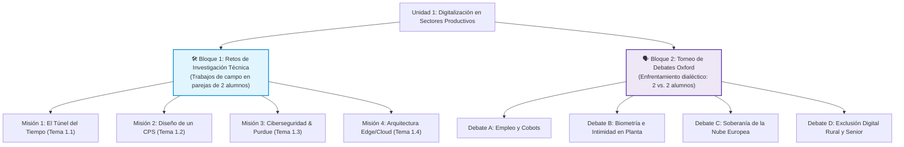

# 1.5 Actividades Prácticas, Retos de Investigación y Debates

La digitalización no se aprende únicamente memorizando conceptos teóricos; se consolida **analizando problemas reales, investigando soluciones técnicas viables y defendiendo decisiones de diseño con rigor y datos contrastados**.

En esta sección se presentan dos bloques de trabajo colaborativo para desarrollar en el aula en **parejas (máximo 2 alumnos por grupo)**:

- **Bloque 1: Misiones de Investigación Técnica Aplicada** (una por cada tema de la unidad, para investigar y presentar).
- **Bloque 2: Torneo de Debates Oxford** (enfrentamiento dialéctico formal entre dos parejas sobre dilemas ético-tecnológicos).

---

## 🛠️ Bloque 1: Misiones de Investigación Técnica (Parejas)

Cada pareja de trabajo seleccionará o recibirá asignada **una misión de investigación**. El objetivo no es redactar un resumen teórico, sino resolver un problema técnico real y defender la solución mediante un informe breve o presentación de 5 minutos.

---

### Misión 1 (Tema 1.1): "El Túnel del Tiempo Industrial"

- **El Desafío:** Elegir un sector productivo tradicional (por ejemplo: *fabricación de calzado, panadería/harinera, almazara de aceite de oliva, bodega de vino, carpintería/muebles o transporte de mercancías*) y reconstruir cómo se ha transformado a lo largo de las **5 revoluciones industriales**.
- **Líneas de investigación para la pareja:**
  - ¿Qué fuente de energía y herramientas mecánicas se usaban en la **1ª Revolución**? ¿Qué riesgos físicos sufrían los obreros?
  - ¿Cómo introdujo la **2ª Revolución** la electrificación y la producción en cadena? ¿Cómo cambió el precio final del producto?
  - ¿Cuándo entraron los primeros autómatas (PLCs) y la informática básica en la **3ª Revolución**?
  - ¿Cómo opera la **4ª Revolución** con sensores IoT, telemetría y software en tiempo real?
  - ¿Qué aporta la **Industria 5.0** en este sector respecto a economía circular, bienestar del trabajador y personalización sostenible?
- **Entregable:** Línea temporal visual (infografía o póster técnico) que compare el sector en las 5 eras.

??? example "📖 Caso de Ejemplo Guiado: La Fabricación de Cerveza a lo largo de las 5 Revoluciones"
    Para que os sirva de guía, así se estructuraría la evolución histórica en el **sector cervecero**:
    
    - **Industria 1.0 (Vapor y Carbón):** Grandes calderas alimentadas con carbón para hervir el mosto. El trasvase de líquido entre cubas de madera se realizaba a mano con cubos o bombas de vapor rudimentarias. Riesgos constantes de quemaduras severas, jornadas de 14 horas y cero control sobre las bacterias del fermento (muchos lotes se agriaban).
    - **Industria 2.0 (Electricidad y Pasteurización):** Pasteurizadores continuos y cintas transportadoras accionadas por motores eléctricos para el llenado y taponado en serie de botellas de vidrio. Aparece la refrigeración eléctrica industrial, permitiendo elaborar cerveza en verano sin que el calor estropee la levadura.
    - **Industria 3.0 (PLCs y Control Digital):** Instalación de autómatas programables (PLCs) en los tanques de maceración. El maestro cervecero programa curvas de temperatura exactas mediante recetas electrónicas. Se digitaliza la gestión del almacén mediante terminales de oficina y bases de datos.
    - **Industria 4.0 (CPS, IIoT y Visión Artificial):** Tanques inteligentes con sensores IoT inalámbricos que miden la densidad, el pH y la presión de fermentación cada 30 segundos, enviando alertas si la levadura se desvía. Línea de embotellado con visión artificial a 60.000 botellas/hora que detecta microfisuras o defectos en el tapón corona.
    - **Industria 5.0 (Sostenibilidad y Factor Humano):** Reutilización del bagazo (cereal sobrante de la cocción) para generar biogás que alimenta la caldera o harinas alimentarias ricas en fibra (economía circular). Brazos cobot que asisten al operario en el paletizado pesado para prevenir lesiones de espalda, reservando al maestro cervecero la cata sensorial y el diseño de recetas artesanas.

---

### Misión 2 (Tema 1.2): "Transformando una Fábrica Tradicional en un CPS Inteligente"

- **El Desafío:** Identificar una máquina o proceso tradicional que funcione de manera "ciega" o manual (ej. un secadero de jamones, un invernadero, una máquina de inyección de plástico o un horno de panadería) y diseñar su transformación completa en un **Sistema Ciberfísico (CPS)**.
- **Líneas de investigación para la pareja:**
  - **1. Capa Física (Sentir):** ¿Qué magnitudes físicas causan mermas o averías? ¿Qué sensores concretos se deben instalar para monitorizarlas en tiempo real?
  - **2. Capa Ciber (Pensar):** ¿Qué algoritmo o software procesará las lecturas? ¿Qué decisiones debe tomar el sistema de forma autónoma sin esperar a que un operario pulse un botón?
  - **3. Capa Actuadora (Actuar):** ¿Qué componentes físicos ejecutarán la acción correctora (electroválvulas, pistones, motores, frenos)?
  - **4. Tecnología Habilitadora Complementaria:** Justificar la integración de al menos una tecnología del tema: *¿Cobot colaborativo, Gemelo Digital, Visión por Computador o Fabricación Aditiva?*
- **Entregable:** Diagrama de bloques del bucle cerrado (Mermaid) y justificación económica del ahorro de mermas y tiempo.

??? example "📖 Caso de Ejemplo Guiado: CPS en una Bodega de Crianza de Vino"
    - **Proceso Físico Crítico:** Crianza de vino en 2.000 barricas de roble durante 18 meses.
    - **El Problema Tradicional:** Si la temperatura sube de 16 °C o la humedad baja del 65%, el vino se evapora a través de la madera (mermas del 10% del volumen) o prolifera la bacteria *Acetobacter*, avinagrando barricas enteras de alto valor económico.
    - **Arquitectura del CPS Diseñado:**
      - *Sensores (Sentir):* Tapones inteligentes en las barricas con sensores IoT inalámbricos de nivel, temperatura interna del líquido y humedad ambiental de la nave.
      - *Capa Ciber (Pensar):* Un microordenador industrial recoge las lecturas cada 5 minutos. Si la humedad de una sala cae al 60%, el software calcula el déficit de vapor de agua y activa la nebulización antes de que la madera se reseque. Además, un gemelo digital predice la fecha exacta de embotellado según la tasa de microoxigenación.
      - *Actuadores (Actuar):* Humidificadores ultrasónicos que expulsan microgotas de agua fría y compuertas motorizadas de ventilación bioclimática nocturna.
      - *Tecnología Complementaria:* Cámara de **visión artificial** en la línea de embotellado para verificar que no haya impurezas en el vidrio y que la etiqueta esté milimétricamente alineada.

---

### Misión 3 (Tema 1.3): "Auditoría Forense de un Ciberataque Industrial y Blindaje con Modelo Purdue"

- **El Desafío:** Analizar un incidente real documentado donde la convergencia IT/OT falló (ej. *el ciberataque Colonial Pipeline en 2021, el intento de envenenamiento de la planta potabilizadora de Oldsmar en 2021, o el ransomware al Hospital Clínic de Barcelona en 2023*) y diseñar la arquitectura blindada que lo hubiera evitado.
- **Líneas de investigación para la pareja:**
  - ¿Cuál fue el **vector de ataque inicial**? (¿phishing a un oficinista, contraseña filtrada sin MFA, memoria USB infectada?).
  - ¿Cómo logró el malware saltar de la red corporativa de oficina (IT) a la red de producción física (OT)?
  - ¿Qué nivel del **Modelo Purdue** falló o brillaba por su ausencia?
  - ¿Qué sanciones y responsabilidades directas exigiría hoy la directiva europea **NIS2** a los directivos de esa empresa por negligencia?
- **Entregable:** Diagrama de red "Antes (vulnerable) vs. Después (blindada con DMZ y Modelo Purdue)" y decálogo de medidas de seguridad obligatorias.

??? example "📖 Caso de Ejemplo Guiado: El Ciberataque a la Planta de Agua Potable de Oldsmar (Florida)"
    - **¿Qué ocurrió en la realidad?** En febrero de 2021, un atacante remoto tomó el control del ordenador del operador de la planta de tratamiento de aguas de Oldsmar utilizando el software de acceso remoto **TeamViewer**. El atacante movió el ratón en la pantalla y modificó los parámetros del autómata que dosifica el hidróxido de sodio (sosa cáustica) en el agua potable, subiéndolo de 100 partes por millón (ppm) a un nivel altamente tóxico y corrosivo de 11.100 ppm. Por suerte, un operador humano presente en la sala vio el cursor moverse solo y canceló la orden manualmente.
    - **Errores Gravísimos de Arquitectura Detectados:**
      - No existía segmentación de red: el PC con TeamViewer tenía conexión directa tanto a Internet como a los autómatas (PLCs) de dosificación química (violación total del Modelo Purdue).
      - Todos los técnicos compartían la misma contraseña de acceso remoto, sin autenticación multifactor (MFA).
      - El sistema operativo del puesto de control era Windows 7 sin soporte de parches desde hacía años.
    - **Blindaje Propuesto por los Alumnos:**
      - *Segmentación Purdue:* Situar los PLCs de dosificación química en el Nivel 1, aislados de cualquier conexión directa a Internet.
      - *DMZ Industrial (Nivel 3.5):* Prohibir software de escritorio remoto comercial como TeamViewer. Obligar a que cualquier acceso técnico externo pase por una VPN industrial con cortafuegos de inspección profunda y servidor intermedio (*Jump Server*).
      - *Autenticación:* Implantar llaves físicas criptográficas (FIDO2) para autorizar cambios en las recetas de dosificación.
      - *Seguridad Física redundante:* Instalar un interruptor limitador mecánico/hardware en la bomba dosificadora que impida físicamente bombear más de 150 ppm de sosa cáustica, de modo que ni siquiera un software manipulado pueda provocar envenenamiento.

---

### Misión 4 (Tema 1.4): "Arquitectura Edge vs. Cloud y Auditoría de Sostenibilidad Green IT"

- **El Desafío:** Diseñar la arquitectura técnica de procesamiento para una empresa de servicios o manufactura (ej. una flota de 100 carretillas autónomas en un gran almacén logístico, o una red de 500 sensores de vibración y vídeo en una refinería).
- **Líneas de investigación para la pareja:**
  - Aplicar las **Tres Preguntas de Oro** para decidir componente a componente qué tareas se ejecutan en el **Edge** (local) y qué tareas van al **Cloud** (nube).
  - **Cálculo de ingeniería de datos:** Estimar matemáticamente el volumen de datos si enviaran el vídeo/telemetría continua a la nube frente a procesar en local y enviar solo alertas. ¿Qué ahorro supone en ancho de banda y latencia?
  - **Propuesta de Green IT para los programadores:** Redactar 3 directrices de buenas prácticas de software (evitar *polling*, compresión, arquitecturas reactivas) y de ciclo de vida del hardware para mitigar el consumo energético y la huella hídrica de los centros de datos.
- **Entregable:** Matriz comparativa de asignación arquitectónica (Edge vs. Cloud) y decálogo de software verde.

??? example "📖 Caso de Ejemplo Guiado: Flota de Drones Autónomos para Inspección Solar"
    - **Escenario:** Una planta solar fotovoltaica en el desierto con 80.000 paneles solares. Una flota de 5 drones recorre los campos para detectar celdas solares rotas o sobrecalentadas mediante cámaras térmicas e infrarrojas.
    - **Decisión Arquitectónica (Las Tres Preguntas de Oro):**
      - *¿Qué se ejecuta en el Edge (en el procesador a bordo del dron)?:*
        - La navegación autónoma, la evasión de colisiones contra postes y el control de vuelo (< 5 ms). No puede esperar a que una orden viaje por 5G a un servidor en Fráncfort; el dron se estrellaría.
        - Detección de anomalías térmicas: un modelo ligero de visión artificial procesa el vídeo térmico fotograma a fotograma en el dron. Si detecta un punto caliente (*hotspot* a más de 70 °C), anota la hora y las coordenadas GPS exactas del panel.
      - *¿Qué se envía al Cloud (en la nube)?:*
        - El dron **no envía 200 GB de vídeo 4K continuo** por 5G (ahorro masivo de ancho de banda y batería de vuelo).
        - Solo transmite al finalizar cada vuelo un paquete de datos JSON ligero de 150 Kilobytes con las 20 anomalías encontradas y una foto fija comprimida de cada panel roto.
        - En la nube se aloja el histórico anual de degradación y el algoritmo que planifica la ruta óptima del equipo de mantenimiento en furgoneta.
    - **Compromiso Green IT:**
      - *Reducción de huella de carbono:* Al no transmitir vídeo continuo ni alimentar servidores Cloud procesando terabytes de datos vacíos, se ahorran megavatios-hora de computación y litros de agua de refrigeración en el datacenter.
      - *Reutilización modular:* Si la cámara térmica se vuelve obsoleta, se actualiza solo el sensor del dron sin desechar el chasis ni los motores.

---

## 🗣️ Bloque 2: Torneo de Debates Oxford (2 vs. 2)

El debate formal exige a los técnicos defender con solvencia sus posturas, refutar con datos y someter las soluciones tecnológicas a escrutinio ético y económico.

### Dinámica de la Sesión de Debate

Se enfrentan **dos parejas de alumnos (4 personas en total)** por cada moción. Una pareja defiende la postura **A Favor** y la otra **En Contra**.

```mermaid
gantt
    title Estructura del Debate Oxford en el Aula (Tiempo Estricto por Reloj)
    dateFormat mm
    axisFormat %M min

    section Apertura
    Intervención de Apertura - Pareja A Favor   : 00, 03m
    Intervención de Apertura - Pareja En Contra : 03, 03m
    section Refutación
    Preguntas cruzadas y refutación dialéctica  : 06, 06m
    section Conclusiones
    Alegato Final - Pareja En Contra            : 12, 02m
    Alegato Final - Pareja A Favor              : 14, 02m
    section Veredicto
    Evaluación y Conclusión Individual          : 16, 04m
```

---

### Moción 1 (Temas 1.1 y 1.2): Cobots y el Futuro del Empleo Técnico

> **Moción:** *"La automatización extrema, los sistemas ciberfísicos y los cobots destruirán de forma neta más puestos de trabajo de los que crearán en los sectores productivos españoles durante la próxima década."*

- **Pistas de investigación para la Pareja A Favor (Defiende la destrucción neta de empleo):**
  - ¿Qué ocurre con los operarios de montaje repetitivo cuando un cobot realiza el atornillado o paletizado sin descanso ni salario?
  - Investigar la paradoja de la recualificación (*reskilling*): ¿puede un operario de 52 años reconvertirse fácilmente a programador de robótica o analista de datos?
  - ¿Cómo afecta la concentración de los beneficios de la automatización en los dueños del capital tecnológico frente a los trabajadores asalariados?

- **Pistas de investigación para la Pareja En Contra (Defiende la creación de empleo y bienestar):**
  - ¿Qué nuevas profesiones e industrias auxiliares surgen alrededor del mantenimiento, integración, seguridad y programación de cobots?
  - Investigar la ventaja competitiva: si una fábrica española no automatiza y sus costes son altos, ¿acabará cerrando por deslocalización a países más baratos, destruyendo el 100% de los empleos?
  - ¿Cómo mejoran los cobots la salud laboral de los operarios al eliminar lesiones musculoesqueléticas graves y accidentes en entornos tóxicos?

- **Vocabulario técnico obligatorio en el debate:** *Cobot, par articular, retorno de inversión (ROI), ergonomía, Industria 5.0, deslocalización.*

---

### Moción 2 (Tema 1.3): Monitorización Biométrico-Corporal en Planta

> **Moción:** *"Las empresas industriales y logísticas tienen derecho a obligar a sus operarios de planta a portar pulseras IoT con telemetría biométrica continua (frecuencia cardíaca, temperatura corporal y geolocalización) bajo el argumento de la prevención de riesgos y la seguridad física (Safety)."*

- **Pistas de investigación para la Pareja A Favor (Defiende la monitorización por seguridad):**
  - ¿Cómo puede una pulsera inteligente salvar la vida de un trabajador que sufre un golpe de calor en un invernadero o un desmayo en un silo aislado (*man-down detection*)?
  - Investigar la reducción de accidentes graves cuando el sistema impide que un brazo robótico arranque si detecta que el operario está fatigado o demasiado cerca.
  - ¿Tiene la empresa la obligación legal de emplear todos los medios tecnológicos disponibles para evitar muertes en el trabajo?

- **Pistas de investigación para la Pareja En Contra (Defiende la intimidad y los derechos laborales):**
  - ¿Dónde está el límite entre la seguridad física (*Safety*) y el control invasivo del rendimiento laboral (saber cuántas veces va el trabajador al aseo o cuánto descansa)?
  - ¿Qué ocurre con los datos médicos según el **RGPD europeo**? Si una base de datos con las pulsaciones de los trabajadores sufre una brecha, ¿qué consecuencias tiene para su intimidad?
  - ¿Cómo repercute en la salud mental y los niveles de estrés laboral saberse monitorizado biológicamente segundo a segundo por un software?

- **Vocabulario técnico obligatorio en el debate:** *Safety vs. Security, RGPD (datos de categoría especial), telemetría IoT, Modelo Purdue, estrés laboral.*

---

### Moción 3 (Tema 1.4): Soberanía del Dato vs. Dependencia de la Nube Extranjera

> **Moción:** *"La Unión Europea debe prohibir por ley que los servicios esenciales (hospitales, redes de agua, centrales energéticas) y las administraciones públicas alojen sus datos en proveedores de nube de fuera de la UE (como AWS, Microsoft Azure o Google Cloud)."*

- **Pistas de investigación para la Pareja A Favor (Defiende la soberanía europea estricta):**
  - Investigar la ley estadounidense **US CLOUD Act**: ¿permite a un juez o agencia de EE.UU. exigir los datos de un hospital europeo solo porque el servidor es de una empresa norteamericana?
  - ¿Qué ocurriría si un conflicto geopolítico o una guerra comercial lleva a una potencia extranjera a bloquear el acceso a la nube a empresas europeas de la noche a la mañana?
  - ¿Es posible crear una industria tecnológica europea competitiva si todo el dinero público se destina a pagar licencias a tres multinacionales de Silicon Valley?

- **Pistas de investigación para la Pareja En Contra (Defiende el pragmatismo de mercado):**
  - ¿Tiene Europa la capacidad técnica y financiera para construir hoy una nube tan segura, resiliente y avanzada como AWS o Azure sin gastar miles de millones de dinero público?
  - Si obligamos a un hospital a usar servidores locales menos protegidos, ¿aumenta el riesgo de que sufran ciberataques devastadores por falta de presupuesto frente a datacenters globales de máxima seguridad?
  - Investigar iniciativas europeas como **Gaia-X**: ¿han logrado ofrecer servicios comerciales reales o se han quedado en proyectos burocráticos sin tracción?

- **Vocabulario técnico obligatorio en el debate:** *US CLOUD Act, soberanía digital, disponibilidad 99.999%, Gaia-X, hiperescalador, cifrado de extremo a extremo.*

---

### Moción 4 (Temas 1.1 y 1.4): La Digitalización Forzosa de Servicios Esenciales

> **Moción:** *"La eliminación masiva de ventanillas físicas en la banca y la administración pública en favor de canales exclusivamente telemáticos constituye una discriminación inaceptable que vulnera los derechos de las personas mayores y la población rural."*

- **Pistas de investigación para la Pareja A Favor (Defiende el derecho a la atención humana presencial):**
  - Investigar el movimiento social *"Soy mayor, no idiota"* impulsado por Carlos San Juan en 2022 y sus conclusiones sobre la exclusión financiera.
  - ¿Qué barreras cognitivas y motoras reales sufren las personas de edad avanzada ante pantallas táctiles, códigos SMS de caducidad en 30 segundos y certificados digitales complejos?
  - En la llamada *"España vaciada"*, ¿qué ocurre cuando cierran la última sucursal bancaria en 30 km a la redonda y no hay transporte público regular?

- **Pistas de investigación para la Pareja En Contra (Defiende la modernización digital obligatoria):**
  - ¿Puede una sociedad con pirámide demográfica invertida sostener el coste económico de mantener miles de oficinas físicas abiertas con personal dedicado a tareas que un servidor resuelve en microsegundos?
  - ¿No es la digitalización la única vía para que un ciudadano de un pueblo remoto pueda realizar trámites a cualquier hora del día sin perder una mañana completa desplazándose a la capital de provincia?
  - ¿La solución real no pasa por educar y alfabetizar digitalmente a la población en lugar de frenar el progreso tecnológico del país?

- **Vocabulario técnico obligatorio en el debate:** *Brecha digital plateada, accesibilidad WCAG, doble factor (MFA), España vaciada, eficiencia del gasto público.*

---

??? example "📖 Caso de Ejemplo Guiado: Cómo Construir un Argumento Técnico Ganador (Método AREI)"
    Para no limitaros a soltar opiniones sin base, los mejores equipos de debate utilizan la estructura **AREI**:
    
    - **1. Afirmación (La tesis en una frase):** *"El cierre de ventanillas bancarias no ahorra dinero a la sociedad, sino que externaliza los costes en los colectivos más vulnerables."*
    - **2. Razonamiento (El porqué lógico):** *"Al eliminar la atención en ventanilla, los trámites no desaparecen; la complejidad técnica de la seguridad bancaria (doble factor, contraseñas temporales) se traslada a personas con pérdida de agudeza visual y destreza motora, obligándolas a depender de familiares o pagar a terceros para cobrar su pensión."*
    - **3. Evidencia / Dato (La prueba técnica o empírica):** *"Según datos del Banco de España, entre 2008 y 2022 se clausuraron más del 50% de las sucursales bancarias del país, dejando a más de 1,4 millones de personas en municipios sin ningún punto de acceso a efectivo físico a menos de 5 kilómetros."*
    - **4. Impacto (La conclusión para el debate):** *"Por tanto, no estamos ante una modernización neutral del servicio, sino ante una barrera de acceso que viola el principio constitucional de no discriminación por edad y lugar de residencia."*

---

## 📝 Conclusión Individual y Reflexión Crítica

Al finalizar cada debate o presentación de misión en clase, **cada alumno y alumna debe entregar individualmente un breve texto reflexivo (15 a 20 líneas)** respondiendo a:

1. *¿Cuál es tu postura personal fundamentada tras haber escuchado los argumentos técnicos de ambas partes?*
2. *¿Qué argumento del bando contrario te ha hecho dudar o te ha parecido más sólido?*
3. *Como futuro profesional de la informática y la tecnología, ¿qué compromiso ético o técnico vas a adoptar en tus futuros diseños de software o sistemas?*

---

## 📊 Rúbrica de Evaluación del Bloque Práctico (Grado Superior)

| Criterio (Peso) | Nivel Excelente (4) | Nivel Notable (3) | Nivel Básico (2) | Nivel Insuficiente (1) |
| :--- | :--- | :--- | :--- | :--- |
| **Rigor técnico y terminología (30%)** | Integra de forma natural y precisa los conceptos del módulo (*CPS, Purdue, Edge, Cobot, NIS2, PUE, etc.*). | Emplea términos técnicos adecuados pero con alguna imprecisión menor. | Vocabulario informal con escasa referencia a la arquitectura técnica. | Confunde o desconoce conceptos elementales del tema. |
| **Investigación y datos contrastados (30%)** | Aporta datos numéricos, normativas vigentes (RGPD, NIS2) o casos reales documentados. | Razonamiento lógico bien estructurado pero con pocos datos concretos de soporte. | Afirmaciones basadas en opiniones personales sin respaldo documental. | Falta de argumentos o información errónea no contrastada. |
| **Trabajo en pareja y réplica (20%)** | Coordinación perfecta en la pareja (50/50 de participación); responde a las objeciones con agudeza y respeto. | Buena coordinación en la pareja; réplica correcta pero sin profundizar en las debilidades del rival. | Uno de los dos miembros monopoliza la exposición; réplicas evasivas. | Descoordinación evidente, interrupciones o falta de respeto dialéctico. |
| **Oratoria, síntesis y tiempo (20%)** | Exposición fluida, asertiva, excelente contacto visual y ajuste milimétrico al reloj asignado. | Buena comunicación oral ajustándose razonablemente al tiempo disponible. | Lectura continuada de notas o diapositivas; ligera desviación del tiempo límite. | Lectura literal monótona o superación desmedida del tiempo estipulado. |
