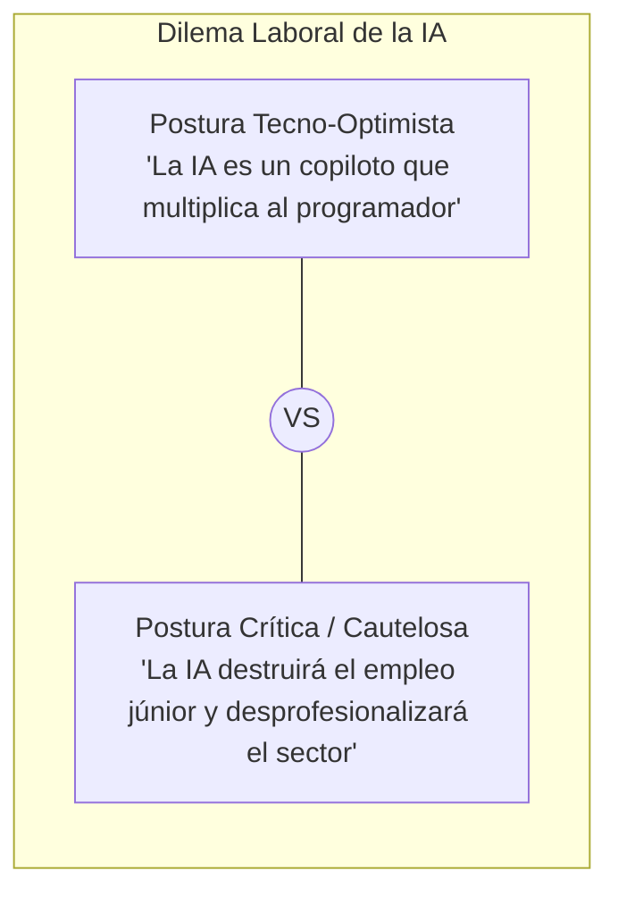
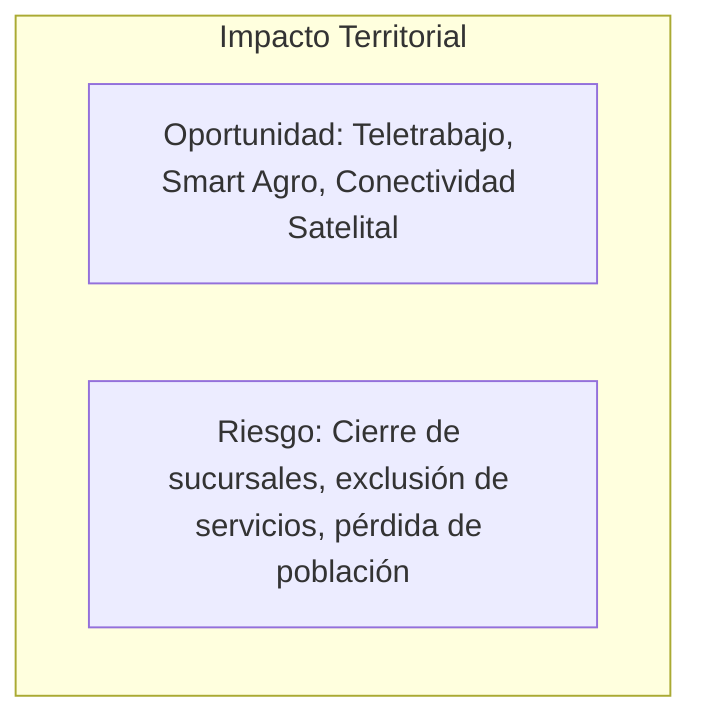
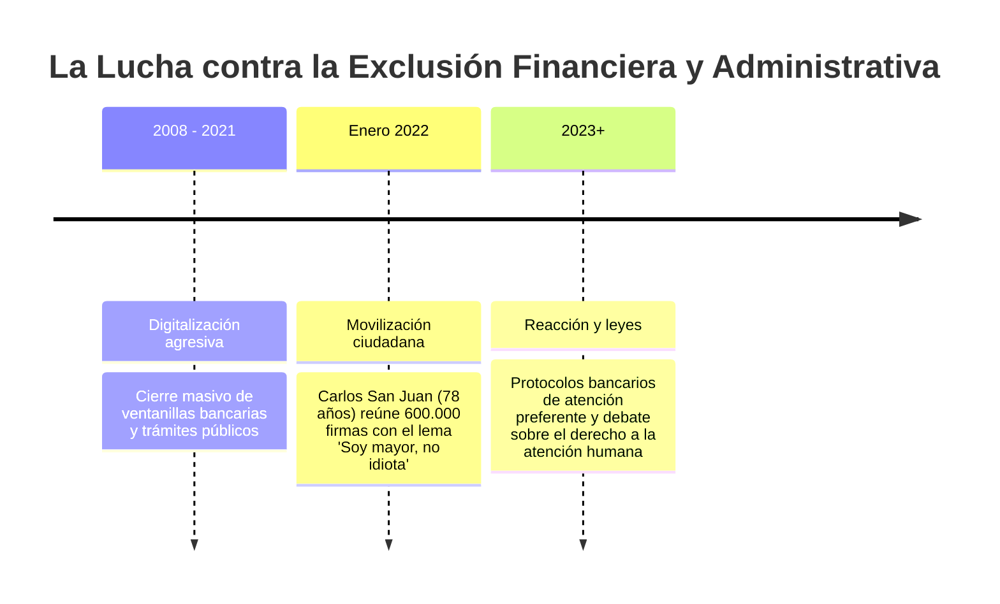
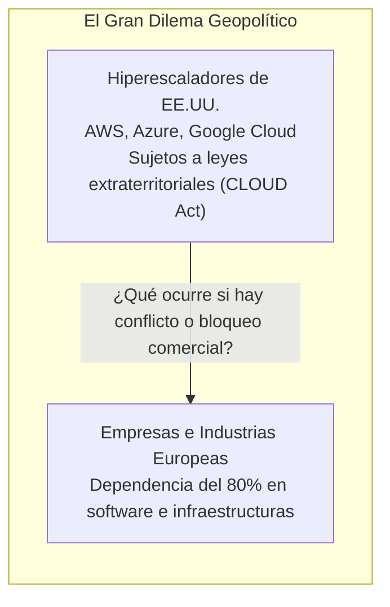
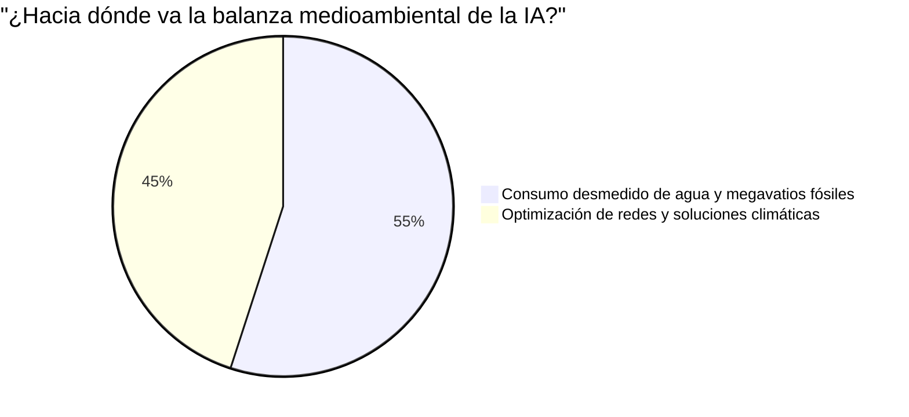

# Taller de Debates y Pensamiento Crítico en Digitalización

> *"La tecnología no es buena ni mala, pero tampoco es neutral."*  
> — **Melvin Kranzberg**, primer historiador de la tecnología.

El alumnado de Formación Profesional de Grado Superior no solo debe dominar la instalación, configuración o desarrollo de sistemas; debe comprender **las consecuencias éticas, laborales, territoriales y humanas** de las soluciones que diseña e implanta en la sociedad.

En este taller se presentan cinco grandes dilemas del mundo contemporáneo estructurados para su debate en el aula, con datos contrastados, posturas enfrentadas y preguntas socráticas para el docente.

---

## Índice de Debates

1. [Debate 1: La Revolución de la IA y el Futuro del Empleo Técnico](#debate-1-la-revolucion-de-la-ia-y-el-futuro-del-empleo-tecnico)
2. [Debate 2: La Digitalización y la "España Vaciada": ¿Salvavidas o Abandono Rural?](#debate-2-la-digitalizacion-y-la-espana-vaciada-salvavidas-o-abandono-rural)
3. [Debate 3: La Brecha Digital Plateada ("Soy mayor, no idiota")](#debate-3-la-brecha-digital-plateada-soy-mayor-no-idiota)
4. [Debate 4: Soberanía del Dato vs. Dependencia de Nubes Extranjeras](#debate-4-soberania-del-dato-vs-dependencia-de-nubes-extranjeras)
5. [Debate 5: La Paradoja Ecológica de la IA y los Centros de Datos](#debate-5-la-paradoja-ecologica-de-la-ia-y-los-centros-de-datos)
6. [Guía Metodológica para el Docente: Dinámica en el Aula y Rúbrica](#guia-metodologica-para-el-docente-dinamica-en-el-aula-y-rubrica)

---

## Debate 1: La Revolución de la IA y el Futuro del Empleo Técnico

### Contexto Real
Con la llegada de herramientas de asistencia basadas en Modelos de Lenguaje (LLMs) como GitHub Copilot, Claude o ChatGPT, escribir código básico, generar pruebas unitarias o redactar consultas SQL se ha vuelto una tarea casi instantánea. Informes de consultoras internacionales pronostican aumentos del 30% al 50% en la productividad de los desarrolladores, pero también una reducción significativa en la contratación de perfiles júnior sin experiencia previa.

---

### Postura A: La IA como Acelerador del Talento (A Favor de la Automatización Extrema)
- **Superación de la rutina:** La IA libera al profesional de escribir código repetitivo (*boilerplate*), permitiéndole concentrarse en la arquitectura de alto nivel, la seguridad y el valor de negocio.
- **Democratización de la tecnología:** Permite que pequeños equipos o emprendedores construyan productos de software complejos que antes requerían departamentos enteros.
- **Evolución profesional natural:** Igual que los compiladores no acabaron con los informáticos que programaban en ensamblador, la IA generativa elevará el nivel de abstracción y creará nuevos roles de mayor valor.

---

### Postura B: Destrucción de la Escalera de Entrada y Desprofesionalización (Crítica)
- **Eliminación del escalón júnior:** Si una IA genera el código que tradicionalmente hacían los recién graduados de FP, ¿dónde y cómo adquirirán la experiencia necesaria para llegar a ser perfiles sénior?
- **La trampa de la ilusión de competencia:** Programar aceptando sugerencias automáticas sin entender a fondo los algoritmos conduce a sistemas frágiles con vulnerabilidades de seguridad ocultas que nadie en la empresa sabe depurar cuando fallan.
- **Presión salarial a la baja:** Si una empresa puede sustituir a un equipo de 5 desarrolladores por 1 único profesional asistido por IA, la consecuencia inmediata en el mercado laboral es la destrucción neta de empleo técnico y la devaluación salarial.

??? question "Preguntas Socráticas para el Debate"
    - Si una IA genera el 80% de una aplicación que luego sufre una brecha de seguridad y filtra datos bancarios de clientes, ¿quién es legal y penalmente responsable: el desarrollador júnior que la validó, la empresa que compró la licencia de la IA o el proveedor del modelo?
    - ¿Qué habilidades estáis aprendiendo en clase hoy que una IA no pueda hacer mejor dentro de dos años?

---

## Debate 2: La Digitalización y la "España Vaciada": ¿Salvavidas o Abandono Rural?

### Contexto Real
En los últimos quince años, España ha cerrado más del **50% de sus oficinas bancarias físicas**, afectando de manera dramática a municipios de menos de 5.000 habitantes. Paralelamente, administraciones públicas, juzgados de paz y centros de salud rurales han suprimido ventanillas físicas exigiendo trámites electrónicos con certificado digital. Por otra parte, la expansión de la fibra óptica y el satélite de órbita baja han facilitado el teletrabajo de perfiles tecnológicos desde el medio rural.

---

### Postura A: La Digitalización como Salvavidas del Medio Rural
- **Atracción de talento:** El teletrabajo permite a ingenieros y programadores fijar su residencia en pueblos, reactivando la economía local, el alquiler y las escuelas rurales.
- **Modernización del sector primario:** La digitalización agrícola (riego telemático, drones, collares IoT para ganado) hace que las explotaciones familiares sean rentables y no dependan de intermediarios abusivos.
- **Acceso universal al conocimiento:** Un joven en una aldea de montaña tiene hoy acceso al mismo contenido educativo, bibliotecas digitales y empleo global que alguien viviendo en el centro de Madrid o Barcelona.

---

### Postura B: La Digitalización como Excusa para el Desmantelamiento y Abandono
- **El espejismo del teletrabajo:** Los teletrabajadores que se mudan al campo son una minoría estadística; no compensan el éxodo constante de jóvenes locales por falta de oportunidades presenciales.
- **Desierto financiero y asistencial:** Obligar a una persona de un pueblo sin autobús de línea a desplazarse 40 km para sacar dinero en efectivo porque "ahora todo va por la app del banco" es una forma de exclusión violenta.
- **Brecha de infraestructura real:** A pesar de los anuncios oficiales, persisten amplias zonas rurales con microcortes de red eléctrica y nula cobertura móvil cuando llueve o nieva, haciendo inviable cualquier proceso industrial digitalizado.

??? question "Preguntas Socráticas para el Debate"
    - ¿Tiene el Estado la obligación legal de garantizar que cualquier trámite público pueda realizarse de forma presencial con un ser humano, o debe ser obligatorio el canal telemático para abaratar costes?
    - Si tuvieras que montar una empresa de digitalización industrial, ¿invertirías en un polígono rural o en la periferia de una gran metrópoli? ¿Por qué?

---

## Debate 3: La Brecha Digital Plateada ("Soy mayor, no idiota")

### Contexto Real
La campaña iniciada en 2022 por el médico jubilado Carlos San Juan puso en jaque al sistema financiero español. Millones de personas de la tercera edad se vieron incapaces de operar cajeros con interfaces táctiles complejas, bloqueos de apps móviles y citas telemáticas con códigos SMS. La exclusión digital no es un problema de falta de inteligencia, sino de **diseño de software excluyente y ausencia de empatía de las organizaciones**.

---

### Postura A: La Sostenibilidad del Sistema Exige Digitalización Obligatoria
- **Eficiencia del gasto público y privado:** Mantener plantillas enteras atendiendo en ventanilla operaciones que un servidor procesa en microsegundos es insostenible económicamente para una sociedad envejecida con tensiones presupuestarias en pensiones y sanidad.
- **Tiempo y comodidad:** Para la mayoría de la población, gestionar trámites a las 23:00 desde el sofá sin hacer colas de dos horas al frío es un avance incuestionable.
- **Responsabilidad formativa:** En lugar de frenar la tecnología, el camino es financiar programas masivos de alfabetización digital para que los mayores aprendan a utilizar herramientas táctiles y asistentes de voz.

---

### Postura B: La Tiranía del Trámite Digital como Violación de Derechos Fundamentales
- **El cliente y el ciudadano hacen el trabajo gratis:** La digitalización forzosa no busca comodidad ciudadana, sino trasladar el trabajo de los empleados de banca o administración a los hombros del usuario para recortar costes laborales.
- **Brecha cognitiva y accesibilidad desatendida:** El envejecimiento conlleva deterioro visual, pérdida de destreza motora fina y dificultades de memoria. Exigir autenticaciones de doble factor complejas con caducidad en 30 segundos genera ansiedad, pánico y dependencia absoluta de terceros.
- **Pérdida de intimidad y dignidad:** Ancianos que se ven forzados a revelar sus números secretos bancarios o contraseñas médicas a vecinos o familiares porque el sistema no les permite interactuar con un ser humano en ventanilla.

??? question "Preguntas Socráticas para el Debate"
    - Al diseñar una interfaz web o móvil, ¿qué criterios de accesibilidad (WCAG) deberíamos aplicar obligatoriamente para no discriminar a colectivos de edad avanzada?
    - ¿Debería considerarse un delito de discriminación institucional denegar una cita médica a quien no sepa usar una aplicación móvil?

---

## Debate 4: Soberanía del Dato vs. Dependencia de Nubes Extranjeras

### Contexto y Puntos de Conflicto:
- La inmensa mayoría de las empresas europeas almacenan sus datos industriales, historiales médicos y bases de clientes en servidores de tres multinacionales estadounidenses.
- La ley **US CLOUD Act** permite a agencias federales estadounidenses acceder a datos custodiados por empresas de su país, incluso si los servidores físicos residen en Europa.
- **Pregunta para debatir:** ¿Es viable y realista construir una "Nube Soberana Europea" (iniciativas como Gaia-X), o Europa ya ha perdido irremediablemente la batalla de la infraestructura digital frente a Estados Unidos y China?

---

## Debate 5: La Paradoja Ecológica de la IA y los Centros de Datos

### Contexto y Puntos de Conflicto:
- Las tecnológicas anuncian que la IA "diseñará nuevos materiales para baterías y optimizará la red eléctrica".
- Al mismo tiempo, la demanda energética de los centros de datos dedicados a IA está retrasando el cierre de centrales de carbón y gas en países desarrollados y secando acuíferos locales para refrigeración por evaporación.
- **Pregunta para debatir:** ¿Tiene sentido moral gastar 500 ml de agua potable y la energía de una bombilla encendida durante 20 minutos para que un usuario le pida a una IA que dibuje a un gato con sombrero o redacte un correo superficial?

---

## Guía Metodológica para el Docente: Dinámica en el Aula y Rúbrica

Para transformar estos temas en una experiencia pedagógica inolvidable en el aula de Grado Superior, se recomienda aplicar el formato de **Debate Oxford Estructurado**.

### Estructura de la Sesión (55 - 60 minutos)

```mermaid
gantt
    title Cronograma de la Dinámica de Debate en el Aula
    dateFormat mm
    axisFormat %M min

    section Preparación
    Asignación de roles y sorteo postura : 00, 10m
    section Debate
    Turno de Apertura (Equipo A y B)       : 10, 10m
    Refutación Cruzada y Argumentos        : 20, 15m
    Turno de Preguntas del Público / Moderador : 35, 10m
    Conclusiones Finales (Equipo A y B)    : 45, 06m
    section Cierre
    Veredicto y Retroalimentación Docente  : 51, 09m
```

### Reglas Clave:
1. **Asignación aleatoria de postura:** A los grupos no se les permite elegir su posición; se sortea minutos antes de debatir. Esto les obliga a empatizar y preparar argumentos incluso contrarios a su opinión personal.
2. **Prohibido el argumento sin datos:** Cualquier afirmación debe apoyarse en datos técnicos, normativos (RGPD, NIS2, ODS) o ejemplos reales documentados.

---

### Rúbrica de Evaluación de la Competencia Crítica (Grado Superior)

| Criterio (Peso) | Nivel Excelente (4) | Nivel Notable (3) | Nivel Básico (2) | Nivel Insuficiente (1) |
| :--- | :--- | :--- | :--- | :--- |
| **Rigor técnico y terminología (30%)** | Emplea con solvencia términos como latencia, OT/IT, RBAC, CPS, PUE o soberanía digital. | Usa términos técnicos adecuados pero con alguna imprecisión conceptual menor. | Vocabulario coloquial con escasa referencia a la arquitectura tecnológica. | Confunde conceptos técnicos elementales del módulo. |
| **Capacidad de argumentación y datos (30%)** | Respalda cada tesis con ejemplos de la industria, normativas europeas o métricas reales. | Aporta argumentos lógicos bien hilados aunque con pocos datos concretos. | Repite opiniones personales sin respaldo documental o empírico. | Falta de argumentos coherentes o desvío del tema. |
| **Escucha activa y réplica (20%)** | Desmonta las premisas del equipo rival rebatiendo sus datos con respeto y agudeza. | Responde a los puntos del adversario sin profundizar en sus debilidades. | Ignora los argumentos rivales y se limita a soltar su guion prefabricado. | Interrupciones, lenguaje irrespetuoso o actitud pasiva. |
| **Oratoria, síntesis y tiempo (20%)** | Tono profesional, contacto visual, lenguaje corporal asertivo y ajuste milimétrico al reloj. | Buena exposición oral ajustándose al tiempo límite asignado. | Dificultad para resumir ideas o ligera desviación del tiempo límite. | Lectura literal de notas, tono monótono o sobrepasar el tiempo ampliamente. |
