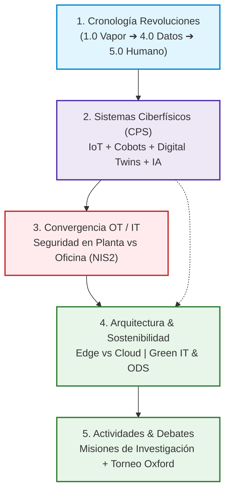

# Unidad 1: Digitalización de los Sectores Productivos

## Visión General y Justificación

La **Unidad 1** establece las bases teóricas, técnicas y reflexivas de la transformación digital contemporánea. Lejos de ser un fenómeno exclusivamente informático, la digitalización representa una convergencia profunda entre el mundo físico de la producción y el mundo digital del procesamiento masivo de datos y la inteligencia algorítmica.

Para un futuro técnico o técnica de Grado Superior, comprender estos conceptos no se limita a conocer el vocabulario de moda (*buzzwords*), sino a desarrollar criterio arquitectónico: saber cuándo aplicar computación en el borde (*Edge*) frente a la nube (*Cloud*), comprender los riesgos de exponer un autómata de planta a Internet, o evaluar el impacto ético y social de implantar sistemas automatizados en comunidades vulnerables.

---

## Mapa Conceptual de la Unidad

---

## Objetivos de Aprendizaje

Al finalizar esta unidad, serás capaz de:

- **Diferenciar con precisión las cuatro revoluciones industriales**, identificando sus fuentes de energía, materias primas, medios de transporte y organización del trabajo.
- **Definir el concepto de Industria 5.0**, justificando por qué sitúa el bienestar humano, la resiliencia y la sostenibilidad en el centro de la tecnología.
- **Analizar la arquitectura de un Sistema Ciberfísico (CPS)** y el papel de los robots colaborativos (*cobots*), los sensores inteligentes y los gemelos digitales (*digital twins*).
- **Distinguir los entornos IT (Tecnología de la Información) y OT (Tecnología Operativa)**, contrastando sus prioridades en la tríada de seguridad (Disponibilidad frente a Confidencialidad).
- **Seleccionar justificadamente entre Cloud Computing y Edge Computing** basándose en métricas de latencia, ancho de banda, criticidad de proceso y costes operativos.
- **Identificar las directrices de los Objetivos de Desarrollo Sostenible (ODS 9 y 13)** y el concepto de *Green Computing* para mitigar la huella hídrica y de carbono de la tecnología.
- **Argumentar con datos y pensamiento crítico** en debates sobre la brecha digital en el medio rural ("España vaciada"), la exclusión de personas mayores y la disrupción de la Inteligencia Artificial en el mercado laboral.

---

## Glosario de Términos Esenciales

| Término | Definición Técnica |
| :--- | :--- |
| **CPS (Cyber-Physical Systems)** | Sistemas que integran computación, redes y procesos físicos, donde sensores y actuadores interactúan con bucles de retroalimentación en tiempo real. |
| **Cobot (Robot Colaborativo)** | Brazo o sistema robótico diseñado para interactuar físicamente con humanos en un espacio de trabajo compartido sin barreras perimetrales fijas. |
| **OT (Operational Technology)** | Hardware y software que detecta o causa un cambio a través de la monitorización y control directo de dispositivos físicos, procesos y eventos industriales. |
| **IT (Information Technology)** | Conjunto de tecnologías empleadas para gestionar, procesar, almacenar y comunicar información en entornos empresariales y administrativos. |
| **SCADA** | *Supervisory Control and Data Acquisition*. Sistema de software y hardware que permite a las organizaciones industriales controlar procesos locales o remotos y monitorizar datos de planta. |
| **Digital Twin (Gemelo Digital)** | Réplica virtual exacta de un objeto, máquina o proceso físico alimentada con datos en tiempo real para simulación, análisis y mantenimiento predictivo. |
| **Edge Computing** | Paradigma de computación distribuida que procesa los datos en la periferia de la red, lo más cerca posible del sensor o dispositivo que los genera. |
| **Green IT (Tecnología Verde)** | Prácticas y enfoques destinados a reducir el impacto medioambiental del ciclo de vida de los sistemas de información y centros de datos. |

---

## Contenidos del Tema

Explora cada una de las secciones detalladas de la unidad:

- **[1.1 Cronología de las Revoluciones e Industria 5.0](./01-revoluciones-industriales.md):** De la máquina de vapor a la inteligencia artificial, evolución de competencias duras y blandas.
- **[1.2 Sistemas Ciberfísicos y Tecnologías Disruptivas](./02-sistemas-ciberfisicos-tecnologias.md):** CPS, cobots, IIoT, visión artificial, gemelos digitales e impresión 3D industrial.
- **[1.3 Estructura Organizativa y Convergencia OT/IT](./03-organizacion-convergencia-ot-it.md):** Gobernanza del dato, control de accesos (IAM/2FA), choque cultural entre planta y sistemas, y ciberseguridad industrial (NIS2).
- **[1.4 Edge Computing, Cloud y Sostenibilidad](./04-edge-cloud-sostenibilidad.md):** Decisiones de arquitectura técnica, latencia, ODS 9 y 13, y el coste medioambiental de la IA.
- **[1.5 Actividades Prácticas, Retos de Investigación y Debates](./05-Actividades.md):** Misiones de investigación técnica aplicada en parejas sobre los temas 1.1 al 1.4 y Torneo de Debates Oxford con dilemas éticos y tecnológicos.
