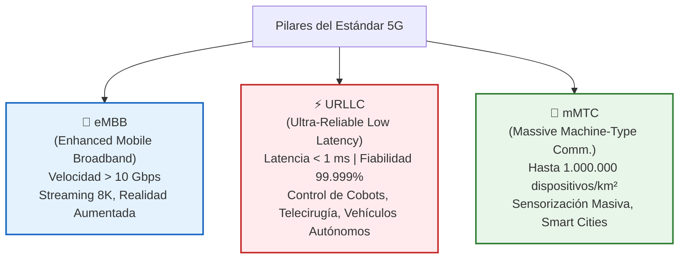
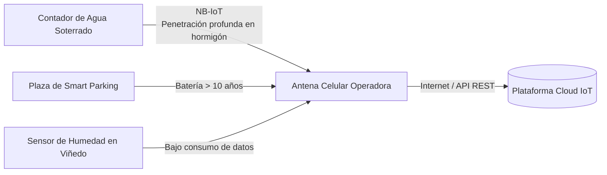
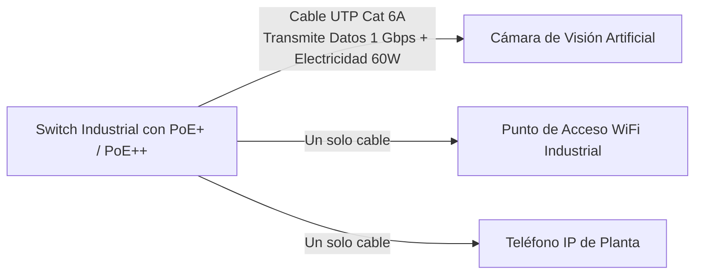

# 2.1 Conectividad Avanzada, 5G e IoT Industrial

La base sobre la que se asientan todas las Tecnologías Digitales Habilitadoras (TDH) es la **conectividad ubicua y robusta**. Sin una red capaz de transportar datos de forma inmediata y fiable, conceptos como la Inteligencia Artificial en tiempo real, los gemelos digitales o la robótica colaborativa no pueden materializarse en un entorno productivo.

---

## 1. La Red 5G en la Industria: Mucho Más que Velocidad

A diferencia de las generaciones móviles anteriores (3G y 4G), cuyo objetivo principal era el consumo de datos en smartphones por parte de usuarios humanos, el **5G** fue diseñado desde su estándar internacional (3GPP) con un enfoque prioritario en la **digitalización industrial y las máquinas (M2M)**.

### 🏭 Redes 5G Privadas (Campus Networks)
En entornos fabriles y logísticos de gran escala (puertos marítimos, refinerías, ensambladoras de automoción), las empresas no utilizan la red 5G comercial de las operadoras públicas. En su lugar, despliegan **Redes 5G Privadas**:

- **Frecuencias dedicadas de radio:** El tráfico de las máquinas no compite con los teléfonos de los ciudadanos en la calle.
- **Soberanía y seguridad del dato:** Los datos de planta nunca salen de la infraestructura local de la empresa (*On-Premise User Plane Function - UPF*).
- **Garantía estricta de Calidad de Servicio (QoS):** Se asigna prioridad máxima al paquete de frenado de un robot sobre el tráfico de una videollamada de oficina mediante técnicas de segmentación de red (*Network Slicing*).

---

## 2. Tecnologías Celulares de Bajo Consumo: NB-IoT y LTE-M

No todos los dispositivos de la industria necesitan transmitir vídeo en alta definición o comunicarse en microsegundos. Millones de sensores solo necesitan enviar unos pocos bytes una vez al día (por ejemplo, el nivel de un tanque de agua o la temperatura de un silo agrícola).

Para estos escenarios se utilizan tecnologías **LPWAN (Low-Power Wide-Area Network)** estandarizadas:

### Características de NB-IoT (Narrowband IoT):
- **Duración extrema de batería:** Diseñado para operar entre **8 y 10 años con una única pila estándar**, gracias a modos avanzados de suspensión profunda (*Power Saving Mode - PSM*).
- **Penetración excepcional en interiores y sótanos:** Permite leer contadores enterrados bajo arquetas de hierro o en aparcamientos subterráneos donde un teléfono móvil pierde totalmente la cobertura.
- **Bajo coste de módem:** Circuitos electrónicos muy simplificados que reducen el coste unitario del sensor a menos de 5 euros.

!!! tip "Caso Real: Smart Parking Urbano e Industrial"
    Mediante sensores geomagnéticos enterrados en el asfalto conectados por **NB-IoT**, una ciudad o un parque logístico monitoriza en tiempo real si cada plaza de estacionamiento o muelle de carga está libre u ocupado. Esto reduce en un **30% el tiempo de circulación de vehículos buscando aparcamiento**, disminuyendo drásticamente las emisiones contaminantes y el desgaste de neumáticos.

---

## 3. Infraestructura Cableada: Power over Ethernet (PoE)

A pesar del auge de las redes inalámbricas, el cableado físico sigue siendo el rey de la estabilidad en planta industrial. Sin embargo, cablear por separado la señal de red y la alimentación eléctrica de 220V multiplica los costes de instalación.

La tecnología **Power over Ethernet (PoE)** resuelve esta fricción permitiendo transmitir **datos de alta velocidad y corriente continua de alimentación por el mismo cable de par trenzado UTP/STP**:

### Evolución de los Estándares PoE:

| Estándar IEEE | Nombre Comercial | Potencia Máxima en Puerto | Dispositivos Habituales en Planta |
| :--- | :--- | :---: | :--- |
| **IEEE 802.3af** | PoE Básico (Tipo 1) | 15.4 W | Sensores simples, teléfonos VoIP, lectores RFID. |
| **IEEE 802.3at** | PoE+ (Tipo 2) | 30.0 W | Puntos de acceso WiFi 6, cámaras PTZ con zoom motorizado. |
| **IEEE 802.3bt** | PoE++ / 4PPoE (Tipo 3) | 60.0 W | Cámaras de visión artificial con iluminación LED integrada. |
| **IEEE 802.3bt** | PoE++ / 4PPoE (Tipo 4) | **90.0 W** | Pantallas táctiles HMI industriales, clientes ligeros (*thin clients*). |

!!! note "Ventajas Técnicas del PoE en Entornos Industriales"
    - **Ahorro masivo en cableado:** No requiere contratar a instaladores electricistas autorizados para llevar enchufes a 8 metros de altura en techos de fábricas.
    - **Reinicio remoto de equipos colgados:** Si una cámara o sensor deja de responder, el administrador de red puede apagar y encender el puerto Ethernet desde la consola de gestión remota para forzar un ciclo de reinicio de corriente.
    - **Protección ante cortes eléctricos:** Centralizar la alimentación en el switch permite respaldar decenas de dispositivos industriales conectando un único Sistema de Alimentación Ininterrumpida (SAI / UPS) en el rack.

---

## 4. Comparativa Técnica de Conectividad Industrial

| Tecnología | Alcance Típico | Ancho de Banda | Latencia | Consumo Energético | Caso de Uso Óptimo |
| :--- | :--- | :--- | :--- | :--- | :--- |
| **5G Privado** | Hasta 2 - 5 km | Muy Alto (hasta 10 Gbps) | **Ultracorta (< 1-5 ms)** | Medio / Alto | Vehículos autónomos (AGV/AMR), cobots móviles, teleoperación. |
| **WiFi 6/7 Industrial** | 50 - 150 metros | Muy Alto (hasta 9 Gbps) | Corta (5 - 20 ms) | Medio | Fábricas compactas, descarga de telemetría por lotes en almacenes. |
| **NB-IoT / LTE-M** | Hasta 15 km | Muy Bajo (< 200 kbps) | Alta (1 - 5 segundos) | **Mínimo (batería 10 años)** | Contadores soterrados, logística de contenedores en ruta, smart agro. |
| **Ethernet / PoE** | 100 metros por segmento | Ultra Alto (1 - 10 Gbps) | **Inmediata y determinista (< 1 ms)** | Alimentado por cable | Cámaras de visión de alta velocidad, PLCs críticos, líneas fijas. |
