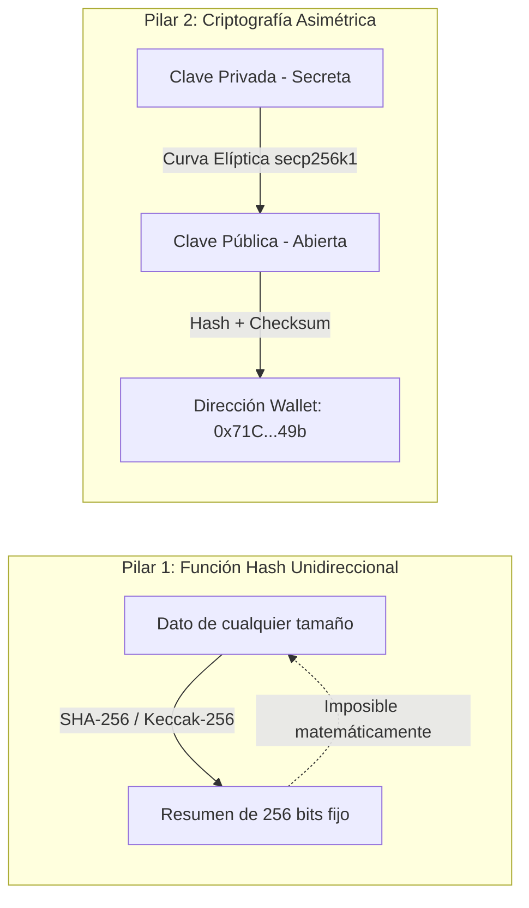
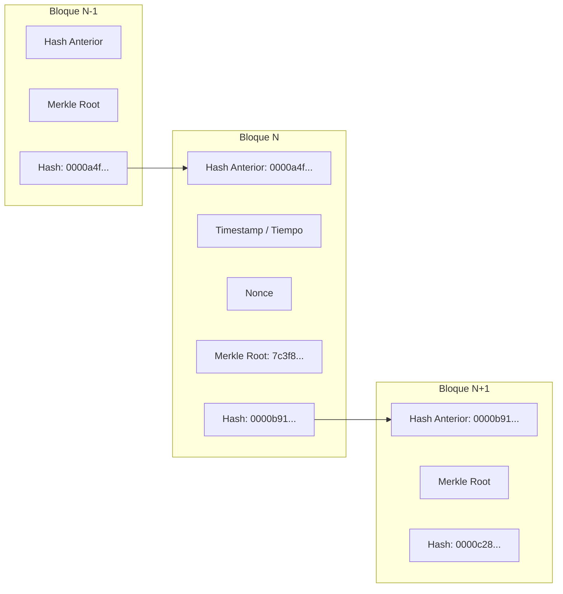
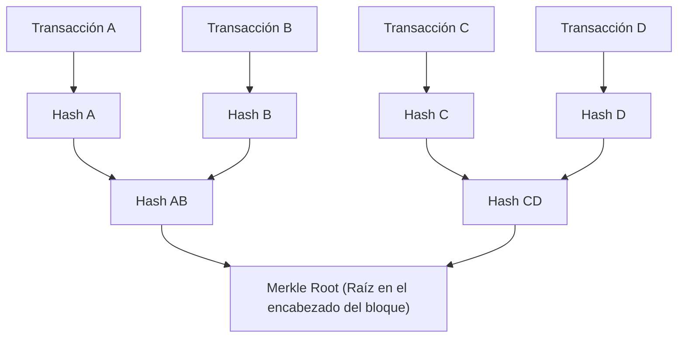
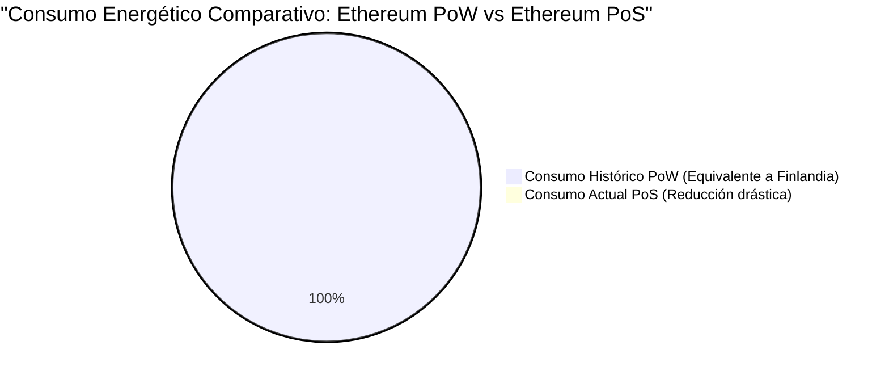
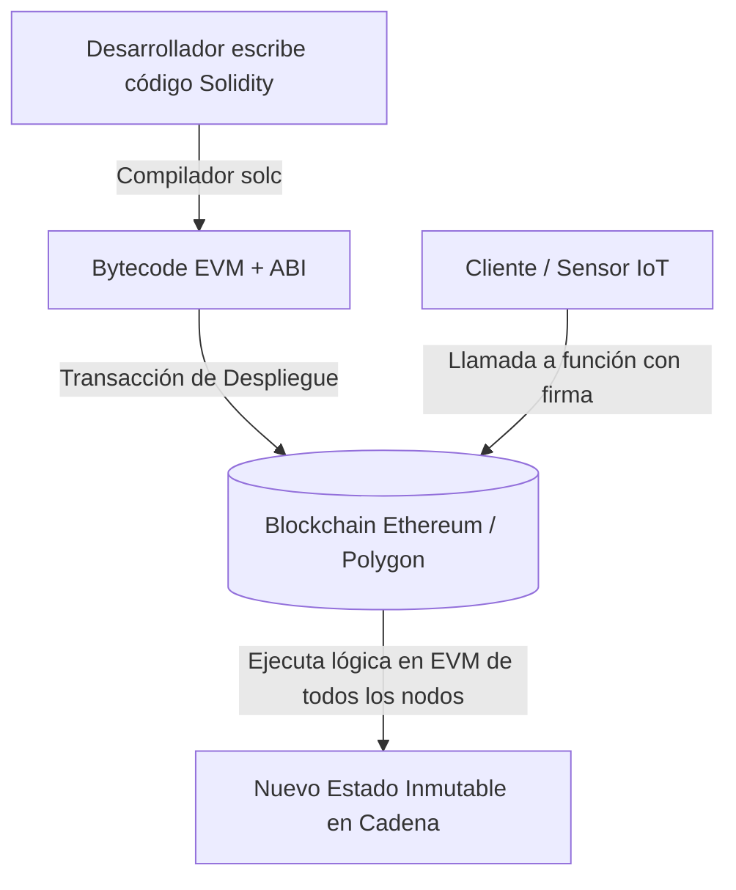
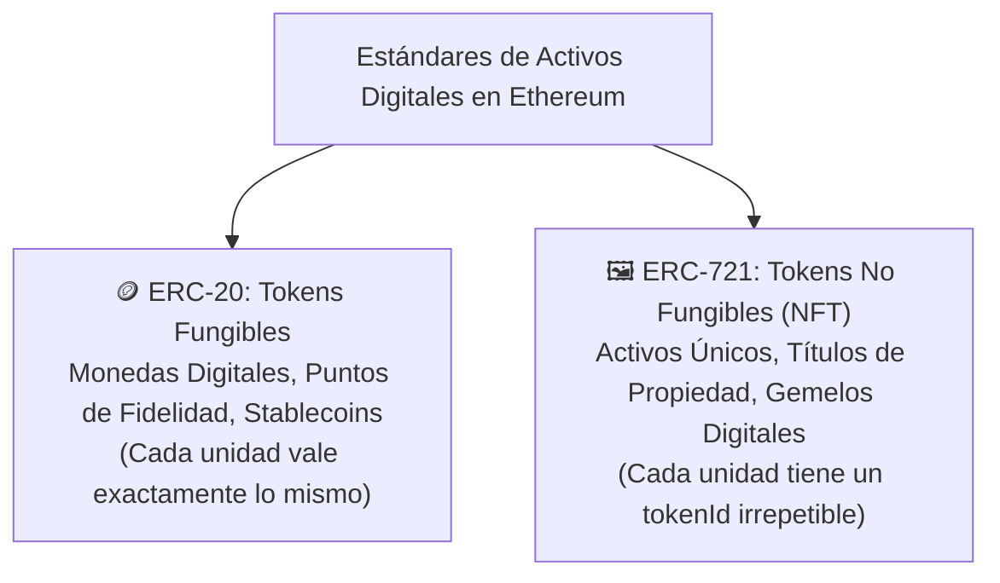
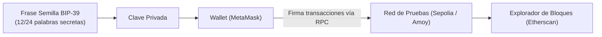

# 2.2 Blockchain, Criptografía y Smart Contracts

La tecnología **Blockchain** (cadena de bloques) y los registros distribuidos (**DLT** - *Distributed Ledger Technology*) representan el cambio de paradigma más profundo en la historia del software para la **gestión de la confianza digital**. Por primera vez es posible transferir valor, certificar datos y ejecutar acuerdos contractuales entre partes que no se conocen ni confían entre sí, sin depender de un intermediario central (banco, notario o servidor corporativo centralizado).

---

## 1. Fundamentos Criptográficos de la Confianza

La seguridad matemática de una red blockchain descansa sobre dos pilares de la criptografía moderna:



### A. Funciones Hash Criptográficas (SHA-256)
Una función hash convierte cualquier entrada de datos (una palabra, un contrato en PDF o una base de datos entera) en una cadena alfanumérica de longitud fija (256 bits). Posee cuatro propiedades obligatorias:

- **Determinista:** La misma entrada siempre genera idéntico hash.
- **Unidireccional (*One-way*):** Conocer el hash no permite deducir los datos originales.
- **Efecto avalancha:** Si cambias un único bit o una coma en un archivo de 10 gigabytes, el hash resultante cambia por completo de forma impredecible.
- **Resistencia a colisiones:** Es estadísticamente imposible encontrar dos documentos distintos que generen el mismo hash.

---

### B. Pares de Claves y Firma Digital (ECDSA)
Cada participante en la red posee un par de claves generado mediante **criptografía de curva elíptica (secp256k1)**:

1. **Clave Privada (*Private Key*):** Un número secreto de 256 bits que NUNCA se comparte. Es la que autoriza el gasto de fondos o la firma de operaciones.

2. **Clave Pública (*Public Key*):** Se deriva matemáticamente de la clave privada. De ella se calcula la **dirección pública (*address*)** que compartes con el mundo para recibir activos.

3. **Firma Digital:** Mediante el algoritmo ECDSA, el usuario firma una transacción con su clave privada. Cualquier nodo de la red puede verificar instantáneamente con la clave pública que la firma es auténtica sin necesidad de conocer la clave secreta. Esto garantiza el **no repudio** absoluto: nadie puede negar haber ordenado una operación firmada.

---

## 2. Anatomía de un Bloque y Árboles de Merkle

Una blockchain es una base de datos distribuida organizada en una lista enlazada de bloques criptográficamente sellados:



### ¿Por qué la cadena es inmutable?
Cada bloque contiene el **Hash del bloque anterior**. Si un ciberdelincuente intentara alterar una transacción del Bloque N:
- El hash del Bloque N cambiaría por el efecto avalancha.
- El Bloque N+1 ya no apuntaría a un hash válido, rompiendo la cadena hacia adelante.
- La red rechazaría el bloque modificado porque no coincidiría con el consenso de los demás nodos.

---

### Árboles de Merkle (*Merkle Trees*)
Dentro de un bloque pueden registrarse miles de transacciones ($Tx_1, Tx_2, \dots, Tx_n$). Para no saturar los encabezados de los bloques, las transacciones se empaquetan en un **árbol binario criptográfico**:



!!! tip "Ventaja Técnica: Pruebas de Inclusión Ligeras (Merkle Proofs)"
    Gracias a la raíz de Merkle, un sensor industrial o un teléfono móvil (*nodo ligero*) no necesita descargarse los cientos de gigabytes de la blockchain completa para comprobar si una transacción suya fue confirmada. Solo necesita solicitar una rama de hashes de tamaño $\mathcal{O}(\log n)$, verificando matemáticamente la inclusión en cuestión de milisegundos.

---

## 3. Mecanismos de Consenso: Proof of Work vs. Proof of Stake

El consenso es el protocolo algorítmico que permite a miles de nodos desconocidos ponerse de acuerdo sobre qué transacciones son válidas sin una autoridad central (resolviendo el célebre **Problema de los Generales Bizantinos**).



### A. Proof of Work (PoW - Prueba de Trabajo)
- **Modelo:** Utilizado en Bitcoin.
- **Funcionamiento:** Los mineros compiten por resolver un acertijo matemático mediante fuerza bruta: encontrar un número (*nonce*) que, combinado con los datos del bloque, produzca un hash con una cantidad específica de ceros iniciales (*dificultad*).
- **Seguridad:** Ataque del 51%: un atacante necesitaría controlar más de la mitad de la potencia de cómputo mundial de la red para manipular el historial.
- **Inconveniente:** Consumo energético colosal de gigavatios hora y baja velocidad de transacción (7 transacciones por segundo en Bitcoin).

---

### B. Proof of Stake (PoS - Prueba de Participación)
- **Modelo:** Utilizado en Ethereum (desde *The Merge* en 2022), Polygon, Cardano, Polkadot.
- **Funcionamiento:** Desaparecen los mineros físicos; los bloques son propuestos y validados por **Validadores**. Para ser validador, se bloquea una cantidad de criptomoneda en depósito de garantía (*staking*, por ejemplo 32 ETH).
- **Mecanismo de castigo (*Slashing*):** Si un validador intenta validar dos bloques conflictivos o actúa de forma fraudulenta, el protocolo destruye automáticamente parte o la totalidad de sus fondos depositados.
- **Eficiencia:** Reduce el consumo energético en más de un **99,95%**, permitiendo mayor velocidad y menores comisiones.

---

## 4. Smart Contracts y la Máquina Virtual de Ethereum (EVM)

Un **Smart Contract (Contrato Inteligente)** no es un papel legal; es un **programa de software inmutable que vive en la blockchain** y ejecuta su código de forma descentralizada y determinista cuando recibe transacciones.



### ¿Qué es el Gas y por qué es imprescindible?
En la Máquina Virtual de Ethereum (**EVM**), cada instrucción de bajo nivel (sumar, guardar en almacenamiento, transferir tokens) tiene un coste medido en **Gas**. El usuario que invoca el contrato debe pagar ese gas en la moneda nativa (Gwei / ETH):

- **Prevención de ataques DoS y bucles infinitos:** En un lenguaje Turing-completo, un atacante podría desplegar un bucle infinito `while(true)`. En la EVM, cuando la transacción agota el gas límite establecido por el remitente, el programa se detiene de inmediato y revierte los cambios, cobrando al atacante el gas consumido.
- **Priorización en red:** A mayor precio por unidad de gas ofrecido (*Gas Price*), más rápido los validadores incluirán tu transacción en el siguiente bloque.

---

### Código de Ejemplo: Smart Contract de Trazabilidad en Solidity

A continuación se muestra un contrato inteligente real escrito en lenguaje **Solidity** para registrar lotes de fabricación industrial en una cadena de suministro:

```solidity
// SPDX-License-Identifier: MIT
pragma solidity ^0.8.20;

contract TrazabilidadIndustrial {
    address public immutable administrador;

    struct Lote {
        string codigoLote;
        string producto;
        uint256 timestamp;
        address fabricante;
        bool verificado;
    }

    // Mapeo del código de lote al registro inmutable
    mapping(string => Lote) public lotes;

    event LoteRegistrado(string indexed codigoLote, address indexed fabricante, uint256 fecha);

    modifier soloAdministrador() {
        require(msg.sender == administrador, "No autorizado: requiere rol de administrador");
        _;
    }

    constructor() {
        administrador = msg.sender; // La cuenta que despliega el contrato es administradora
    }

    function registrarLote(string memory _codigoLote, string memory _producto) external {
        require(lotes[_codigoLote].timestamp == 0, "Error: El lote ya ha sido registrado previamente");

        lotes[_codigoLote] = Lote({
            codigoLote: _codigoLote,
            producto: _producto,
            timestamp: block.timestamp,
            fabricante: msg.sender,
            verificado: true
        });

        emit LoteRegistrado(_codigoLote, msg.sender, block.timestamp);
    }
}
```

---

## 5. Estándares de Tokens: Monedas Digitales vs. NFTs

En blockchain, un **Token** es un contrato inteligente que gestiona un balance contable de saldos o propiedades según especificaciones estándar:



### Tabla Comparativa de Estándares:

| Característica | Estándar ERC-20 (Fungible) | Estándar ERC-721 (No Fungible / NFT) |
| :--- | :--- | :--- |
| **Naturaleza del activo** | Divisible e intercambiable (como un billete de 50€ o USDC) | Único, indivisible y diferenciado con metadatos asociados |
| **Identificación** | Solo importa el balance: `balanceOf(usuario)` | Se consulta el dueño de una pieza exacta: `ownerOf(tokenId)` |
| **Casos industriales** | Pagos entre máquinas (M2M), monedas de fidelización, *utility tokens* | Certificados de autenticidad de piezas, pasaportes digitales de producto, licencias de maquinaria |

---

## 6. Ecosistema Práctico para Trabajar con Blockchain

Para interactuar con una red blockchain desde el código o el navegador se emplean las siguientes herramientas clave:



- **Frase Semilla (Mnemónico BIP-39):** Cadena de 12 o 24 palabras en inglés que representa matemáticamente la semilla maestra de la cual se derivan todas las claves privadas de un usuario de forma jerárquica y determinista.
- **Billeteras (*Wallets*):** Aplicaciones como **MetaMask** o **Rabby** que custodian las claves privadas en el navegador o móvil de forma cifrada y permiten firmar transacciones e interactuar con contratos web3.
- **Redes de Prueba (*Testnets*):** Entornos de desarrollo idénticos a la red real (como **Sepolia** en Ethereum o **Amoy** en Polygon) donde la criptomoneda no tiene valor económico real y se obtiene gratis a través de grifos (*Faucets*) para realizar pruebas y laboratorios.
- **Exploradores de Bloques (*Block Explorers*):** Herramientas web como **Etherscan** o **Polygonscan** que permiten auditar en tiempo real el historial completo de cualquier transacción, inspeccionar el código fuente verificado de un Smart Contract y revisar los eventos emitidos.
