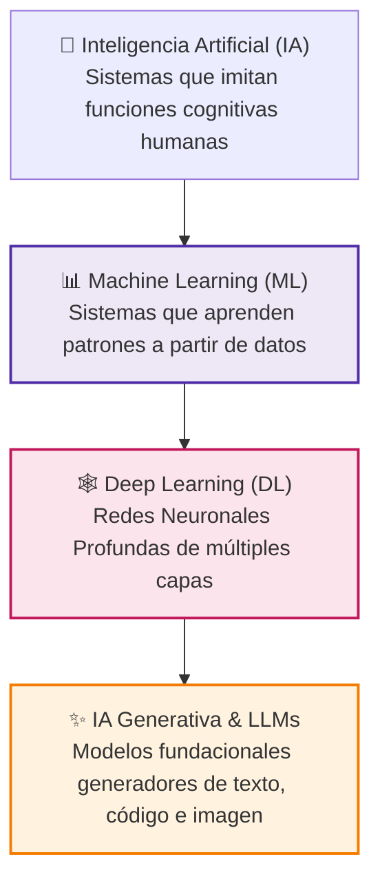
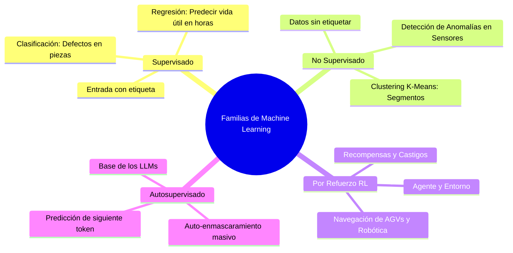
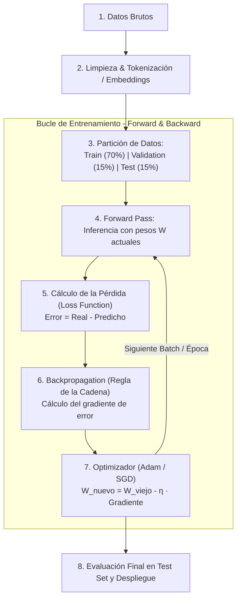

# 2.3 Inteligencia Artificial y Entrenamiento de Modelos

La **Inteligencia Artificial (IA)** ha dejado de ser una disciplina teórica de laboratorio para convertirse en el núcleo operativo de la industria y los servicios contemporáneos. Sin embargo, para un futuro técnico de Grado Superior, la IA no debe entenderse como una "caja mágica", sino como un conjunto estructurado de **algoritmos matemáticos, optimización estadística e ingeniería del dato**.

---

## 1. Taxonomía y Familias de la Inteligencia Artificial

Antes de entrenar un modelo, es imprescindible ubicar con precisión qué tipo de sistema estamos diseñando:



### A. Niveles de Capacidad de la IA
- **ANI (*Artificial Narrow Intelligence* / IA Débil o Estrecha):** La única que existe hoy en día. Son sistemas superespecializados en una tarea concreta (clasificar radiografías, jugar al ajedrez, traducir idiomas o conducir un coche en autopista). No pueden extrapolar su conocimiento a otra disciplina.
- **AGI (*Artificial General Intelligence* / IA General):** Sistema hipotético con capacidad de razonamiento flexible, autoconsciencia y adaptación a cualquier tarea intelectual al nivel de un ser humano medio.
- **ASI (*Artificial Superintelligence* / Superinteligencia):** Nivel teórico que superaría con creces la capacidad cognitiva de toda la humanidad combinada.

---

### B. Las Cuatro Grandes Familias de Aprendizaje



1. **Aprendizaje Supervisado (*Supervised Learning*):**
   - El algoritmo recibe un conjunto de datos etiquetado por humanos: parejas de entradas (X) con su respuesta correcta esperada (y).
   - **Clasificación:** Predecir una clase discreta (ej. *¿Es esta soldadura correcta o defectuosa?*).
   - **Regresión:** Predecir un valor numérico continuo (ej. *¿Cuántas horas le quedan al rodamiento antes de romperse?*).

2. **Aprendizaje No Supervisado (*Unsupervised Learning*):**
   - El sistema recibe únicamente datos de entrada (X) sin etiquetas ni respuestas correctas. Su misión es descubrir estructuras ocultas, patrones o agrupaciones naturales.
   - **Clustering (K-Means, DBSCAN):** Agrupación de perfiles de clientes o comportamientos similares de motores.
   - **Detección de anomalías:** Identificar lecturas de sensores que se salen del comportamiento estadístico habitual para alertar de una avería inminente.

3. **Aprendizaje por Refuerzo (*Reinforcement Learning - RL*):**
   - Un **agente** aprende a tomar decisiones dentro de un **entorno** mediante ensayo y error, guiado por una **función de recompensa** (positiva si se acerca al objetivo, negativa si colisiona o comete un fallo). Es la base del control de robots bípedos y la optimización térmica de centros de datos.

4. **Aprendizaje Autosupervisado (*Self-Supervised Learning*):**
   - El propio algoritmo genera sus etiquetas ocultando parte del dato y entrenándose para predecir la parte que falta. Es la arquitectura base que permite entrenar modelos de lenguaje gigantes (LLMs) con billones de textos de Internet sin necesidad de etiquetado humano manual.

---

## 2. El Pipeline de Entrenamiento: ¿Cómo Aprende una Red Neuronal?

El entrenamiento de un modelo de Deep Learning sigue un flujo de ingeniería estricto y determinista:



---

### A. La Mecánica Matemática Interna: Loss y Descenso de Gradiente
Para que una red aprenda, necesita cuantificar cuánto se equivoca y corregir sus conexiones sinápticas (pesos W y sesgos b):

1. **Función de Pérdida (*Loss Function*):** Mide el error entre la predicción de la red y la realidad.
   - Para regresión: *Error Cuadrático Medio* (MSE).
   - Para clasificación: *Entropía Cruzada* (*Cross-Entropy Loss*).

2. **Descenso de Gradiente (*Gradient Descent*):** Algoritmo de optimización que busca el mínimo de la función de pérdida descendiendo por la pendiente de mayor inclinación:

> **Nuevo_Peso = Peso_Actual - (Tasa_de_Aprendizaje × Gradiente_del_Error)**

Donde la **Tasa de Aprendizaje (*Learning Rate*)** es un hiperparámetro crítico: si es demasiado alta, el modelo oscila y no converge; si es demasiado baja, el entrenamiento tarda semanas.

3. **Retropropagación (*Backpropagation*):** Aplicación recursiva de la regla de la cadena del cálculo diferencial para propagar el error desde la capa de salida hacia atrás, calculando exactamente cuánto contribuyó cada neurona al error final para ajustar su peso en la dirección correcta.

---

## 3. Evaluación de Rendimiento: Evitar el Autoengaño

Un modelo no sirve si solo funciona bien con los datos con los que ha sido entrenado; debe tener capacidad de **generalización** ante datos nunca vistos en el mundo real.

```mermaid
graph LR
    subgraph Underfitting (Subajuste)
        U["Modelo demasiado simple<br/>Falla tanto en Train como en Test<br/>Alto Sesgo (High Bias)"]
    end

    subgraph Punto Óptimo (Ideal)
        O["Equilibrio Sesgo-Varianza<br/>Bajo error en Train y bajo en Test<br/>Buena Generalización"]
    end

    subgraph Overfitting (Sobreajuste)
        OV["Modelo memoriza el ruido<br/>0% error en Train pero falla en Test<br/>Alta Varianza (High Variance)"]
    end
```

### Métricas Reales en Clasificación (Matriz de Confusión)
En la industria, el porcentaje global de acierto (*Accuracy*) suele ser una métrica engañosa. Por ejemplo, en una fábrica donde solo 1 de cada 1.000 piezas es defectuosa, un modelo inútil que siempre diga "pieza correcta" tendrá un 99.9% de accuracy, pero fallará en el 100% de los defectos.

| Concepto | Fórmula | Significado Industrial |
| :--- | :---: | :--- |
| **Precisión (*Precision*)** | TP / (TP + FP) | De todas las piezas que el modelo marcó como defectuosas, ¿cuántas lo eran realmente? (Evita tirar piezas buenas a la basura). |
| **Sensibilidad (*Recall*)** | TP / (TP + FN) | De todos los defectos reales que pasaron por la cinta, ¿cuántos logró detectar el modelo? (Evita enviar piezas rotas a clientes). |
| **Puntuación F1-Score** | 2 × (Precisión × Recall) / (Precisión + Recall) | **Media armónica** entre Precisión y Recall; la métrica de referencia para evaluar modelos industriales desbalanceados. |

---

## 4. Técnicas Modernas: Fine-Tuning, LoRA y Arquitecturas RAG

En la actualidad, las empresas no entrenan modelos fundacionales gigantes desde cero debido a su coste prohibitivo (millones de dólares en cómputo GPU). En su lugar, utilizan técnicas de adaptación especializada:

```mermaid
flowchart TD
    subgraph Estrategia 1: Fine-Tuning con LoRA
        LLM[Modelo Base Preentrenado LLaMA / Mistral] -->|Pesos originales congelados| BASE[W Congelado]
        BASE --> ADAPT["Adaptadores LoRA de Bajo Rango<br/>(Solo se entrena el 1% de parámetros)"]
    end

    subgraph Estrategia 2: RAG (Retrieval-Augmented Generation)
        USER[Pregunta de Usuario o Técnico de Planta] --> EMB[Genera Vector Embedding]
        EMB --> VDB[(Base de Datos Vectorial: Manuales Técnicos PDF)]
        VDB -->|Búsqueda Semántica por Coseno| CTX[Fragmentos Relevantes del Manual]
        CTX & USER --> PROMPT[Prompt Enriquecido con Datos Reales]
        PROMPT --> LLM_RAG[LLM Genera Respuesta Verificada sin Alucinaciones]
    end
```

### ¿Por qué RAG es el estándar en la industria?
- **Cero alucinaciones:** El modelo solo responde basándose en la documentación técnica privada de la empresa inyectada en el prompt.
- **Actualización instantánea:** Si un procedimiento de mantenimiento cambia hoy, basta con actualizar el PDF en la base de datos vectorial (ChromaDB, Pinecone, Qdrant) sin tener que reentrenar el modelo de lenguaje.
- **Privacidad y cumplimiento:** Los datos sensibles de patentes o clientes no se envían a servidores de terceros para entrenamiento.
