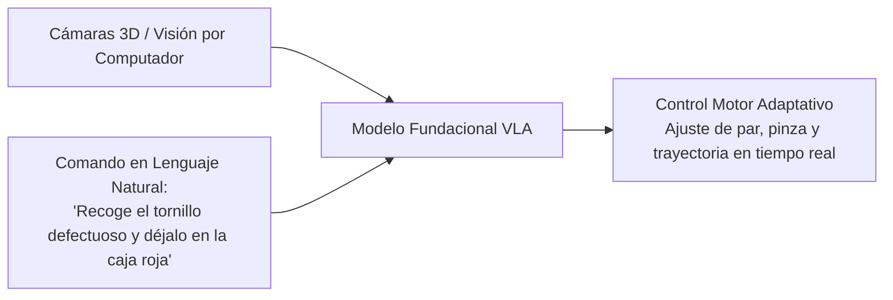
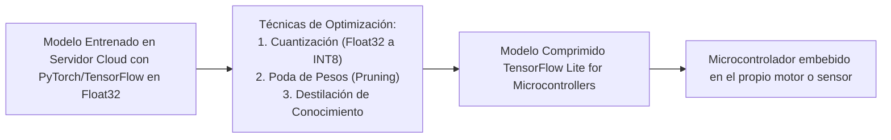
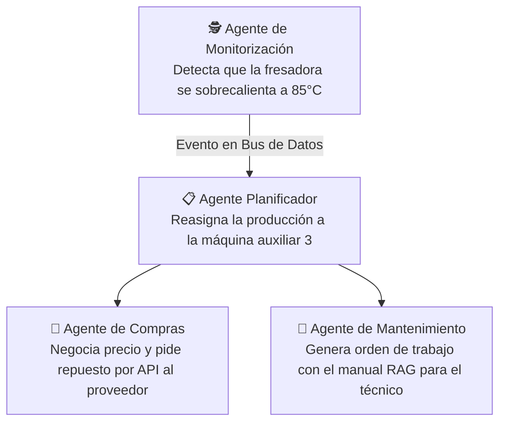
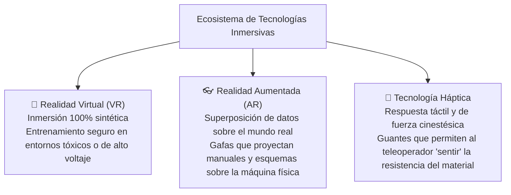
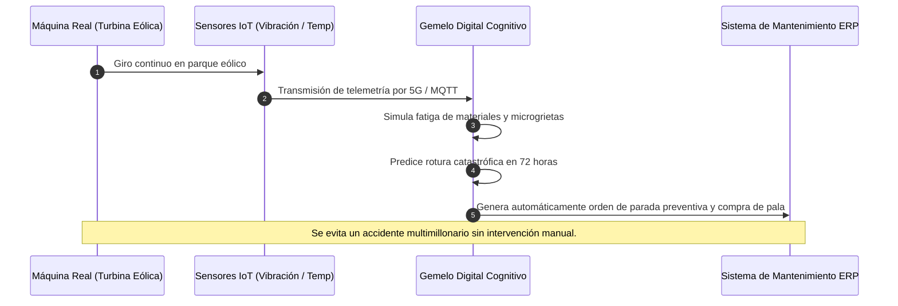
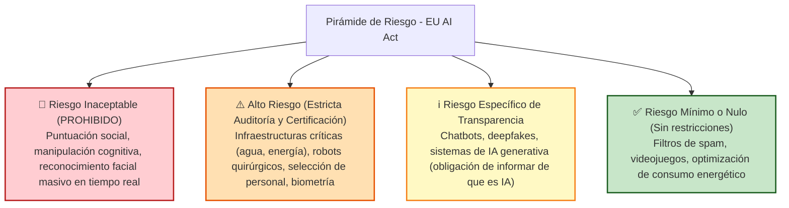

# 2.4 Fronteras de la IA, Robótica y Gemelos Digitales

La integración de la Inteligencia Artificial con los sistemas físicos está abriendo una nueva frontera industrial. Ya no se trata solo de procesar texto o predecir ventas en una hoja de cálculo, sino de dotar a las máquinas y robots de **percepción espacial, capacidad de acción motora y comprensión del mundo físico**.

---

## 1. Physical AI y Robótica con Modelos VLA (Vision-Language-Action)

Durante décadas, programar un robot industrial implicaba definir trayectorias matemáticas rígidas: coordenadas $(X, Y, Z)$ fijas y ángulos de giro milimétricos. Si una pieza se desplazaba 2 centímetros de su posición habitual, el robot chocaba o fallaba el agarre.

La revolución de la **Physical AI (IA Física o Embodied AI)** cambia este paradigma mediante modelos fundacionales **VLA (Vision-Language-Action)**:

### Características de la Physical AI:
- **Comprensión semántica del entorno:** El robot no solo ve píxeles; entiende conceptos físicos como fragilidad, gravedad, peso y rozamiento.
- **Aprendizaje por imitación (*Learning from Demonstration*):** Un operario realiza la tarea una decena de veces guiando el brazo robótico manualmente o mediante teleoperación con gafas de realidad virtual; la red neuronal generaliza la habilidad para ejecutarla ante cualquier variación de luz o posición.
- **Robots humanoides en logística y ensamblaje:** Proyectos de vanguardia industrial (Figure AI, Tesla Optimus, Boston Dynamics Atlas) demuestran robots capaces de caminar en plantas industriales pensadas originalmente para humanos, subiendo escaleras y manipulando cajas sin adaptar las instalaciones.

---

## 2. Edge AI y TinyML: Inteligencia en Milivatios

En entornos industriales remotos (plataformas petrolíferas, líneas de alta tensión o sensores enterrados), no existe conexión a Internet ni potencia eléctrica para instalar procesadores GPU de alto consumo.

Aquí entra en juego **TinyML (Tiny Machine Learning)**: la disciplina que permite ejecutar inferencias de modelos de Deep Learning directamente en **microcontroladores de bajo coste (ARM Cortex-M, ESP32)** con consumos inferiores a **1 milivatio**:

!!! tip "Caso Industrial: Detección de Anomalías Acústicas con TinyML"
    Un microcontrolador de 3 euros con un micrófono conectado se adhiere al chasis de un motor industrial. Ejecuta en local una red neuronal convolucional comprimida que analiza el espectrograma de sonido del motor en tiempo real. Si detecta un silbido anómalo característico de un rodamiento desgastado, enciende un LED rojo de alarma de inmediato, funcionando durante 5 años con una simple pila de botón.

---

## 3. Agentes Autónomos Industriales y Orquestación Multi-Agente

La última frontera en software industrial es la transición de los asistentes pasivos (que esperan una orden) a los **Sistemas Multi-Agente Autónomos**:

En este esquema, los agentes colaboran de forma autónoma siguiendo políticas de negocio predefinidas, resolviendo incidentes operativos en cuestión de segundos antes de que provoquen una parada de planta costosa.

---

## 4. Realidades Inmersivas: VR, AR y Tecnología Háptica

Las interfaces hombre-máquina están evolucionando desde las pantallas táctiles fijas hacia entornos inmersivos tridimensionales:

### Casos de Uso Críticos en la Industria:
- **Entrenamiento de operarios sin riesgo (VR):** Simulaciones de maniobras de alta tensión en subestaciones eléctricas o procedimientos de evacuación en plantas químicas donde un error en el mundo real resultaría mortal.
- **Mantenimiento asistido con manos libres (AR):** Un técnico con gafas inteligentes mira el motor averiado y el sistema proyecta flechas interactivas sobre el tornillo exacto que debe desmontar, indicando el par de apriete necesario y mostrando la telemetría en tiempo real.
- **Telecirugía y teleoperación de precisión (Háptica):** Un cirujano o técnico opera a distancia un brazo mecánico sintiendo en sus dedos la dureza del tejido o la tensión del cable mediante actuadores piezoeléctricos.

---

## 5. Gemelos Digitales Cognitivos (*Cognitive Digital Twins*)

Un **Gemelo Digital Cognitivo** va un paso más allá de la simple visualización 3D: combina la simulación física matemática con algoritmos de Machine Learning para anticipar el futuro:

---

## 6. Marco Regulatorio: El Reglamento Europeo de IA (EU AI Act)

La Unión Europea aprobó en 2024 el primer marco regulatorio integral del mundo sobre Inteligencia Artificial (**EU AI Act**), clasificando las aplicaciones según su nivel de riesgo:

!!! warning "Exigencia de Explicabilidad (XAI - Explainable AI)"
    En sistemas catalogados como de **Alto Riesgo**, la legislación europea prohíbe el uso de algoritmos de "caja negra" donde los ingenieros no puedan explicar por qué el modelo tomó una decisión concreta. Se exige trazabilidad de los datos de entrenamiento, supervisión humana obligatoria (*Human-in-the-loop*) y pruebas de no discriminación por sesgo estadístico.
