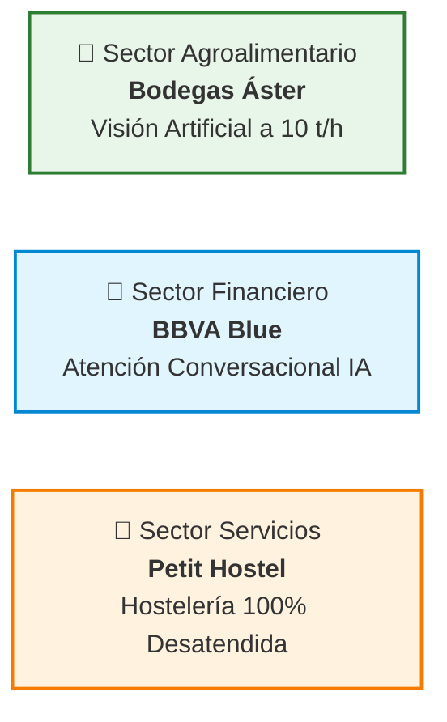
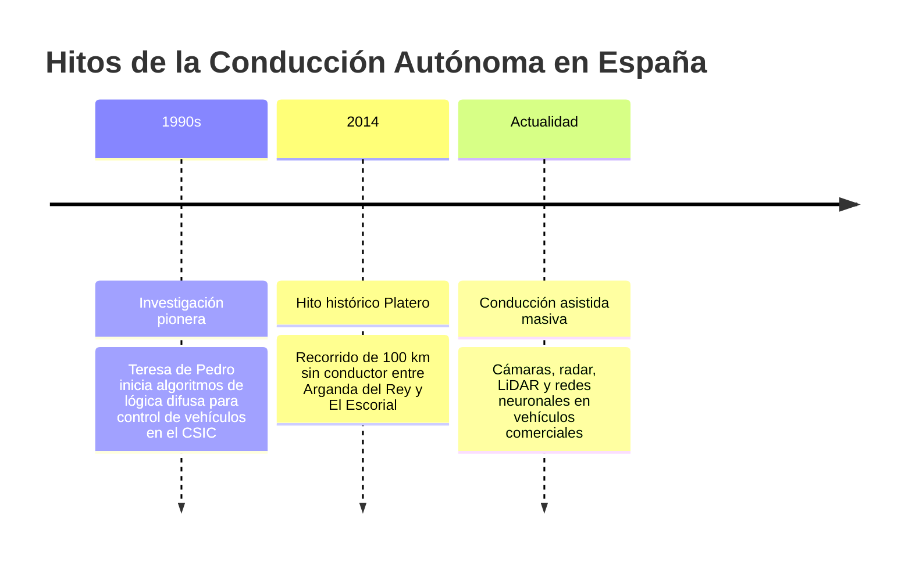
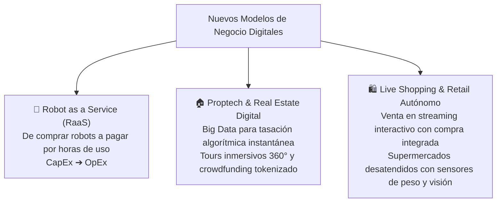
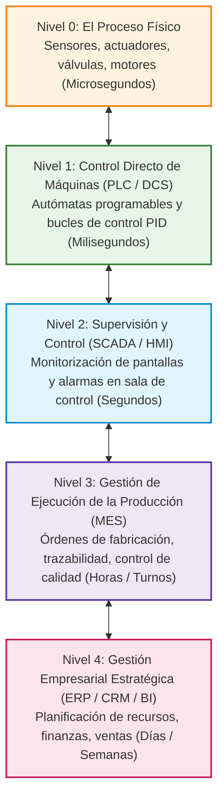

# 2.5 Modelos de Negocio, Integración y Estrategia Data-Driven

La adopción de Tecnologías Digitales Habilitadoras (TDH) no consiste simplemente en adquirir ordenadores más potentes o instalar robots en una nave. Su verdadero valor reside en la **reinvención de los modelos de negocio tradicionales**, la integración integral de la información entre la fábrica y la dirección, y la transición hacia una cultura empresarial guiada por los datos (**Data-Driven**).

---

## 1. Casos Reales de Éxito en Sectores Tradicionales

La digitalización no es exclusiva de las empresas de Silicon Valley; transforma sectores tan arraigados como la agricultura vinícola, la banca o la hostelería:

---

### A. Bodegas Áster: Visión Artificial en la Vendimia
Ubicada en Anguix (Burgos, D.O. Ribera del Duero), esta bodega integró la mesa de selección óptica *Bucher Vaslin Delta Vistalys*:
- **Mecanismo técnico:** Una cámara lineal de alta velocidad fotografía cada racimo y uva en caída libre a lo largo de una cinta transportadora.
- **Toma de decisión en microsegundos:** Algoritmos de visión por computador analizan en tiempo real el color, forma y tamaño de cada grano, activando pequeños chorros de aire comprimido ultrarrápidos para expulsar uvas inmaduras, hojas e impurezas.
- **Rendimiento:** Clasifica más de **10 toneladas de uva por hora**, garantizando una homogeneidad y calidad enológica inalcanzable para la vista humana cansada tras jornadas extenuantes.

---

### B. BBVA: El Asistente Virtual Inteligente Blue
En el sector bancario, BBVA implementó su asistente conversacional *Blue*:
- **Evolución del Chatbot:** Pasa de los antiguos árboles rígidos de preguntas frecuentes ("Pulse 1 para saldo, pulse 2 para transferencias") a un motor de procesamiento de lenguaje natural (PLN) contextual.
- **Personalización del dato:** Analiza los patrones de gasto recurrentes del cliente y le avisa de forma proactiva: *"Atención: tu factura de luz este mes es un 40% superior a tu media habitual"*.
- **Impacto:** Resuelve más del 70% de las consultas transaccionales cotidianas de los clientes sin colapsar el servicio telefónico de atención humana.

---

### C. Petit Hostel: El Hotel 100% Autónomo
Un modelo disruptivo de alojamiento urbano que elimina por completo el mostrador y el personal de recepción:
- **Reserva y verificación:** El huésped reserva por la web, escanea su DNI mediante reconocimiento óptico de caracteres (OCR) y se toma un selfie para validación biométrica.
- **Acceso sin llaves físicas:** Al confirmar el pago, recibe un código numérico y una llave digital en su smartphone para abrir tanto la puerta exterior del edificio como su habitación mediante cerraduras inteligentes conectadas por IoT.
- **Eficiencia operativa:** Reduce los costes fijos de personal presencial nocturno en un 80%, ofreciendo precios más competitivos en el centro de las ciudades con atención al cliente remota 24/7.

---

### D. Pioneros Españoles: Teresa de Pedro y el Proyecto Platero (CSIC)

Mucho antes de que compañías como Google, Uber o Tesla coparan los titulares internacionales sobre coches autónomos, la investigadora española **Teresa de Pedro** lideró en el Centro de Automática y Robótica del CSIC el desarrollo del vehículo autónomo **Platero** (un Citroën C3 descapotable modificado):

En 2014, el vehículo *Platero* completó con éxito un trayecto de **100 kilómetros por carreteras públicas de Madrid** sin que ningún conductor tocara el volante o los pedales, guiándose exclusivamente mediante receptores GPS diferenciales de alta precisión y un sistema de visión artificial que detectaba las líneas de la calzada e imprevistos en la carretera.

---

## 2. Nuevos Modelos de Negocio Nacidos de las TDH

La tecnología digital no solo optimiza lo que ya existía; crea industrias y dinámicas de mercado radicalmente nuevas:

### A. Robot as a Service (RaaS) y la Servitización Industrial
Tradicionalmente, automatizar un taller requería un gasto de capital colosal (**CapEx**): comprar un brazo robótico por 80.000 euros, más costes de integración, instalación y mantenimiento. Si el negocio decaía, el robot se convertía en una máquina ociosa amortizándose con pérdidas.

El modelo **RaaS** traslada la economía de suscripción a la planta física (**OpEx**):
- El fabricante o integrador instala el robot sin coste inicial para la empresa.
- El cliente paga una cuota mensual por **horas trabajadas o por piezas correctamente procesadas**.
- Si la demanda cae o se requiere otro modelo de robot, el contrato se adapta de forma elástica, democratizando la automatización para pequeñas y medianas empresas (PYMEs).

---

### B. El Ecosistema Proptech (*Property Technology*)
La aplicación del Big Data, la realidad virtual y blockchain al sector inmobiliario:
- **Tasación algorítmica (AVM - Automated Valuation Models):** Portales como Idealista o Fotocasa analizan millones de testigos de ventas históricas, metros cuadrados, servicios cercanos (colegios, metro) y evolución socioeconómica para tasar el valor de una vivienda en segundos.
- **Tokenización inmobiliaria:** División del valor de un edificio en miles de tokens en una red blockchain, permitiendo a pequeños ahorradores invertir 100 euros y recibir su parte proporcional de las rentas del alquiler mediante smart contracts.

---

## 3. Integración de Sistemas en la Empresa: La Norma ISA-95

Para que las tecnologías habilitadoras funcionen coordinadas, los datos no pueden estar aislados en silos. La industria sigue el estándar internacional **ANSI/ISA-95** (la Pirámide de Automatización):

### Tipos de Integración:
- **Integración Vertical:** Flujo de datos que conecta el sensor físico de planta (Nivel 0) con el software de contabilidad y ventas de la dirección (Nivel 4). Si una máquina produce 500 botellas, el ERP descuenta automáticamente el stock de envases y genera la orden de reposición de vidrio.
- **Integración Horizontal:** Conexión continua a lo largo de toda la cadena de valor entre empresas distintas: desde el proveedor de materias primas, pasando por el transportista con seguimiento GPS, la fábrica y los puntos de venta minoristas.

---

## 4. De la Intuición al Dato: Cultura Data-Driven

Históricamente, muchas decisiones empresariales se tomaban por "intuición del jefe", tradición o inercias de trabajo. Una organización **Data-Driven** sustituye las opiniones por evidencias empíricas contrastadas:

### ¿Por qué fracasan los proyectos de transformación digital?
Estudios internacionales demuestran que más del **70% de los proyectos de implantación tecnológica fracasan**. Rara vez el problema es que el software o el robot no funcionen técnicamente; los tres grandes cuellos de botella son:

1. **Resistencia cultural al cambio:** Empleados que perciben las nuevas herramientas como una amenaza de sustitución o una complicación innecesaria y continúan usando hojas de cálculo paralelas en papel.

2. **Mala calidad del dato (*Garbage in, Garbage out*):** Si las bases de datos contienen duplicados, campos vacíos o datos desfasados, el modelo de Inteligencia Artificial más sofisticado del mundo generará predicciones erróneas y peligrosas.

3. **Falta de gobierno del dato (*Data Governance*):** Ausencia de políticas claras sobre quién es el dueño de cada dato, quién tiene permiso para modificarlo, cómo se cifra y qué protocolos de custodia y privacidad se aplican.
