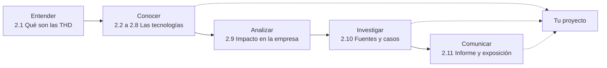

# Unidad 2: Tecnologías Habilitadoras Digitales (THD)

Inteligencia artificial, nube, *blockchain*... Todo el mundo habla de ellas, pero ¿qué aportan de verdad? ¿Cuándo merece la pena usarlas y cuándo son solo humo? En esta unidad **investigarás casos reales** para aprender a responder con datos, una habilidad muy útil cuando trabajes en una empresa.

!!! danger "Tu tarea en esta unidad"
    Se evalúa con un [Proyecto de Investigación sobre una THD](./proyecto-investigacion-thd.md) y un cuestionario. Las fechas se publican en Moodle.

---

## Ruta de la Unidad

---

## Qué Vas a Aprender

Al terminar esta unidad serás capaz de:

- Identificar las principales THD y explicar qué aporta cada una.
- Relacionarlas con el desarrollo de productos y servicios, y con los nuevos mercados que generan.
- Distinguir su efecto en la planta y en el negocio, y las mejoras en los entornos IT y OT.
- Valorar su relación con una economía sostenible y eficiente, con sus ventajas y sus costes.
- Elaborar un informe que relacione tecnologías, características y áreas de aplicación.

---

## Contenidos

| Sección | Qué encontrarás | Para tu proyecto |
| :--- | :--- | :--- |
| **[2.1 ¿Qué son las THD?](./thd-que-son.md)** | Concepto y cómo se combinan | Introducción |
| **[2.2 Internet de las Cosas](./thd-iot.md)** | Del sensor a la decisión | Si te toca IoT |
| **[2.3 Cloud](./thd-cloud.md)** | Modelos y responsabilidad | Si te toca *cloud* |
| **[2.4 Big Data](./thd-big-data.md)** | Del dato al KPI | Si te toca *Big Data* |
| **[2.5 IA y Machine Learning](./thd-ia.md)** | Aprender de datos y sus sesgos | Si te toca IA/ML |
| **[2.6 Blockchain](./thd-blockchain.md)** | Registro compartido y sus límites | Si te toca *blockchain* |
| **[2.7 Ciberseguridad](./thd-ciberseguridad.md)** | Cómo avanza un ataque y cómo cortarlo | Si te toca ciberseguridad |
| **[2.8 Otras THD](./thd-otras.md)** | Robótica, gemelos digitales, 5G y más | Contexto general |
| **[2.9 Impacto en la empresa](./thd-impacto.md)** | Planta y negocio, IT y OT, mercados, sostenibilidad | Conclusiones y ampliación |
| **[2.10 Investigar y comparar](./thd-investigar.md)** | Fuentes, análisis y comparación de casos | Búsqueda, casos y comparativa |
| **[2.11 Informe y exposición](./thd-informe-exposicion.md)** | Redacción, presentación y revisión | Entregables |

**Cómo usar estas páginas.** Cada tecnología sigue la misma estructura que se te pide en el proyecto: qué es en tres ideas, miniglosario, casos reales, riesgos y buenas prácticas. Fíjate en cómo está hecho, pero recuerda que **tus casos deben ser distintos**.

!!! actividad "Busca este bloque"
    Las actividades de clase aparecen en un bloque como este, con su duración. Intenta resolverlas antes de abrir la orientación desplegable.

