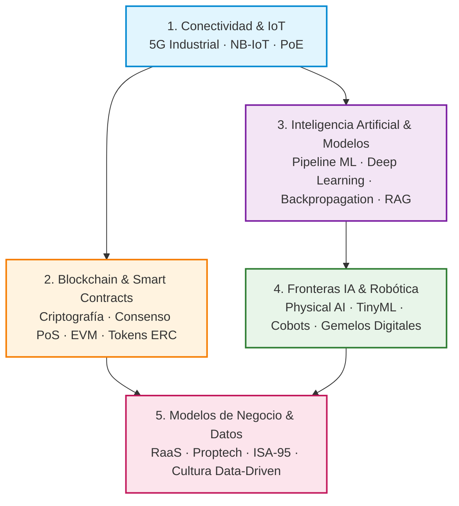

# Unidad 2: Tecnologías Digitales Habilitadoras (TDH)

## 🌐 Visión General y Justificación

Las **Tecnologías Digitales Habilitadoras (TDH)** son el conjunto de herramientas tecnológicas de vanguardia con un elevado potencial transformador y transversal. No son fines en sí mismas, sino los catalizadores que permiten rediseñar modelos productivos, optimizar cadenas de suministro, generar nuevos modelos de negocio y avanzar hacia la sostenibilidad y la descarbonización.

En esta unidad profundizaremos con rigor técnico en los dos grandes motores de disrupción actual —la **Inteligencia Artificial** y la tecnología **Blockchain / DLT**—, integrándolos junto a la conectividad avanzada (**5G / IoT**), la robótica colaborativa (**Cobots**), los **Gemelos Digitales** y la integración estratégica de sistemas en la empresa.

---

## 🗺️ Mapa Conceptual de la Unidad

---

## 🎯 Objetivos de Aprendizaje

Al finalizar esta unidad, serás capaz de:

- **Evaluar tecnologías de conectividad industrial**, distinguiendo cuándo aplicar **5G Standalone**, **NB-IoT** o **Power over Ethernet (PoE)** en función del ancho de banda y la latencia.
- **Comprender la arquitectura interna de una Blockchain**, explicando el papel de las funciones hash criptográficas, los árboles de Merkle, los mecanismos de consenso (**PoW vs. PoS**) y el funcionamiento de la **EVM (Ethereum Virtual Machine)**.
- **Diferenciar estándares de tokens y activos digitales**, contrastando tokens fungibles (**ERC-20**) con tokens no fungibles (**ERC-721**) para su aplicación en la economía digital y la trazabilidad de la cadena de suministro.
- **Dominar el ciclo de vida y entrenamiento de modelos de Machine Learning y Deep Learning**, analizando la función de pérdida, el descenso de gradiente, la retropropagación y las métricas de rendimiento (puntuación F1-Score, matriz de confusión).
- **Identificar las técnicas modernas de IA generativa aplicada**, tales como **Transfer Learning**, **Fine-Tuning con LoRA** y arquitecturas **RAG (Retrieval-Augmented Generation)**.
- **Analizar las fronteras emergentes de la IA en la industria**, incluyendo **Physical AI**, **TinyML / Edge AI** y el cumplimiento del **Reglamento Europeo de IA (EU AI Act)**.
- **Reconocer el impacto transformador de las TDH en los modelos de negocio**, analizando la servitización (**Robot as a Service - RaaS**), la integración vertical y horizontal de sistemas (**ISA-95**) y la cultura empresarial guiada por datos (**Data-Driven**).

---

## 📚 Glosario de Términos Clave

| Término | Emoticono | Definición Técnica |
| :--- | :---: | :--- |
| **TDH** | 🚀 | *Tecnologías Digitales Habilitadoras*. Tecnologías disruptivas de base transversal con capacidad de transformar procesos industriales y crear nuevos mercados. |
| **NB-IoT** | 📡 | *Narrowband IoT*. Estándar celular de banda estrecha para comunicaciones masivas M2M de bajo consumo energético y gran penetración en interiores. |
| **Merkle Tree** | 🌲 | Estructura de datos en árbol binario criptográfico donde cada hoja es el hash de una transacción y la raíz (*Merkle Root*) resume el bloque completo. |
| **PoS (Proof of Stake)** | 🪙 | Mecanismo de consenso en redes blockchain donde los validadores bloquean capital (*staking*) para proponer y validar bloques sin gastar energía masiva. |
| **Smart Contract** | 📜 | Programa inmutable desplegado en una blockchain que ejecuta automáticamente acuerdos y transacciones cuando se cumplen condiciones predefinidas. |
| **Backpropagation** | 🔄 | Algoritmo fundamental de entrenamiento de redes neuronales que calcula el gradiente de la función de pérdida respecto a cada peso mediante la regla de la cadena. |
| **RAG** | 🔍 | *Retrieval-Augmented Generation*. Técnica que conecta un modelo LLM con una base de datos vectorial externa para enriquecer la respuesta con datos actualizados y privados. |
| **TinyML** | 🔬 | Rama de la IA centrada en ejecutar inferencias de modelos cuantizados y optimizados en microcontroladores de consumo ultra-bajo (milivatios). |
| **Physical AI** | 🦾 | Modelos de IA con comprensión del mundo físico, gravedad y cinemática, capaces de controlar robots y humanoides mediante modelos de visión-lenguaje-acción (VLA). |
| **RaaS** | 💼 | *Robot as a Service*. Modelo de negocio de suscripción donde la empresa paga por horas de operación o tareas completadas por el robot sin comprar el hardware. |

---

## 📑 Índice de Contenidos

Explora cada una de las secciones temáticas de la unidad:

- **[2.1 Conectividad Avanzada, 5G e IoT Industrial](./01-conectividad-redes-5g-iot.md):** 5G Standalone, NB-IoT, PoE y arquitecturas de telecomunicación en planta.
- **[2.2 Blockchain, Criptografía y Smart Contracts](./02-blockchain-criptografia-smart-contracts.md):** Bloque exhaustivo sobre criptografía asimétrica, Merkle, PoW/PoS, EVM, tokens ERC-20/721 y wallets.
- **[2.3 Inteligencia Artificial y Entrenamiento de Modelos](./03-inteligencia-artificial-entrenamiento.md):** Taxonomía formal, pipeline completo de ML, función de pérdida, retropropagación, métricas, Fine-Tuning y RAG.
- **[2.4 Fronteras de la IA, Robótica y Gemelos Digitales](./04-fronteras-ia-robotica-gemelos.md):** Physical AI, TinyML, Cobots, Gemelos Digitales cognitivos y visión por computador.
- **[2.5 Modelos de Negocio, Integración y Estrategia Data-Driven](./05-modelos-negocio-integracion-sectores.md):** Casos reales (Áster, BBVA, Petit Hostel, Teresa de Pedro), RaaS, Proptech, norma ISA-95 y cultura del dato.
