# 2.4 Big Data y Análisis de Datos

Todas las empresas tienen datos, pero pocas los convierten en decisiones. El **análisis de datos** consiste en hacerles preguntas útiles. Se habla de ***Big Data*** cuando el volumen, la velocidad o la variedad superan lo que permiten las herramientas tradicionales.

<figure markdown="span">
  { width="560" }
  <figcaption>Cada vehículo y cada entrega generan datos que pueden analizarse. Foto: Departamento de Agricultura de EE. UU., dominio público, vía <a href="https://commons.wikimedia.org/wiki/File:UPS_truck_at_Arlington_Texas_facility.jpg">Wikimedia Commons</a>.</figcaption>
</figure>

---

## 1. Qué Es, en Tres Ideas

- **El dato no basta:** un registro de ventas es un dato; saber que un producto se vende peor los lunes es información; decidir qué hacer es el objetivo.
- **La calidad importa más que la cantidad:** con datos malos se obtienen conclusiones malas, aunque haya muchos.
- **Correlación no es causa:** que dos cosas ocurran a la vez no significa que una provoque la otra.

### Del dato a la decisión

<figure markdown="span">
  { width="760" }
  <figcaption>El punto cambia de color al limpiarse: los datos sucios no sirven para decidir. Elaboración propia.</figcaption>
</figure>

### Miniglosario

| Término | Significado |
| :--- | :--- |
| **KPI** | Indicador que mide si se cumple un objetivo |
| **Segmentación** | Dividir los datos en grupos con rasgos comunes |
| **Dato estructurado** | Dato organizado en tablas, como una base de datos de ventas |
| **Las «V» del *Big Data*** | Volumen, velocidad y variedad, a las que suelen añadirse veracidad y valor |
| **Gobernanza del dato** | Reglas sobre quién es responsable de los datos y cómo se usan |

---

## 2. Dos Casos Reales

!!! example "Caso que funciona: UPS y las rutas de reparto"
    - **Sector:** logística.
    - **Problema:** en una flota enorme, unos pocos kilómetros de más por ruta suponen un gran coste.
    - **Decisión:** desarrollar ORION, un sistema que combina datos de entregas y mapas para proponer rutas.
    - **Resultado:** la empresa [estimaba un ahorro anual de unos 10 millones de galones de combustible](https://www.informs.org/Impact/O.R.-Analytics-Success-Stories/UPS-On-Road-Integrated-Optimization-and-Navigation-ORION-Project) con el sistema completo. Es una estimación de la propia compañía: recuerda indicarlo cuando uses cifras así.

!!! danger "Caso que salió mal: Google Flu Trends"
    - **Sector:** salud pública.
    - **Idea:** estimar la gripe a partir de las búsquedas en Google.
    - **Qué pasó:** [un estudio publicado en *Science* en 2014](https://www.wbur.org/news/2014/03/14/google-flu-trends-hubris) señaló que había sobreestimado la gripe durante la mayor parte de un periodo de dos años. Unos datos tradicionales con tres semanas de retraso predecían mejor.
    - **Lección:** tener muchísimos datos no sustituye a medir bien. Las búsquedas de la gente cambian por muchos motivos, no solo porque esté enferma.

---

## 3. Riesgos y Buenas Prácticas

| Riesgo | Medida básica |
| :--- | :--- |
| Datos erróneos o incompletos | Definir controles de calidad |
| Sesgos en los datos | Preguntarse a quién dejan fuera |
| Indicadores engañosos | Elegir KPI vinculados a un objetivo real |
| Privacidad | Recoger lo mínimo y anonimizar cuando sea posible |
| Conclusiones precipitadas | Comparar con otra fuente antes de decidir |

---

## 4. Actividad

!!! actividad "En clase · 10 min · ¿Qué mide de verdad este KPI?"
    Una academia online quiere mejorar y su panel muestra tres indicadores:

    - Visitas a la web: +40 %.
    - Alumnado matriculado: +2 %.
    - Alumnado que termina el curso: -15 %.

    Por parejas, responded:

    1. ¿Qué indicador usaríais para presumir? ¿Y para tomar decisiones?

    2. ¿Qué dato adicional necesitáis para entender qué ocurre?

    3. Proponed una decisión y cómo sabríais si ha funcionado.

??? success "Orientación para corregir"
    El primero es vistoso, pero el tercero señala el problema. Harían falta datos como la lección en la que abandona el alumnado o sus motivos. Una buena propuesta incluye un indicador y un plazo: por ejemplo, reforzar esa lección y medir el abandono del siguiente grupo.

!!! tip "Si te ha tocado Big Data"
    Tu pregunta dice «grandes volúmenes o no», así que también valen organizaciones medianas. Elige **un área concreta** y documenta qué KPI usan y qué decisión cambiaron gracias a los datos.
