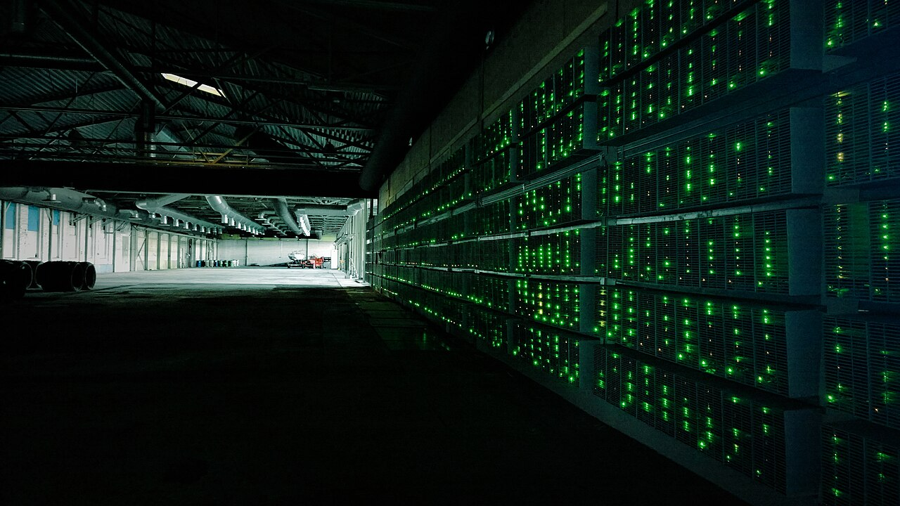
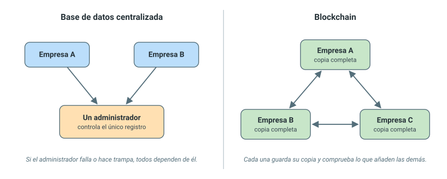

# 2.6 *Blockchain*

Imagina un cuaderno de cuentas del que cada participante tiene una copia idéntica. Para añadir una línea, la mayoría debe estar de acuerdo, y nadie puede borrar lo anterior sin que los demás lo noten. Eso es, en esencia, una ***blockchain***: un **registro compartido, difícil de alterar y sin un único dueño**.

<figure markdown="span">
  { width="560" }
  <figcaption>Una instalación de minería de Bitcoin. Otras <em>blockchain</em> usan métodos que consumen mucha menos energía. Foto: Marko Ahtisaari, <a href="https://creativecommons.org/licenses/by/2.0/deed.es">CC BY 2.0</a>, vía <a href="https://commons.wikimedia.org/wiki/File:Bitcoin_mining_farm.jpg">Wikimedia Commons</a>.</figcaption>
</figure>

---

## 1. Qué Es, en Tres Ideas

- **Registro compartido:** varias partes guardan una copia de los mismos datos.
- **Encadenado:** cada bloque incluye una huella del anterior, de modo que cualquier cambio se detecta.
- **Confianza por consenso:** los participantes acuerdan qué es válido siguiendo unas reglas comunes.

### ¿Dónde está la confianza?

<figure markdown="span">
  { width="720" }
  <figcaption>Elaboración propia.</figcaption>
</figure>

!!! warning "Un error muy extendido"
    Que un registro sea difícil de alterar **no significa que el dato sea cierto**. Si alguien introduce un dato falso, quedará guardado de forma muy fiable. Por eso importa quién y cómo introduce los datos.

### Pruébalo: construye la cadena paso a paso

Este simulador calcula *hashes* SHA-256 reales y te lleva en seis pasos desde la huella de un texto hasta un intento de fraude: **la huella, un bloque, la cadena, minar, las copias y la trampa**. En cada paso hay una sola idea nueva y algo que hacer; cuando lo hayas hecho, el botón *Siguiente* se resalta. Al final queda un modo libre para experimentar. Los datos son un ejemplo inventado.

  
Este simulador necesita JavaScript. Si no se carga, consulta la explicación que hay debajo.

??? success "Qué deberías haber visto"
    - **La huella:** un cambio mínimo en el texto cambia por completo su *hash*.
    - **La cadena:** cada bloque guarda la huella del anterior. Si cambias un bloque, el siguiente apunta a una huella que ya no existe, y al arreglarlo se rompe el siguiente: **un cambio arrastra a todos los bloques posteriores**.
    - **Minar:** sin más reglas, reescribir la cadena sería rápido. La regla del `000` obliga a probar miles de *nonces* por bloque; en una red real, muchísimos más.
    - **Las copias y la trampa:** cada empresa guarda su propia copia. Aunque repares la tuya, su último *hash* no coincide con el de B y C, que son mayoría y rechazan tu versión: **la seguridad está en el *hash* más el consenso**, no en una sola copia.

### Miniglosario

| Término | Significado |
| :--- | :--- |
| **Hash** | Huella digital de un dato; cambia por completo si el dato cambia |
| **Consenso** | Método por el que la red acuerda qué es válido |
| **Pública / permisionada** | Abierta a cualquiera, o limitada a participantes autorizados |
| **Contrato inteligente** | Programa guardado en la cadena que se ejecuta según unas condiciones |
| **DLT** | Tecnología de registro distribuido, la familia a la que pertenece *blockchain* |

---

## 2. Dos Casos Reales

!!! example "Caso prometedor: ¿de dónde viene este mango?"
    - **Sector:** alimentación.
    - **Problema:** ante una alerta alimentaria, rastrear un producto obliga a llamar a muchos intermediarios.
    - **Decisión:** Walmart probó con IBM una *blockchain* permisionada compartida con sus proveedores.
    - **Resultado:** en una demostración, [rastrear unos mangos pasó de unos 7 días a 2,2 segundos](https://supermarketnews.com/food-safety/walmart-blockchain-tech-boon-food-safety). Ojo: es una demostración, contada por las empresas implicadas, no una media de casos reales. Además, pregúntate cuánta mejora se debe a la *blockchain* y cuánta a digitalizar y unificar los datos.

!!! danger "Caso que salió mal: TradeLens"
    - **Sector:** transporte marítimo.
    - **Idea:** Maersk e IBM lanzaron en 2018 una plataforma *blockchain* para compartir documentos de envíos.
    - **Qué pasó:** en 2022 anunciaron su cierre porque [no se alcanzó la colaboración global necesaria en el sector](https://www.gtreview.com/news/fintech/maersk-and-ibm-pull-the-plug-on-tradelens/). Algunos análisis apuntan a que otras navieras dudaban de usar una plataforma impulsada por un competidor.
    - **Lección:** la tecnología podía funcionar, pero el problema era de confianza entre empresas y de modelo de negocio.

---

## 3. Riesgos y Buenas Prácticas

| Riesgo | Medida básica |
| :--- | :--- |
| Datos falsos en origen | Controlar quién introduce los datos y verificarlos |
| Datos personales imposibles de borrar | No guardarlos en la cadena |
| Errores en contratos inteligentes | Revisar el código y hacer pruebas |
| Consumo energético | Elegir un método de consenso eficiente |
| Poca participación | Asegurar antes que los socios van a usarla |

---

## 4. Actividad

!!! actividad "En clase · 10 min · Vendedores contra escépticos"
    Una empresa propone usar *blockchain* para **registrar la asistencia de su plantilla**. En grupos de cuatro:

    1. Dos personas defienden la idea durante 2 minutos.

    2. Las otras dos la atacan durante 2 minutos.

    3. Todo el grupo decide: ¿hay varias partes que no se fían entre sí? ¿Qué pasa con los datos personales?

    4. Proponed una alternativa y explicad qué se ganaría y qué se perdería.

??? success "Orientación para corregir"
    Normalmente hay un único responsable, los datos son personales y podrían necesitar corrección. Una base de datos con registro de cambios y copias resuelve el problema con menos coste. Si surge un argumento a favor bien razonado, como la desconfianza entre empresa y plantilla, también merece debate.

!!! tip "Si te ha tocado Blockchain"
    Tu pregunta compara con una base de datos tradicional. Busca casos con **resultados verificados** y también proyectos abandonados. Un proyecto que cerró es una fuente de información muy valiosa.

