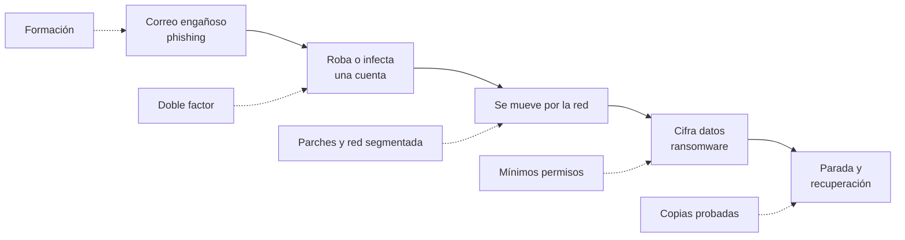

# 2.7 Ciberseguridad

Cada THD que incorpora una empresa es también una puerta nueva para un atacante. La **ciberseguridad** no pretende eliminar todo riesgo, algo imposible, sino **reducirlo a un nivel razonable y saber cómo recuperarse** cuando algo falle.

Es como proteger una casa: puedes poner una buena cerradura y una alarma, pero también conviene saber qué harías si alguien entra.

<figure markdown="span">
  { width="540" }
  <figcaption>Un ciberataque también puede paralizar barcos y puertos, como le ocurrió a Maersk en 2017. Foto: Petar Milošević, <a href="https://creativecommons.org/licenses/by-sa/4.0/deed.es">CC BY-SA 4.0</a>, vía <a href="https://commons.wikimedia.org/wiki/File:MAERSK_HANOI_Container_Ship_(Port_Koper_SIKOP,_2023).jpg">Wikimedia Commons</a>.</figcaption>
</figure>

---

## 1. Qué Es, en Tres Ideas

- **Protege tres cosas:** confidencialidad (solo accede quien debe), integridad (los datos no se alteran) y disponibilidad (el servicio funciona).
- **Las personas forman parte:** muchos ataques empiezan con un engaño, no con un fallo técnico.
- **Varias capas:** si una defensa falla, otra debe frenar el ataque.

### Cómo avanza un ataque y dónde cortarlo

### Miniglosario

| Término | Significado |
| :--- | :--- |
| **Phishing** | Engaño que suplanta a alguien para robar datos o instalar *malware* |
| **Ransomware** | *Malware* que cifra los datos y pide un rescate |
| **2FA** | Doble factor: además de la contraseña, se exige otra prueba |
| **Copia 3-2-1** | 3 copias, en 2 soportes distintos y 1 fuera de la empresa |
| **Parche** | Actualización que corrige un fallo |

---

## 2. Dos Casos Reales

!!! danger "Caso global: Maersk y NotPetya"
    - **Sector:** transporte marítimo.
    - **Qué pasó:** en 2017, el *malware* NotPetya inutilizó los sistemas de una de las mayores navieras del mundo, incluidos sus controladores de dominio, que gestionan el acceso a la red.
    - **El giro:** solo [sobrevivió un controlador en Ghana, porque un corte de luz lo había dejado desconectado](https://www.controleng.com/throwback-attack-how-notpetya-accidentally-took-down-global-shipping-giant-maersk). A partir de él se pudo recuperar el acceso.
    - **Resultado:** Maersk estimó el coste entre 250 y 300 millones de dólares.
    - **Lección:** una recuperación no debería depender de la suerte. Las copias deben existir, estar aisladas y haberse probado.

!!! danger "Caso cercano: el SEPE"
    - **Sector:** administración pública.
    - **Qué pasó:** en marzo de 2021, un ataque informático [dejó sin servicio la web y la sede electrónica del SEPE](https://www.genbeta.com/seguridad/sepe-sufre-ciberataque-que-ha-inutilizado-sus-sistemas-informaticos-ha-hecho-que-web-no-funcione/amp) durante días y obligó a suspender citas. Se atribuyó al *ransomware* Ryuk, aunque sin confirmación oficial, y el Gobierno aseguró que no se habían sustraído datos.
    - **Lección:** las consecuencias llegan a personas que no saben nada de informática, como quienes esperan una prestación.

---

## 3. Riesgos y Buenas Prácticas

| Riesgo | Medida básica |
| :--- | :--- |
| Robo de contraseñas | Doble factor y gestor de contraseñas |
| *Ransomware* | Copias 3-2-1 y pruebas de restauración |
| Fallos conocidos | Aplicar parches |
| Engaños al personal | Formación y un canal para avisar sin miedo |
| Exceso de permisos | Dar a cada persona solo lo que necesita |

---

## 4. Actividad

!!! actividad "En clase · 15 min · Sala de crisis"
    **Escenario ficticio.** Es lunes, 8:30, y las pantallas de una clínica dental muestran un mensaje que pide un rescate. Hay pacientes citados.

    Formad grupos con estos roles: dirección, informática, atención al paciente y protección de datos.

    1. Decidid las tres primeras acciones, en orden.

    2. Decidid a quién avisáis y qué le decís a los pacientes.

    3. ¿Pagáis el rescate? Argumentadlo.

    4. Elegid una sola medida que, de haberse aplicado antes, habría cambiado más la situación.

??? success "Orientación para corregir"
    Primero conviene aislar los equipos, sin borrar evidencias; después activar el plan, evaluar las copias y comunicar. En España, [INCIBE](https://www.incibe.es/empresas) atiende a empresas, y una brecha de datos personales puede requerir comunicarse a la autoridad de protección de datos. Pagar no garantiza recuperar los datos. La medida con más efecto suele ser disponer de copias probadas.

!!! tip "Si te ha tocado Ciberseguridad"
    Tu pregunta se centra en pymes y centros educativos. La [sección para empresas de INCIBE](https://www.incibe.es/empresas) es un buen punto de partida, pero recuerda que debes buscar **casos con su resultado** y datos sobre la frecuencia de los ataques.
