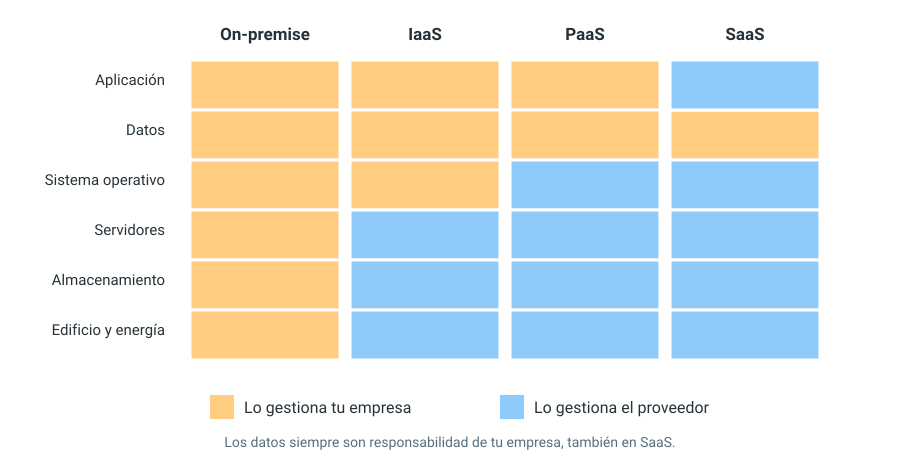

# 2.3 Computación en la Nube (*Cloud*)

La nube no está en el cielo: son **ordenadores de otra empresa** a los que accedes por Internet y que pagas según el uso. En lugar de comprar servidores, los alquilas cuando los necesitas.

Es como la diferencia entre comprar un coche, alquilarlo o pedir un taxi. Cuanto menos te ocupas de la gestión, menos control tienes.

<figure markdown="span">
  { width="520" }
  <figcaption>Detrás de «la nube» hay edificios, máquinas y técnicos. Foto: Derrick Coetzee, <a href="https://creativecommons.org/publicdomain/zero/1.0/deed.es">CC0</a>, vía <a href="https://commons.wikimedia.org/wiki/File:Technician_with_laptop_working_on_server_rack_at_NERSC.jpg">Wikimedia Commons</a>.</figcaption>
</figure>

---

## 1. Qué Es, en Tres Ideas

- **Bajo demanda:** usas más o menos recursos según lo necesites.
- **Pago por uso:** se sustituye una gran compra inicial por un gasto periódico que puede variar.
- **Responsabilidad compartida:** el proveedor gestiona una parte, pero la otra sigue siendo tuya.

### ¿Quién gestiona qué?

<figure markdown="span">
  { width="720" }
  <figcaption>Modelo simplificado; el reparto exacto depende de cada servicio. Elaboración propia.</figcaption>
</figure>

| Modelo | Qué te dan | Ejemplo |
| :--- | :--- | :--- |
| **IaaS** | Máquinas virtuales y almacenamiento | Amazon EC2 |
| **PaaS** | Una plataforma para desplegar tu código | Heroku, Google App Engine |
| **SaaS** | La aplicación lista para usar | Gmail, Microsoft 365 |

### Miniglosario

| Término | Significado |
| :--- | :--- |
| **On-premise** | Infraestructura propia, en las instalaciones de la empresa |
| **Escalado** | Aumentar o reducir recursos según la demanda |
| **Región** | Zona geográfica donde están los centros de datos del proveedor |
| **Dependencia del proveedor (*lock-in*)** | Dificultad para cambiar de proveedor |
| **Disponibilidad** | Tiempo que un servicio funciona correctamente |

!!! note "Más adelante"
    La **UT3** profundizará en los niveles de la nube, *edge*, *fog* y *mist computing*. Aquí basta con entender qué es y qué decisiones implica.

---

## 2. Dos Casos Reales

!!! example "Caso que funciona: Netflix abandona sus centros de datos"
    - **Sector:** entretenimiento.
    - **Problema:** en agosto de 2008, una corrupción de su base de datos impidió a Netflix enviar DVD durante tres días.
    - **Decisión:** migrar a la nube durante años, en lugar de reforzar sus propios centros de datos.
    - **Resultado:** [completó la migración en enero de 2016](https://about.netflix.com/en/news/completing-the-netflix-cloud-migration), con ocho veces más miembros de *streaming* que en 2008. Aun así, mantiene equipos propios cerca de sus clientes para distribuir el vídeo.

!!! danger "Caso que salió mal: el incendio de OVH en Estrasburgo"
    - **Sector:** servicios en la nube.
    - **Qué pasó:** el 10 de marzo de 2021, un incendio destruyó el centro de datos SBG2 y dañó SBG1. Algunas empresas perdieron sus datos.
    - **La parte interesante:** un tribunal francés dio la razón a clientes que habían contratado un servicio de copias que no se prestó como debía, y [rechazó las demandas de quienes no tenían copia](https://www.datacenterdynamics.com/en/news/ovhcloud-ordered-to-pay-250k-to-two-customers-who-lost-data-in-strasbourg-data-center-fire). Son decisiones de 2023 que OVH anunció que recurriría.
    - **Lección:** «estar en la nube» no significa tener copia de seguridad. Hay que comprobar qué incluye el contrato y dónde están las copias.

---

## 3. Riesgos y Buenas Prácticas

| Riesgo | Medida básica |
| :--- | :--- |
| Pérdida de datos | Copias en otra ubicación y pruebas de restauración |
| Factura inesperada | Alertas de gasto y revisión periódica |
| Dependencia del proveedor | Valorar el coste de salida antes de contratar |
| Normativa sobre datos personales | Elegir la región y revisar el contrato |
| Configuración insegura | Doble factor, mínimos permisos y cifrado |

---

## 4. Actividad

!!! actividad "En clase · 10 min · ¿Coche, alquiler o taxi?"
    Por parejas, decidid qué modelo usaríais (*on-premise*, IaaS, PaaS o SaaS) y justificadlo en una frase:

    1. Una gestoría de 5 personas necesita correo y documentos compartidos.

    2. Dos estudiantes lanzan una web y no quieren administrar servidores.

    3. Una empresa tiene un programa antiguo que solo funciona en un sistema operativo concreto.

    4. Una fábrica controla una máquina que no puede detenerse si cae Internet.

??? success "Una posible solución"
    1. SaaS: no tiene sentido mantener un servidor de correo propio.

    2. PaaS: se concentran en el código.

    3. IaaS: permite controlar el sistema operativo.

    4. *On-premise* o local: el control crítico debe funcionar sin conexión.

    Se pueden defender otras respuestas: lo que se valora es el criterio.

!!! tip "Si te ha tocado Cloud"
    Las grandes plataformas no se parecen a una pyme o a un centro educativo. Busca experiencias de organizaciones de ese tamaño y anota también los **costes reales** y lo que decidieron **no** migrar.
