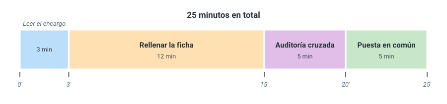

# 2.12 Consultoría Exprés

Hasta ahora has estudiado cada tecnología por separado. En la empresa real nadie te pedirá «usa IoT»: te contarán un **problema** y tendrás que decidir qué tecnología ayuda, cuál sobra y qué riesgos trae. En esta actividad vuestro grupo será una pequeña consultora con **25 minutos** para dar una recomendación a un cliente.

!!! info "Qué necesitáis"
    Un dispositivo por grupo con estos apuntes abiertos. Podéis consultar cualquier página de la unidad.

    - **Plantilla:** haced una copia de la [ficha de la consultora](https://docs.google.com/document/d/1zCrTE6Pe-9WkHC_7zLlEYq9pvhm9l9Rd3XImKNIAcbA/copy) y compartidla con el grupo.
    - **Entrega:** una persona por grupo sube la ficha en PDF a la [tarea de Moodle (DAW2A)](https://informatica.iesalbarregas.com/mod/assign/view.php?id=14342).

---

## 1. Cómo Funciona

<figure markdown="span">
  { width="720" }
  <figcaption>Elaboración propia.</figcaption>
</figure>

Formad grupos de cuatro y repartid estos roles:

| Rol | Qué hace |
| :--- | :--- |
| **Coordinación** | Reparte el trabajo y controla el tiempo |
| **Secretaría** | Escribe la ficha |
| **Escéptico o escéptica** | Busca el humo: pregunta «¿de verdad hace falta?» a cada propuesta |
| **Portavoz** | Presenta la recomendación y defiende la ficha en la auditoría |

---

## 2. Los Encargos

Cada grupo recibe **un encargo** que asigna el profesor. Todos son **escenarios ficticios**, aunque inspirados en problemas habituales.

!!! abstract "Encargo A · Taller de mecanizado"
    Un taller de 25 personas fabrica piezas metálicas para la industria del automóvil. Su torno principal se avería sin aviso unas cuatro veces al año y cada parada dura dos días. Además, un cliente ha devuelto un lote por piezas defectuosas que nadie detectó. El gerente ha leído que «la *blockchain* lo soluciona todo».

!!! abstract "Encargo B · Hotel rural"
    Un hotel rural con 20 habitaciones tiene su web de reservas en un ordenador viejo debajo del mostrador de recepción. En verano la web se cae cuando hay muchas visitas, y el año pasado se perdieron todas las reservas de un mes por un fallo del disco. La dueña quiere «un chatbot con IA» para atender a los clientes.

!!! abstract "Encargo C · Clínica de fisioterapia"
    Una clínica con 6 fisioterapeutas apunta las citas en una agenda de papel y guarda los informes de pacientes en una carpeta compartida a la que se entra con una única contraseña que conoce todo el personal. Un paciente ha preguntado quién puede ver su historial. El socio mayoritario quiere «una IA que diagnostique lesiones».

!!! abstract "Encargo D · Recogida de residuos de una mancomunidad"
    Una mancomunidad de varios pueblos recoge los contenedores siguiendo rutas fijas, todos los días a la misma hora. Los camiones vacían muchos contenedores medio vacíos, mientras otros desbordan los fines de semana. El presidente ha oído que necesitan «5G en todos los pueblos» para mejorar.

!!! abstract "Encargo E · Tienda online de ropa"
    Una tienda online vende unos 300 productos y tiene un 30 % de devoluciones, casi todas por problemas de talla. Quieren contratar «un sistema de IA de recomendación como el de las grandes plataformas». Sus datos de ventas están repartidos en varias hojas de cálculo.

!!! abstract "Encargo F · Quesería artesanal"
    Una quesería familiar madura sus quesos en dos cámaras. Si la temperatura o la humedad se descontrolan durante la noche, pierden el lote, y ya les ha pasado dos veces. Quieren vender fuera de España, y un distribuidor les pide demostrar el origen y el proceso de cada lote. Alguien les ha propuesto «un gemelo digital de toda la quesería».

---

## 3. La Ficha de la Consultora

!!! actividad "En clase · 25 min · Consultoría exprés"
    Rellenad la ficha para vuestro encargo. **Cada respuesta debe caber en una o dos frases.**

    1. **El problema real.** ¿Qué le duele de verdad al cliente? Separad el problema de la solución que pide.

    2. **Nuestra recomendación.** Una o dos THD como máximo. Para cada una, explicad qué hace en este caso usando una idea de su apartado «Qué es, en tres ideas».

    3. **Lo que no recomendamos.** La tecnología que pide el cliente u otra que suene bien, y por qué no hace falta o no es prioritaria. Si una solución sencilla basta, decidlo.

    4. **Dónde actúa.** ¿En la planta, en el negocio o en ambos? ¿Conecta IT y OT?

    5. **Dos riesgos y su medida.** Usad las tablas de riesgos de las páginas de cada tecnología.

    6. **Sostenibilidad.** Una ventaja y un coste, ambiental o social.

    7. **Primer paso.** Imaginad que el cliente os dice: «Vale, me convence. ¿Qué hago el lunes?». Es la primera acción que puede hacer ya, antes de gastar dinero en la tecnología. Debe ser **concreta** (quién hace qué), **rápida** (una semana o un mes), **barata** (sin comprar la solución completa) y **útil para decidir** (da datos o resuelve lo más urgente). Ejemplo de otro sector: si una academia quiere «una plataforma de formación con IA», un mal primer paso es «contratar la plataforma»; uno bueno, «usar durante un mes el aula virtual que ya tiene con un grupo y contar cuántos alumnos entran cada semana».

    **Auditoría cruzada (5 min).** Intercambiad la ficha con el grupo de al lado. Escribid en la suya **un acierto** y **una pregunta incómoda** que su cliente podría hacerles. Devolvedla y preparad la respuesta.

    **Puesta en común (5 min).** Dos o tres portavoces presentan su recomendación en un minuto y responden a la pregunta incómoda que recibieron.

!!! tip "Pistas si os atascáis"
    - Volved a la tabla de [planta y negocio](./thd-impacto.md) y al diagrama de [IT y OT](./thd-impacto.md#2-mejoras-al-conectar-it-y-ot).
    - Para la *blockchain*, preguntaos si hay varias partes que no se fían entre sí, como en [su actividad](./thd-blockchain.md).
    - Para la IA, preguntaos si un simple `if` lo resolvería, como en [su actividad](./thd-ia.md).
    - Toda tecnología conectada necesita ciberseguridad: no la olvidéis entre los riesgos.

---

## 4. Cómo se Valora

| Criterio | Bien resuelto | Por mejorar |
| :--- | :--- | :--- |
| **Problema** | Se identifica el problema real, no la solución que pide el cliente | Se repite la petición del cliente |
| **Elección de THD** | Encaja con el problema y se justifica con lo visto en la unidad | Se elige la más llamativa o se proponen muchas |
| **Espíritu crítico** | Se descarta algo con argumentos | Todo parece buena idea |
| **Riesgos** | Riesgos concretos con una medida realista | Riesgos genéricos sin medida |
| **Auditoría** | La pregunta incómoda es concreta y se responde con argumentos | Preguntas vagas o sin respuesta |

??? success "Orientación para corregir"
    No hay una única respuesta válida. Estas son las líneas que se esperan:

    - **A · Taller:** IoT para mantenimiento predictivo del torno y visión artificial o un control de calidad mejorado para los defectos. La *blockchain* no aporta nada si no hay varias partes que compartan un registro. Riesgos: conectar la máquina abre una vía de ataque (segmentar la red de planta) y falsas alarmas. Primer paso: registrar las averías y medir vibración o temperatura.
    - **B · Hotel:** pasar la web a un servicio en la nube o a una plataforma de reservas (SaaS) y tener copias 3-2-1. El chatbot no resuelve ni la caída ni la pérdida de datos; podría venir después. Riesgos: dependencia del proveedor y configuración de accesos. Primer paso: hacer hoy una copia de seguridad fuera del hotel.
    - **C · Clínica:** agenda y expediente en una aplicación en la nube con usuarios individuales, doble factor y permisos por perfil. Son datos de salud, especialmente protegidos. Una IA que diagnostique implica un riesgo alto para las personas y no resuelve el problema actual. Primer paso: una cuenta por persona y cambiar la contraseña compartida.
    - **D · Mancomunidad:** sensores de llenado en los contenedores (IoT) y análisis de datos para planificar rutas según la necesidad. Las redes de baja potencia suelen bastar para enviar pocos datos; el 5G no es la clave. Ventaja sostenible: menos kilómetros y combustible. Coste: fabricación y baterías de los sensores. Primer paso: probar en un pueblo antes de extenderlo.
    - **E · Tienda:** unificar los datos y analizar las devoluciones por producto y talla (*Big Data* a pequeña escala). Con 300 productos, una guía de tallas y reglas sencillas pueden bastar antes que una IA. Riesgos: datos personales de clientes y calidad de los datos. Primer paso: juntar las hojas en una sola fuente.
    - **F · Quesería:** sensores IoT en las cámaras con alarmas al móvil, que resuelven el problema más urgente. Para la trazabilidad ante un distribuidor sí puede discutirse un registro compartido, aunque un sistema de lotes bien documentado puede bastar. Un gemelo digital de toda la quesería es desproporcionado. Primer paso: un sensor con alarma en cada cámara.

    Valora sobre todo que el grupo **separe el problema de la moda tecnológica** y que la pregunta incómoda de la auditoría ponga a prueba la recomendación.
