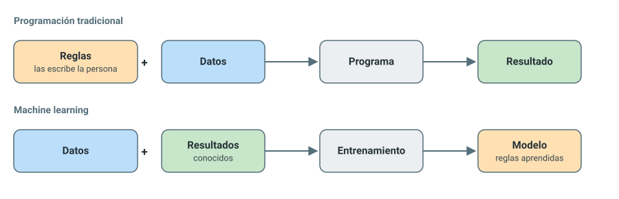

# 2.5 Inteligencia Artificial y *Machine Learning*

En la programación tradicional escribes las reglas: «si el importe es mayor que 1.000, avisa». En el ***machine learning*** (ML) das ejemplos y el sistema **aprende las reglas a partir de los datos**. Por eso una IA puede ser tan buena o tan mala como los ejemplos que recibe.

<figure markdown="span">
  { width="720" }
  <figcaption>Elaboración propia.</figcaption>
</figure>

---

## 1. Qué Es, en Tres Ideas

- **Aprende de ejemplos:** detecta patrones en datos pasados.
- **Predice, no comprende:** da la respuesta más probable según lo aprendido, y puede equivocarse con total seguridad.
- **Lo pasado se hereda:** si los datos tienen sesgos, el modelo tenderá a repetirlos.

### El ciclo de un sistema de IA

<figure markdown="span">
  { width="760" }
  <figcaption>Elaboración propia.</figcaption>
</figure>

Observa la flecha discontinua: las decisiones de hoy serán los datos de entrenamiento de mañana. Un sesgo no corregido puede agravarse con el tiempo.

### En vídeo: qué es el *machine learning*

Este vídeo de unos ocho minutos ordena los conceptos que se suelen mezclar: inteligencia artificial, *machine learning* y *deep learning*. Es de 2017, pero las ideas de base no han cambiado.

  <iframe src="https://www.youtube-nocookie.com/embed/KytW151dpqU" title="¿Qué es el Machine Learning? ¿Y Deep Learning? Un mapa conceptual" loading="lazy" allow="accelerometer; clipboard-write; encrypted-media; gyroscope; picture-in-picture; web-share" referrerpolicy="strict-origin-when-cross-origin" allowfullscreen></iframe>
  
Dot CSV, «<a href="https://www.youtube.com/watch?v=KytW151dpqU">¿Qué es el Machine Learning? ¿Y Deep Learning? Un mapa conceptual</a>», YouTube.

### Miniglosario

| Término | Significado |
| :--- | :--- |
| **Modelo** | Resultado del entrenamiento; el programa que hace predicciones |
| **Entrenamiento** | Proceso por el que el modelo ajusta su comportamiento a partir de datos |
| **Sesgo** | Error sistemático que favorece o perjudica a un grupo o resultado |
| **IA generativa** | IA que crea texto, imágenes o código nuevos |
| **Explicabilidad** | Capacidad de entender por qué un sistema dio un resultado |

### Pruébalo: entrena un filtro de *spam*

En este simulador enseñas a un filtro de correo a distinguir el *spam* de los mensajes normales. El modelo es muy sencillo: apunta en una «libreta» cuántos puntos de *spam* vale cada palabra. Los filtros reales siguen una idea parecida, pero con probabilidades y millones de mensajes. En cuatro pasos verás las tres ideas de arriba. Los mensajes, la empresa y las cifras son inventados.

  
Este simulador necesita JavaScript. Si no se carga, consulta la explicación que hay debajo.

??? success "Qué deberías haber visto"
    - **Aprender de ejemplos:** la libreta se llena con cada mensaje que etiquetas, sin que nadie escriba una regla.
    - **Predecir no es comprender:** el filtro manda a *spam* un aviso de tu centro solo porque dice «gratis», y deja pasar un engaño con palabras que no había visto. Siempre decide, aunque no sepa.
    - **El sesgo heredado:** como todo el *spam* de entrenamiento estaba en inglés, el filtro de la empresa castiga el inglés y bloquea el pedido de un cliente.
    - **Corregirlo:** borrar palabras sueltas no basta, porque otras ocupan su lugar. Lo sólido es entrenar con datos variados y comprobar el resultado con mensajes de todos los grupos.

!!! tip "Para ir más allá: entrena un modelo con tu cámara"
    [Teachable Machine](https://teachablemachine.withgoogle.com/) es una herramienta gratuita de Google para entrenar un modelo de imágenes, sonidos o posturas desde el navegador. Crea un proyecto de imagen con dos clases (por ejemplo, «pulgar arriba» y «pulgar abajo»), graba unas decenas de ejemplos de cada una con la *webcam* y entrena el modelo. El entrenamiento se hace en tu propio navegador.

    Después, haz trampa a propósito: entrena una clase siempre con la misma camiseta o el mismo fondo y prueba a cambiarlos. ¿Qué ha aprendido el modelo de verdad?

!!! note "Más adelante"
    La **UT4** profundizará en lenguajes, herramientas y automatización.

---

## 2. Dos Casos Reales

<figure markdown="span">
  { width="520" }
  <figcaption>Los centros de datos dedican mucha energía a refrigeración. Foto: Carl Lender, <a href="https://creativecommons.org/licenses/by/2.0/deed.es">CC BY 2.0</a>, vía <a href="https://commons.wikimedia.org/wiki/File:Datacenter_Server_Racks_(22370909788).jpg">Wikimedia Commons</a>.</figcaption>
</figure>

!!! example "Caso que funciona: una IA para enfriar centros de datos"
    - **Sector:** infraestructura tecnológica.
    - **Problema:** la refrigeración de un centro de datos es compleja y consume mucha energía.
    - **Decisión:** Google y DeepMind entrenaron modelos con datos históricos de sensores para predecir la temperatura de la siguiente hora y ajustar la refrigeración.
    - **Resultado:** [hasta un 40 % menos de energía en refrigeración](https://deepmind.google/blog/deepmind-ai-reduces-google-data-centre-cooling-bill-by-40/), según anunciaron las empresas en 2016. Fíjate en la combinación: IoT, datos e IA.

!!! danger "Caso que salió mal: el filtro de currículums de Amazon"
    - **Sector:** recursos humanos.
    - **Idea:** puntuar candidaturas automáticamente de una a cinco estrellas.
    - **Qué pasó:** el modelo se entrenó con currículums recibidos durante años, en su mayoría de hombres, y [penalizaba los que contenían la palabra *women's*](https://www.euronews.com/2018/10/10/amazon-scraps-secret-ai-recruiting-tool-that-showed-bias-against-women). Amazon abandonó el proyecto y afirmó que sus reclutadores nunca lo usaron para evaluar candidaturas.
    - **Lección:** el modelo aprendió justo lo que le enseñaron los datos. Quitar una palabra no garantiza que desaparezca el sesgo.

---

## 3. Riesgos y Buenas Prácticas

| Riesgo | Medida básica |
| :--- | :--- |
| Sesgos | Revisar los datos y medir resultados por grupos |
| Respuestas falsas | Verificar con fuentes y mantener la revisión humana |
| Privacidad | No introducir datos personales o confidenciales en servicios externos |
| Falta de explicación | Evitar decisiones importantes sin supervisión |
| Coste excesivo | Comprobar si una regla sencilla resuelve el problema |

!!! info "En vídeo: agentes de IA en el día a día"
    Los **agentes de IA** no solo responden: encadenan tareas y usan otras herramientas. Este vídeo muestra cómo se usan en el trabajo diario.

    :material-youtube: [Euge Oller, «Así utilizo los agentes de IA a diario»](https://www.youtube.com/watch?v=JuAQILH7dkQ&t=240s){ target="_blank" rel="noopener" }

    Mientras lo ves, piensa qué riesgos de la tabla anterior aparecen y qué resultados habría que revisar antes de darlos por buenos.

---

## 4. Actividad

!!! actividad "En clase · 10 min · ¿IA o un simple `if`?"
    Por parejas, decidid si usaríais reglas fijas, IA o ninguna de las dos:

    1. Aplicar un 10 % de descuento en pedidos superiores a 50 €.

    2. Detectar piezas defectuosas en fotos de una cadena de montaje.

    3. Decidir automáticamente a quién se contrata.

    4. Sugerir productos similares en una tienda online con pocos productos.

??? success "Una posible solución"
    1. Regla fija: la condición es exacta.

    2. IA: es difícil escribir reglas para todos los defectos, aunque requiere fotos de ejemplo.

    3. No debería decidir sola: el riesgo para las personas exige supervisión humana.

    4. Depende: con pocos productos puede bastar una regla por categorías.

!!! tip "Si te ha tocado IA/ML"
    Tu pregunta trata de la personalización. Desconfía de las cifras de las propias empresas si no explican cómo se han medido, y no olvides la subpregunta sobre **alternativas sin IA**.

!!! warning "Usar IA en tu proyecto"
    Una IA puede ayudarte a buscar palabras clave o a entender un concepto, pero también puede inventar casos y referencias. **Comprueba cada fuente abriéndola.** Todo lo que entregues debe poder explicarlo en clase.
