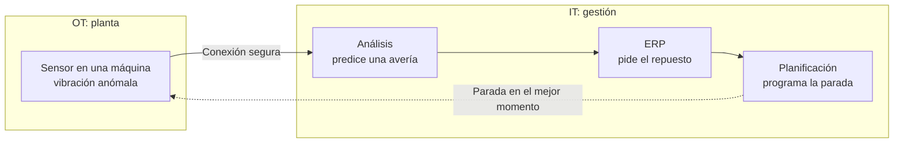

# 2.9 Impacto de las THD en la Empresa

Ya sabes qué hace cada tecnología. Ahora toca la pregunta que haría cualquier dirección de empresa: **¿qué cambia en realidad?** Vamos a verlo desde cuatro ángulos: planta y negocio, IT y OT, nuevos mercados, y sostenibilidad.

---

## 1. En Planta y en Negocio

Las THD no actúan en un único lugar de la empresa. La misma tecnología puede servir para objetivos muy distintos:

| THD | En planta o en la operación | En el negocio |
| :--- | :--- | :--- |
| **IoT** | Vigilar el estado de una máquina | Vender un servicio basado en su uso |
| **Cloud** | Guardar datos de producción | Trabajar en equipo o lanzar una web rápido |
| **Big Data** | Encontrar la causa de los defectos | Saber qué clientes abandonan |
| **IA/ML** | Detectar piezas defectuosas por imagen | Recomendar productos |
| **Blockchain** | Registrar la trazabilidad de un lote | Compartir documentos entre empresas |
| **Ciberseguridad** | Proteger sistemas de control | Proteger datos de clientes y pagos |

---

## 2. Mejoras al Conectar IT y OT

En la [Unidad 1](../01-digitalizacion/03-organizacion-convergencia-ot-it.md) viste que **IT** gestiona la información y **OT** controla las máquinas. Conectarlos es lo que permite muchas de las mejoras de las THD:

- **Antes:** la máquina se avería, se detiene la producción y se busca el repuesto con urgencia.
- **Después:** se detecta el problema, llega el repuesto y se para en el momento menos perjudicial.
- **Coste:** cada conexión es una nueva vía de ataque, por lo que hay que segmentar y proteger.

---

## 3. Nuevos Mercados

Las THD no solo abaratan lo que ya existe, también permiten vender de otra forma:

| Modelo | Antes | Ahora | Ejemplo |
| :--- | :--- | :--- | :--- |
| **Servitización** | Vendo un producto | Vendo su uso o su resultado | [Motores por hora de vuelo](./thd-iot.md) |
| **Suscripción** | Compro un programa | Pago mientras lo uso | Microsoft 365 |
| **Plataforma** | Soy intermediario físico | Conecto oferta y demanda | Plataformas de reparto |
| **Robot como servicio (RaaS)** | Compro un robot caro | Pago por uso, sin gran inversión inicial | Alquiler de robots |

Fíjate en que estos modelos también crean empleo tecnológico: alguien tiene que desarrollar, integrar y mantener esos sistemas. Ahí puedes entrar tú, como futuro profesional de DAM o DAW.

---

## 4. Sostenibilidad: las Dos Caras

Las THD pueden ayudar, y también perjudicar:

| Puede reducir el impacto | Puede aumentarlo |
| :--- | :--- |
| Optimizar rutas y consumir menos combustible | Centros de datos con gran consumo de energía y agua |
| Refrigerar mejor con IA | Entrenar modelos de IA consume muchos recursos |
| Regar solo cuando hace falta | Fabricar dispositivos genera residuos electrónicos |
| Reducir desplazamientos | Sustituir equipos antes de tiempo |

También hay un impacto social: quien no tiene conectividad, formación o medios puede quedarse fuera. Cuando una tecnología se presente como «verde», pregúntate qué se mide y qué se deja fuera.

---

## 5. Actividad

!!! actividad "En clase · 15 min · El Consejo de Dirección"
    **Escenario ficticio.** Una cooperativa de aceite con 40 personas dispone de 50.000 € para invertir en **una sola** tecnología.

    1. Formad grupos de cinco y repartid los roles: dirección general, finanzas, jefatura de almazara, seguridad y sostenibilidad.

    2. Cada persona dispone de 1 minuto para defender una propuesta desde su rol.

    3. Haced las preguntas de vuestra tarjeta:

        - **Dirección:** ¿abre un mercado nuevo?
        - **Finanzas:** ¿cuánto cuesta y cuándo se recupera?
        - **Jefatura:** ¿qué cambia en planta y en la oficina?
        - **Seguridad:** ¿qué puede salir mal con los datos?
        - **Sostenibilidad:** ¿qué impacto ambiental y social tiene?

    4. Votad y explicad la decisión en dos frases. Después, cada grupo cuenta qué argumento le hizo cambiar de opinión.

??? success "Orientación para corregir"
    No hay una respuesta correcta. Valora que justifiquen con cifras estimadas, reconozcan inconvenientes y relacionen la tecnología con un problema de la cooperativa, como la trazabilidad, la calidad o el consumo.
