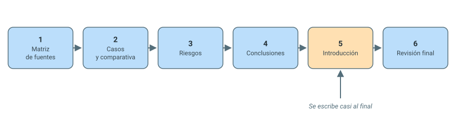

# 2.11 Del Análisis al Informe y la Exposición

Una buena investigación pierde valor si no se entiende. En una empresa, un informe sirve para que alguien tome una decisión, a menudo sin tiempo para leerlo todo. Por eso aquí aprenderás a **contar tus resultados con claridad**.

---

## 1. Cómo Se Construye un Informe

Sigue el índice de tu [Proyecto de Investigación](./proyecto-investigacion-thd.md), pero no lo escribas en ese orden:

<figure markdown="span">
  { width="760" }
  <figcaption>Elaboración propia.</figcaption>
</figure>

La introducción se escribe casi al final: es más fácil presentar algo que ya existe.

### Di lo mismo, pero mejor

| Evita | Mejor |
| :--- | :--- |
| «El IoT está revolucionando el mundo.» | «El IoT permite medir el consumo por zonas y detectar gastos ocultos.» |
| «Muchas empresas han mejorado mucho.» | «La empresa X redujo un 12 % su consumo en un año, según su informe de 2025.» |
| «En conclusión, es muy importante.» | «Responde a mi pregunta solo en parte: ahorra energía, pero no encontré datos sobre el coste de mantenimiento.» |

### Una conclusión tiene tres partes

1. **Respuesta:** qué has descubierto sobre tu pregunta.

2. **Límites:** qué no has podido comprobar.

3. **Siguiente paso:** qué investigarías o recomendarías ahora.

---

## 2. La Exposición: 3-4 Minutos

Tienes muy poco tiempo. No intentes contarlo todo: elige **una idea que quieras que recuerde la clase**.

| Tiempo | Qué contar |
| :--- | :--- |
| 30 s | Tu pregunta, con un ejemplo que enganche |
| 45 s | Qué es la THD, sin leer definiciones |
| 90 s | Tus casos y qué aprendiste al compararlos |
| 30 s | El mayor riesgo |
| 15 s | La respuesta a tu pregunta |

**Consejos para las diapositivas:**

- Una idea por diapositiva.
- Pocas palabras: si está escrito, nadie te escucha.
- Una imagen o tabla mejor que un párrafo, siempre indicando la fuente.
- Ensaya con cronómetro: casi todo el mundo se pasa de tiempo la primera vez.

---

## 3. Revisión Antes de Entregar

- [ ] He respondido a la pregunta de mi THD.
- [ ] Cada caso es real, tiene una organización identificable y he abierto su fuente.
- [ ] Mis casos son distintos a los de los apuntes.
- [ ] Indico qué cifras proceden de la propia empresa.
- [ ] Cada valoración de la tabla comparativa está justificada.
- [ ] Los riesgos incluyen medidas concretas.
- [ ] La conclusión reconoce lo que no he podido comprobar.
- [ ] Tengo al menos 5 referencias, con la matriz completa.
- [ ] Puedo explicar con mis palabras todo lo que he escrito.
- [ ] El documento tiene 4-6 páginas y la presentación, 5-6 diapositivas.

---

## 4. Errores Frecuentes

| Error | Cómo evitarlo |
| :--- | :--- |
| Trabajo que parece publicidad | Incluye límites, costes y fracasos |
| Casos genéricos, sin nombre | Exige organización, fecha y fuente |
| Definiciones copiadas | Explícalas con tus palabras y un ejemplo |
| Texto de IA sin revisar | Comprueba cada dato y referencia |
| Webgrafía al final, de memoria | Rellena la matriz mientras investigas |

---

## 5. Actividad

!!! actividad "En clase · 15 min · Revisión entre compañeros"
    Por parejas, intercambiad el borrador de vuestro trabajo:

    1. Comprobad la lista de revisión y marcad lo que falte.

    2. Abrid dos fuentes elegidas al azar: ¿dicen lo que afirma el trabajo?

    3. Señalad una cosa que esté bien y una que se pueda mejorar.

    4. Contad en 30 segundos la idea principal de vuestro trabajo. ¿Tu compañero o compañera la ha entendido?
