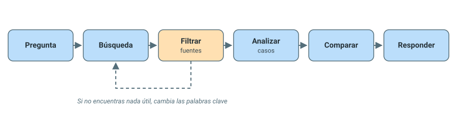

# 2.10 Cómo Investigar y Comparar Casos

Internet está lleno de artículos que afirman que una tecnología lo mejora todo. Tu trabajo en el [Proyecto de Investigación](./proyecto-investigacion-thd.md) consiste en **separar lo demostrado de lo que solo se promete**.

<figure markdown="span">
  { width="760" }
  <figcaption>Elaboración propia.</figcaption>
</figure>

---

## 1. Busca con Palabras Clave

No copies tu pregunta entera en el buscador. Sepárala en conceptos y prueba combinaciones:

| En lugar de... | Prueba con... |
| :--- | :--- |
| ¿Qué impacto tiene el IoT en una pyme? | `IoT pyme ahorro energético caso de éxito` |
| Ventajas de la nube | `migración cloud pyme costes lecciones aprendidas` |
| Empresas que usan *blockchain* | `blockchain proyecto cancelado motivos` |

Tres trucos útiles:

- **Busca también en inglés:** suele haber más estudios.
- **Limita por fecha:** en Google, usa *Herramientas > Fecha*.
- **Busca el fracaso:** añade palabras como `problemas`, `limitaciones` o `lecciones`.

---

## 2. ¿Puedo Fiarme de esta Fuente?

Antes de añadir una fuente a tu matriz, hazte estas cuatro preguntas:

| Pregunta | Señal de alerta |
| :--- | :--- |
| **¿Quién lo dice?** | No hay autor ni entidad identificable |
| **¿Qué gana con ello?** | Vende justo esa tecnología |
| **¿De cuándo es?** | No tiene fecha o está muy desactualizada |
| **¿Puedo comprobarlo?** | Da cifras sin decir de dónde salen |

Una fuente interesada no es inútil. Puedes citar a un fabricante, pero indicando que **es su versión**. Así lo hacen estos apuntes con las cifras de UPS o Walmart.

!!! warning "El caso que suena real, pero no existe"
    Desconfía de frases como «una empresa de manufactura logró un 20 % de mejora» sin decir qué empresa, cuándo ni quién lo midió. Si no puedes identificarla, **no es un caso real para tu proyecto**. Lo mismo sirve para lo que te responda una IA: abre siempre la fuente original.

!!! actividad "En clase · 10 min · Cazadores de humo"
    Por parejas, analizad estas afirmaciones **ficticias**, creadas para esta actividad. Decidid si las usaríais y qué comprobaríais:

    1. «Según un experto, el 90 % de las empresas que adoptan IA duplican sus ventas.»

    2. «Nuestra plataforma IoT ahorró un 32 % de energía a Hotel Ejemplo en 2025», en la web del fabricante.

    3. «Un informe público de una universidad, con su método, estudia 40 pymes y halla ahorros muy distintos entre ellas.»

??? success "Orientación para corregir"
    1. No: no hay experto identificable, ni fuente, ni método.

    2. Con cautela: es concreta, pero la publica quien vende el producto. Habría que indicarlo y buscar otra fuente.

    3. Es la más fiable, aunque sea menos llamativa. Que los resultados varíen suele ser una buena señal de realismo.

---

## 3. Analiza un Caso

Para cada caso, recoge lo mismo. Así podrás compararlos después:

| Dato | Ejemplo con UPS ([sección 2.4](./thd-big-data.md)) |
| :--- | :--- |
| **Sector** | Logística |
| **Qué resolvía** | Rutas de reparto ineficientes |
| **Qué se hizo** | Un sistema de optimización de rutas |
| **Resultado** | Estimación de unos 10 millones de galones de combustible al año |
| **¿Quién lo afirma?** | La empresa y un caso de estudio de INFORMS |
| **¿Qué falta saber?** | Coste total, dificultades de adopción |

!!! danger "Regla del proyecto"
    Los casos de estos apuntes son ejemplos. **En tu proyecto debes usar casos distintos**, que hayas localizado y comprobado por tu cuenta.

---

## 4. Compara con Criterio

«Alto» o «Bajo» no significan nada por sí solos: **hay que justificarlos**.

| Criterio | Valoración floja | Valoración justificada |
| :--- | :--- | :--- |
| **Valor aportado** | Alto | Alto: redujo el tiempo de respuesta de días a horas, según la fuente 2 |
| **Coste/recursos** | Medio | No se publica; se estima medio porque requirió cambiar 12 equipos |
| **Dificultad** | Baja | Baja: el proveedor lo instaló, sin personal técnico propio |
| **Riesgos** | Privacidad | Privacidad: registra la presencia de personas |

Si una fuente no da un dato, **escribe «no disponible»**. Reconocerlo es mejor que inventarlo.

!!! actividad "En clase · 10 min · Tribunal de casos"
    Con los casos de [IA](./thd-ia.md) o [*blockchain*](./thd-blockchain.md) de estos apuntes:

    1. Rellenad la tabla comparativa de dos casos, con una justificación por celda.

    2. Intercambiadla con otra pareja.

    3. Señalad la valoración peor justificada de la otra pareja y proponed cómo mejorarla.
