# 2.2 Internet de las Cosas (IoT)

Una cámara, un contador de la luz o un motor de avión tienen algo en común: pueden medir lo que ocurre y comunicarlo sin que nadie los consulte. Eso es el **Internet de las Cosas**: objetos físicos conectados que generan datos y, a veces, actúan.

<figure markdown="span">
  { width="320" }
  <figcaption>Un contador inteligente es un dispositivo IoT cotidiano: mide el consumo y lo transmite sin visitas a domicilio. Foto: RobbieIanMorrison, <a href="https://creativecommons.org/licenses/by/4.0/deed.es">CC BY 4.0</a>, vía <a href="https://commons.wikimedia.org/wiki/File:Logarex_smart_household_electricity_meter_build_year_2023.jpg">Wikimedia Commons</a>.</figcaption>
</figure>

---

## 1. Qué Es, en Tres Ideas

- **Mide el mundo físico:** los sensores convierten temperatura, presencia o vibración en datos.
- **Conecta:** los datos viajan hasta donde pueden usarse, en local o en la nube.
- **Permite actuar:** con esos datos, una persona o un sistema toma una decisión, y un actuador puede ejecutarla.

### El recorrido de un dato

<figure markdown="span">
  { width="760" }
  <figcaption>Elaboración propia.</figcaption>
</figure>

### Miniglosario

| Término | Significado |
| :--- | :--- |
| **Sensor** | Dispositivo que mide una magnitud física |
| **Actuador** | Dispositivo que ejecuta una acción física, como abrir una válvula |
| **Pasarela (*gateway*)** | Equipo que conecta los dispositivos con la red o la nube |
| **MQTT** | Protocolo ligero muy usado para enviar datos de dispositivos |
| **Broker** | Servidor MQTT que recibe los mensajes y los reparte entre quienes están suscritos |
| ***Topic*** | «Dirección» de un mensaje MQTT, como `cooperativa/camara1/temperatura` |
| **Telemetría** | Envío automático de medidas a distancia |

### Pruébalo: una noche en la cámara frigorífica

Este simulador recorre en cinco pasos lo que pasa con un dato IoT: se mide, se envía por MQTT, se reparte, activa una regla y, si se cae Internet, puede no llegar a ninguna parte. Una cooperativa de cereza guarda la fruta en frío y esta noche se avería el compresor. El escenario y las temperaturas son inventados.

<div class="iot-sim" markdown="0">
  <p>Este simulador necesita JavaScript. Si no se carga, consulta la explicación que hay debajo.</p>
</div>

??? success "Qué deberías haber visto"
    - **Medir no basta:** sin nadie que reciba y use el dato, la fruta se estropea aunque el sensor lo haya registrado todo.
    - **MQTT:** el sensor publica mensajes en un *topic* y el *broker* los reparte. Quien publica no sabe quién escucha, así que se pueden añadir suscriptores sin tocar los sensores.
    - **La regla:** un umbral demasiado alto actúa tarde, y uno demasiado bajo salta por cualquier variación.
    - **Sin conexión:** si la regla vive en la nube y se cae Internet, nadie actúa. Lo crítico debe decidirse en local, cerca del dispositivo.

!!! note "¿Y qué programarías tú?"
    En un sistema IoT, la mayor parte del trabajo de DAM y DAW está lejos del sensor:

    - **DAM:** la app que se suscribe a los avisos y los muestra como notificaciones en el móvil.
    - **DAW:** el panel web con gráficas e histórico, y la API que guarda las lecturas en una base de datos.
    - **Ambos:** las reglas que se ejecutan en la pasarela o en la nube, y la gestión de usuarios y permisos.

    El mensaje que llega a tu código suele ser un JSON tan sencillo como este, publicado en el *topic* `cooperativa/camara1/temperatura`:

    ```json
    {"camara": 1, "temperatura": 3.4, "hora": "2026-11-18T23:10:00"}
    ```

---

## 2. Dos Casos Reales

!!! example "Caso que funciona: motores que se pagan por hora de vuelo"
    - **Sector:** aviación.
    - **Problema:** una avería imprevista en un motor deja un avión en tierra y resulta muy cara.
    - **Decisión:** con [TotalCare](https://www.rolls-royce.com/products-and-services/civil-aerospace/services/totalcare.aspx), Rolls-Royce combina la monitorización de la salud del motor con el mantenimiento predictivo.
    - **Resultado:** la aerolínea [paga por hora de vuelo del motor](https://www.rolls-royce.com/products-and-services/civil-aerospace/services/passenger), de forma que el fabricante también gana si el motor funciona bien. Los datos permiten vender un servicio, no solo una máquina.

!!! danger "Caso que salió mal: las cámaras que tumbaron medio Internet"
    - **Sector:** dispositivos de consumo.
    - **Problema:** miles de cámaras y grabadores se vendían con contraseñas de fábrica que casi nadie cambiaba.
    - **Qué pasó:** el 21 de octubre de 2016, la red de dispositivos infectados por el *malware* Mirai atacó a Dyn, un proveedor de DNS. Hubo problemas de acceso a [sitios como Twitter, GitHub o Netflix](https://krebsonsecurity.com/2016/10/hacked-cameras-dvrs-powered-todays-massive-internet-outage/).
    - **Lección:** un dispositivo barato e inseguro no es solo un problema de quien lo compra. Puede convertirse en un arma contra terceros.

<figure markdown="span">
  { width="760" }
  <figcaption>Esquema simplificado del ataque de 2016. Las webs seguían funcionando; lo que fallaba era encontrar su dirección. Elaboración propia.</figcaption>
</figure>

---

## 3. Riesgos y Buenas Prácticas

| Riesgo | Medida básica |
| :--- | :--- |
| Contraseñas de fábrica | Cambiarlas durante la instalación |
| Dispositivos sin actualizar | Elegir fabricantes con soporte y aplicar actualizaciones |
| Datos personales (rutinas, presencia) | Recoger solo lo necesario e informar a las personas afectadas |
| Fallos de conexión | Diseñar lo que debe seguir funcionando sin red |
| Coste de mantenimiento | Calcular baterías, sustituciones y soporte, no solo la compra |

---

## 4. Actividad

!!! actividad "En clase · 10 min · Diseña el sistema de un invernadero"
    Un agricultor pierde cosechas porque detecta tarde las heladas. Por parejas:

    1. Elegid qué sensor y qué actuador instalaríais.

    2. Dibujad el recorrido del dato, como en el esquema del apartado 1.

    3. Decidid qué debe seguir funcionando si cae Internet.

    4. Señalad un riesgo y una medida para reducirlo.

??? success "Una posible solución"
    Sensor de temperatura y aviso al móvil, con activación local de un sistema antiheladas. La decisión crítica debe tomarse **en local**, porque una helada no espera a que vuelva la conexión. Un riesgo sería una lectura errónea del sensor, que puede reducirse con un segundo sensor y una alerta si los valores no coinciden.

!!! tip "Si te ha tocado IoT"
    Tu pregunta se centra en un hogar, un aula o una pyme, así que estos casos solo son un modelo. Busca los tuyos y fíjate en si aportan **datos medidos**: ahorro, tiempo de respuesta o incidencias.
