# 2.8 Otras THD que Debes Conocer

Tu proyecto se centra en seis tecnologías, pero hay otras que están cambiando los sectores productivos. Aquí basta con saber qué hacen y cuándo tienen sentido.

| THD | Qué hace | Ejemplo de uso | Pregunta clave antes de usarla |
| :--- | :--- | :--- | :--- |
| **Robótica colaborativa** | Robots que comparten espacio con personas | Sujetar piezas pesadas mientras una persona hace el ajuste fino | ¿La tarea es repetitiva o peligrosa? |
| **Gemelos digitales** | Réplica virtual conectada a datos reales | Probar cambios en un proceso antes de aplicarlos | ¿Hay datos reales para alimentarlo? |
| **5G y redes avanzadas** | Más velocidad, menos latencia y muchos dispositivos | Vehículos autónomos en un almacén | ¿Basta con Wi-Fi o cable? |
| **Realidades inmersivas** | Superponen o simulan entornos (RA y RV) | Formación en maniobras peligrosas | ¿Es más seguro o barato que practicar en real? |
| **Fabricación aditiva** | Impresión 3D de piezas | Repuestos en pequeñas series | ¿Sale a cuenta frente a fabricar en serie? |

### Cómo funciona un gemelo digital

Un gemelo digital no es una simple maqueta en 3D: está **conectado a datos reales** de la máquina o la línea que copia. Eso permite probar cambios en la copia y aplicar en la realidad solo los que funcionan.

<figure markdown="span">
  { width="760" }
  <figcaption>Esquema simplificado. Elaboración propia.</figcaption>
</figure>

---

## Un Caso Cercano: Platero

Mucho antes de que los coches autónomos llenaran titulares, un equipo del CSIC ya trabajaba en ellos en España. El 10 de junio de 2012, un coche sin conductor llamado Platero [recorrió unos 100 km entre San Lorenzo de El Escorial y Arganda del Rey](https://www.publico.es/ciencias/coche-conductor-espanola.html), en un proyecto dirigido por la investigadora Teresa de Pedro.

Hay un detalle importante: **Platero seguía a un coche guía**, Clavileño, que le enviaba su posición. Sus responsables explicaron que los mapas de los navegadores no eran lo bastante precisos. Es un buen ejemplo de por qué hay que leer los casos con atención: «sin conductor» no significaba que no tuviera ayuda.

---

## Actividad

!!! actividad "En clase · 5 min · ¿Cuál elegirías?"
    Para cada situación, elegid una tecnología de la tabla y justificadla en una frase:

    1. Una academia forma a personal de mantenimiento en líneas de alta tensión.

    2. Un taller necesita 3 repuestos de una máquina antigua descatalogada.

    3. Una fábrica quiere cambiar la distribución de su línea sin detenerla para probar.

??? success "Una posible solución"
    1. Realidad virtual: permite practicar sin riesgo.

    2. Fabricación aditiva: hacer un molde no compensaría con tan pocas piezas.

    3. Gemelo digital: permite simular antes de tocar la línea real.

