# 2.1 ¿Qué son las THD?

Cuando abres una app para pedir comida, varias tecnologías trabajan a la vez sin que las veas. Una calcula la ruta del repartidor, otra sirve la app desde un centro de datos y otra protege tu pago. Son **Tecnologías Habilitadoras Digitales (THD)**.

---

## 1. ¿Por qué se llaman «habilitadoras»?

Una THD es una tecnología que **hace posible algo nuevo en muchos sectores**. Rara vez es el producto final: es lo que permite construirlo.

Piensa en la electricidad. Nadie compra electricidad por el gusto de tenerla: la compra para iluminar, refrigerar o mover máquinas. Con el mismo enchufe funcionan una panadería, un hospital y una fábrica. Las THD se comportan de forma parecida: la misma tecnología sirve para sectores muy distintos.

Para reconocer una THD, comprueba tres cosas:

- **Es transversal:** se aplica en muchos sectores, no solo en uno.
- **Cambia cómo se trabaja:** no se limita a hacer lo mismo un poco más rápido.
- **Se combina con otras:** su mayor valor aparece cuando trabaja junto a otras tecnologías.

---

## 2. Las Seis THD de tu Proyecto

| THD | La pregunta que responde | Te suena de... |
| :--- | :--- | :--- |
| **IoT** | ¿Qué está pasando ahí fuera? | Contador de la luz inteligente, reloj deportivo |
| **Cloud** | ¿Dónde guardo y ejecuto todo esto? | Google Drive, Netflix, Microsoft 365 |
| **Big Data/Analytics** | ¿Qué nos dicen los datos? | Informes de ventas, resumen anual de Spotify |
| **IA/ML** | ¿Qué es probable que pase y qué hago? | Recomendaciones, filtro de *spam*, ChatGPT |
| **Blockchain** | ¿Cómo nos fiamos sin un intermediario? | Bitcoin, certificados verificables |
| **Ciberseguridad** | ¿Cómo evito que todo esto se vuelva en mi contra? | Doble factor, copias de seguridad |

Hay más, como la robótica colaborativa o los gemelos digitales. Las verás en la sección [2.8](./thd-otras.md).

---

## 3. No Trabajan Solas

Lo habitual es que las THD formen una cadena: el dato nace en un sensor, viaja a la nube, se analiza y acaba en una decisión.

<figure markdown="span">
  { width="760" }
  <figcaption>Cómo se combinan las seis THD. Elaboración propia.</figcaption>
</figure>

**Un ejemplo: una flota de reparto.** Los sensores de los vehículos miden posición y consumo (IoT). Esos datos se almacenan en servidores remotos (*cloud*), donde se analizan para encontrar patrones (*Big Data*). Con ello, un algoritmo propone mejores rutas (IA). Y todo debe protegerse de ataques (ciberseguridad).

!!! warning "Error frecuente: confundir herramienta y objetivo"
    «Vamos a poner IA» no es un objetivo. «Reducir un 10 % los retrasos» sí lo es. Una empresa debe partir del problema y elegir después la tecnología. A veces la mejor solución no necesita ninguna THD.

---

## 4. Cazar THD

!!! actividad "En clase · 10 min · Caza THD en tu móvil"
    1. Por parejas, elegid una app que uséis a diario.

    2. Dibujad el recorrido de una acción concreta, como pedir un Bizum o ver un vídeo.

    3. Señalad al menos tres THD que intervengan y qué hace cada una.

    4. Comparad con otra pareja: ¿qué tecnología os resulta imposible de comprobar desde fuera?

??? success "Orientación para corregir"
    Por ejemplo, en una app de vídeo: *cloud* para servir el contenido, *Big Data* para medir qué se ve, IA para recomendar y ciberseguridad para proteger las cuentas. Lo importante es **justificar** cada una. Muchas respuestas serán suposiciones razonables, y reconocerlo también es pensar como investigador o investigadora.

---

## 5. ¿Lo Tienes Claro?

??? question "¿Una hoja de cálculo es una THD?"
    No en este sentido. Es una herramienta muy útil y sirve para muchos sectores, pero no hace posible por sí sola una forma nueva de trabajar. El análisis avanzado de datos, que quizá empiece en una hoja de cálculo, sí se considera una THD.

??? question "Una empresa quiere «digitalizarse» y compra sensores para todas sus máquinas. ¿Qué le preguntarías primero?"
    Qué problema quiere resolver y qué decisión tomará con esos datos. Sin esa respuesta, solo habrá comprado sensores.
